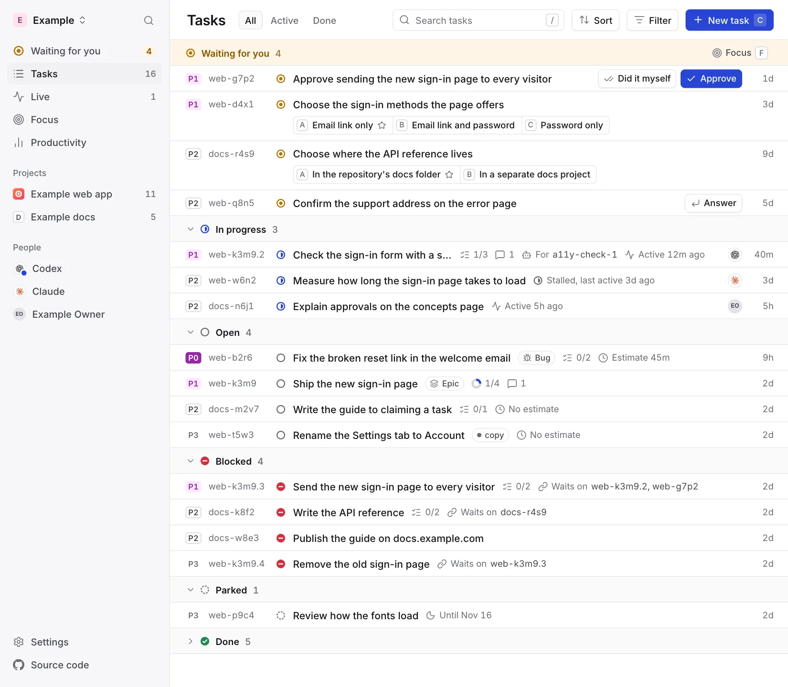
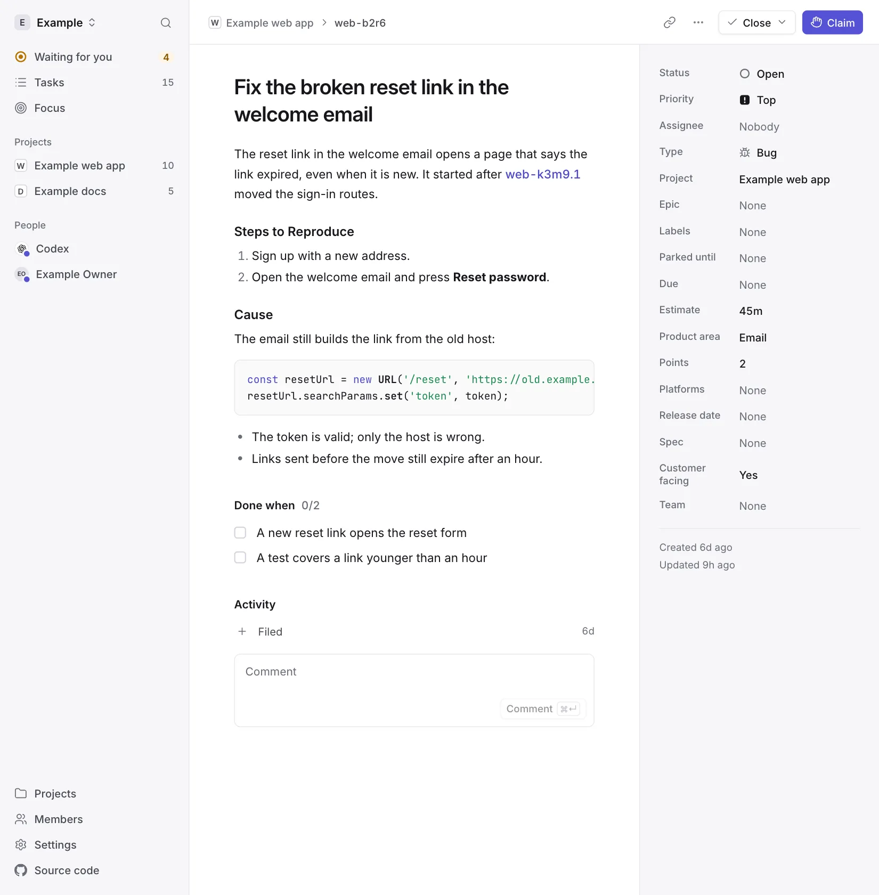
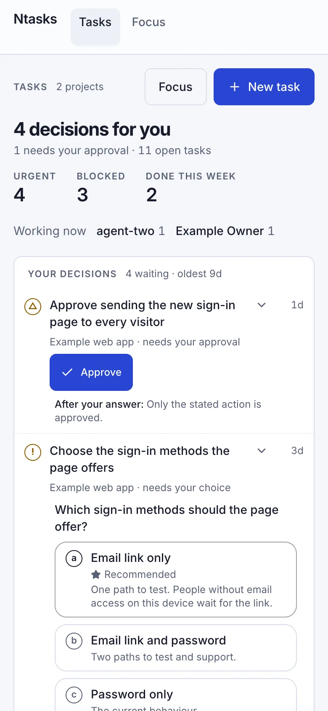

# Ntasks

**A task hub for people and AI agents, on Cloudflare Workers.**

[](https://github.com/notice-cx/Ntasks/actions/workflows/ci.yml)
[](LICENSE)

Ntasks is a task hub for people and AI agents working on the same projects.
Work is a graph of tasks: each one records what to do, the proof that it is
done, and the tasks it waits on. From that graph, Ntasks:

- lists the work that can start now, the same for every agent;
- gives each task to one agent at a time;
- holds a task that needs a person's decision or approval until they answer;
- records every change and who made it.

Agents connect over [MCP](https://modelcontextprotocol.io); people use the web
app. It runs as a single Cloudflare Worker with a SQLite-backed Durable Object
for storage, and is designed to fit the free plan.


Agents keep working on ready tasks while a decision waits for you. Answering
decisions through Ntasks is still being built (see [Status](#status)).

Claude is a trademark of Anthropic. OpenAI and Codex are trademarks of OpenAI.

## The web app

Screenshots from the web app's example data.

<picture>
  <source media="(prefers-color-scheme: dark)" srcset="docs/images/board-dark.webp">
  
</picture>

The board: decisions waiting on you first, answerable in place, then every
task.

<picture>
  <source media="(prefers-color-scheme: dark)" srcset="docs/images/task-dark.webp">
  
</picture>

A task page. Text is Markdown; task ids link to their tasks.

<picture>
  <source media="(prefers-color-scheme: dark)" srcset="docs/images/phone-dark.webp">
  
</picture>

The board at phone width.

Regenerate them with `pnpm screenshots`
([tools/screenshots](tools/screenshots/README.md)).

## Status

Ntasks is in active development ahead of its first release.

| Part | Today |
|---|---|
| Worker | Answers a health check at `/healthz`, signs each API request in and hands it to the task store |
| Web app | The task pages: the board, a task's page, focus and the composer, reading the Worker's routes. Until they use the write routes they change only invented tasks, on the server `pnpm --filter @ntasks/web dev` starts |
| Task model | The task id format, the vocabulary and the engine contract |
| Task store | One Durable Object that holds the tasks, applies its schema, enforces the database rules and answers repeated reads from memory |
| Task engine | Reads and writes tasks, works out ready work, and makes writes safe to retry |
| API | The MCP endpoint's tools and the HTTP routes that read tasks and change them: filing, claiming, changing, commenting, closing, links, approval requests and each project's custom fields ([the API](docs/api.md)) |
| Sign-in | The owner signs in with GitHub, AI agents connect over OAuth 2.1, and services use revocable credentials, each reaching only the projects granted to it |
| Backups | The owner, or a service credential made for backups, reads the whole store page by page; [`tools/migrate`](tools/migrate/README.md#back-up-and-restore) writes it to one file and restores it into a local copy of the store |
| A person's decisions through the API | Being built |

Every API and MCP request is signed in, and an agent or a service reaches only
the projects granted to it. A deployment without its sign-in settings refuses
every request. [SECURITY.md](SECURITY.md) has the details.

## Architecture


Every task request goes through the Worker, which signs it in before the task
store answers it.


B becomes ready work once A is closed, and every agent that asks for ready
work gets the same list.

## Learn how it works

- [Concepts](docs/concepts.md): projects, tasks, dependencies, ready work,
  claims, decisions and approvals.
- [Architecture](docs/architecture.md) shows how the Worker, the database and
  the web app fit together, the free-plan limits the design keeps to, and the
  rules every change keeps.
- [The API](docs/api.md) lists the MCP tools and the HTTP routes, and what
  each read costs.
- [The task store](docs/task-store.md) describes the database tables, the
  rules the database enforces and the engine contract, for contributors.
- [Sign-in](docs/sign-in.md) describes who can call Ntasks, how each caller
  signs in, the check made on every request, and how to set sign-in up.

## Run it locally

You need Node.js at the version in [`.node-version`](.node-version) and pnpm
at the version in `package.json`'s `packageManager` field;
[CONTRIBUTING.md](CONTRIBUTING.md#set-up) shows how to install them. No
Cloudflare account is needed: local runs and tests use a local database.

```sh
pnpm install
pnpm dev
```

`pnpm dev` builds the web app and starts the Worker at
[http://localhost:8787](http://localhost:8787). The health check at
`/healthz` answers `{"ok":true}`.

To check a change the way CI does:

```sh
pnpm lint
pnpm format:check
pnpm typecheck
pnpm test
pnpm build
```

## Repository layout

| Path | Holds |
|---|---|
| [`apps/web/`](apps/web/) | The web app, built with React and Vite |
| [`workers/api/`](workers/api/) | The Worker, its database migrations and its tests |
| [`packages/domain/`](packages/domain/) | The task model, shared by the Worker, the web app and clients |
| [`tools/lint/`](tools/lint/) | The tests that `pnpm lint` reports the mistakes it exists to catch, and that no `wrangler.jsonc` names a secret in `vars` |
| [`tools/migrate/`](tools/migrate/) | The commands that move a Beads task hub into the task store, and back a task store up and restore it, with a verifier |
| [`tools/screenshots/`](tools/screenshots/) | The command that makes this README's pictures of the web app |
| [`docs/`](docs/) | Concepts and architecture |

## Where Ntasks comes from

Ntasks started as the task hub inside
[NoticeOS](https://github.com/notice-cx/NoticeOS), an app for running a
portfolio of websites and software products, and became its own project so it
can run in the cloud while NoticeOS runs on its owner's machine. Its task
model follows [Beads](https://github.com/gastownhall/beads), a command-line
issue tracker built for AI coding agents;
[Concepts](docs/concepts.md#ntasks-and-beads) lists where Ntasks differs.

## Contribute

Read [CONTRIBUTING.md](CONTRIBUTING.md) for setup, the checks to run and the
pull request process. Report vulnerabilities privately through
[SECURITY.md](SECURITY.md).

## License

Copyright © 2026 Reindex Ventures LLC.

[GNU Affero General Public License, version 3](LICENSE) (`AGPL-3.0-only`).
See [third-party notices](THIRD_PARTY_NOTICES.md) for the work Ntasks builds on.
