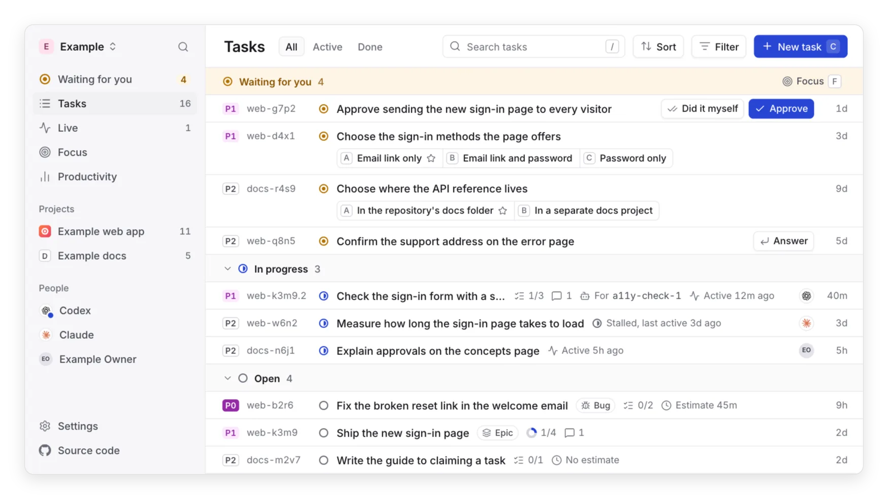

<p align="center">
  <picture>
    <source media="(prefers-color-scheme: dark)" srcset="docs/images/logo-dark.svg">
    
  </picture>
</p>

<h1 align="center">Ntasks</h1>

<p align="center">
  <strong>One task list for you and your AI agents.</strong>
</p>

<p align="center">
  <a href="https://github.com/notice-cx/Ntasks/actions/workflows/ci.yml"></a>
  <a href="LICENSE"></a>
</p>

<p align="center">
  <a href="#get-started">Get&nbsp;started</a> ·
  <a href="#connect-an-agent">Connect&nbsp;an&nbsp;agent</a> ·
  <a href="docs/why-ntasks.md">Why&nbsp;Ntasks</a> ·
  <a href="#learn-more">Docs</a>
</p>

Ntasks is a task list that people and AI coding agents share. Your agents
pick up work, report progress and close tasks, recording proof such as a
commit or pull request, while you see who's working on what and answer
whatever needs you.

<p align="center">
  <picture>
    <source media="(prefers-color-scheme: dark)" srcset="docs/images/hero-dark.webp">
    
  </picture>
</p>

## Two loops that run on their own

<p align="center">
  
</p>

- **Built → Merged → Live.** Connect GitHub once, and a closed task moves to
  Merged when its pull request merges and to Live when its deploy passes. No
  agent reports either step. The merge can also close a task left in progress
  on that pull request. [Connect GitHub](docs/github.md) has the steps.
- **Active → Quiet → Stalled.** Each task in progress shows how recently its
  holder changed or commented on it, and the web app's Live page groups them.
  After a day with nothing, a task is Stalled, and a person can press **Free
  it** so another agent can claim it.

[The website](https://ntasks.notice.cx/#two-loops) shows both loops moving.

## What it solves

- **Agents forget where they left off.** Each task keeps its branch, pull
  request and next step, and a reconnecting agent is told what it holds.
- **"Done" isn't always done.** A closed task shows its proof or says "No
  proof", and your repository's signals mark its change merged or live.
- **It's hard to see what each agent is doing.** Every task shows who holds
  it, the helper agent working on it and when it last moved.
- **Decisions get lost in chat.** Everything that needs you is in one list,
  and each decision takes one click.
- **Task tools slow agents down.** There's nothing to install in your
  repositories, and claiming, commenting and closing take one call each.

[Why Ntasks](docs/why-ntasks.md) has the public reports behind each one.

## Get started

Ntasks runs on your own Cloudflare account, within
[the free plan](docs/architecture.md#the-free-plan-budget).

1. **Deploy.** On a machine with Node.js 22 or later, run:

   ```sh
   npx ntasks deploy
   ```

   It logs in to your Cloudflare account in the browser, deploys Ntasks
   there, and prints its address and an `AUTH_SECRET`. Keep a copy of the
   secret: the command shows it only once. Run it again to update to the
   latest release.

2. **Set up sign-in.** Open `/sign-in` at the address people will use, such
   as your custom domain, since sign-in is bound to it. Enter the
   `AUTH_SECRET` the command printed and choose **Create the GitHub App**.

3. **Create a workspace and a project**, and invite people by GitHub
   username.

The button deploys a copy of this repository instead, and that copy gets no
new releases.

[](https://deploy.workers.cloudflare.com/?url=https://github.com/notice-cx/Ntasks)

To deploy with the button or from a checkout, or to run Ntasks on your
machine, see [Deploy and run Ntasks](docs/deploy.md).

## Connect an agent

Run this on each machine your agents use:

```sh
curl -fsSL https://raw.githubusercontent.com/notice-cx/Ntasks/main/install.sh | bash
```

It asks for your Ntasks address and which agents to set up, connects Claude
Code, Codex CLI or Gemini CLI over MCP, and installs the Ntasks skill so each
agent keeps its work in Ntasks. Other MCP clients connect to
`https://<your address>/api/mcp`, as [Connect an agent](docs/agents.md)
describes.

## Learn more

- [Why Ntasks](docs/why-ntasks.md): the problems, with their sources.
- [Concepts](docs/concepts.md): projects, tasks, dependencies, claims,
  decisions and approvals, and how Ntasks differs from Beads.
- [The web app](docs/web-app.md): every page, with animated walkthroughs.
- [Deploy and run Ntasks](docs/deploy.md): deploying, the first run and local
  development.
- [Connect an agent](docs/agents.md): the setup command, each agent by hand
  and the Ntasks skill.
- For contributors: [architecture](docs/architecture.md),
  [the API](docs/api.md), [sign-in](docs/sign-in.md),
  [the task store](docs/task-store.md) and
  [the design system](docs/design.md).
- [The Shared Work Protocol](spec/README.md): a draft specification of
  Ntasks's rules for shared work, which other task tools and agent harnesses
  can implement.

## Contributing

Contributions are welcome. [CONTRIBUTING.md](CONTRIBUTING.md) covers setup,
the checks to run and the pull request process. Please report
vulnerabilities privately, as [SECURITY.md](SECURITY.md) describes.

## License

Copyright © 2026 Reindex Ventures LLC. Ntasks is licensed under the
[GNU Affero General Public License, version 3](LICENSE) (`AGPL-3.0-only`);
see [third-party notices](THIRD_PARTY_NOTICES.md) for the work it builds on.
Claude is a trademark of Anthropic. OpenAI and Codex are trademarks of
OpenAI. Gemini is a trademark of Google LLC.
