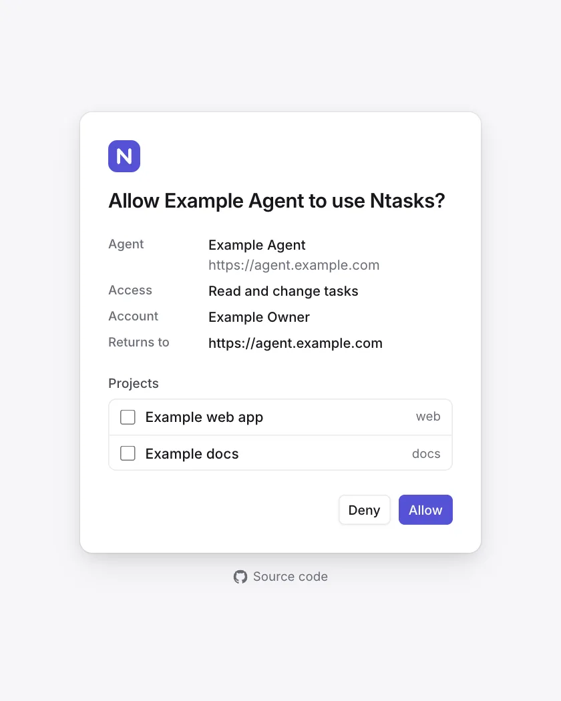

# Connect an agent

An AI agent works with Ntasks through the MCP endpoint, `/api/mcp`. Setting
an agent up takes two steps, and [the setup command](#set-up-with-one-command)
does both:

1. **Register the server** with the agent's MCP client. On first use the
   client signs in with OAuth: Ntasks opens in your browser, and you allow the
   agent and choose the projects it may reach
   ([How an AI agent connects](sign-in.md#how-an-ai-agent-connects)).
2. **Install the Ntasks skill**,
   [`skills/ntasks/SKILL.md`](../skills/ntasks/SKILL.md). It gives the agent
   standing rules: Ntasks is the only list of open work, work the agent finds
   becomes a task, and `get_task_guide` holds the rest.

<picture>
  <source media="(prefers-color-scheme: dark)" srcset="images/agent-access-dark.webp">
  
</picture>

The MCP server sends a writing checklist when an agent connects. Any
connected agent can call `get_task_guide` for the full workflow and writing
guide, and `get_task_template` for the Markdown to start a task, bug,
decision or request for a person to do steps. The skill tells the agent to
file work it finds in any session.

## Set up with one command

Run this on each machine your agents use:

```sh
curl -fsSL https://raw.githubusercontent.com/notice-cx/Ntasks/main/install.sh | bash
```

[`install.sh`](../install.sh):

1. asks for your Ntasks address;
2. lists the supported agents it finds on the machine and asks which to set
   up;
3. shows what it will change, and asks before changing anything;
4. for each agent, registers an MCP server named `ntasks` at
   `<address>/api/mcp` for every project, and writes the skill file.

It needs no `sudo`.

| Agent | It registers the server with | It writes the skill to | Sign-in step it prints |
|---|---|---|---|
| Claude Code | `claude mcp add --transport http --scope user ntasks <endpoint>` | `~/.claude/skills/ntasks/SKILL.md` | `claude mcp login ntasks`, or `/mcp` in a session |
| OpenAI Codex CLI | `codex mcp add ntasks --url <endpoint>` | `~/.agents/skills/ntasks/SKILL.md` | `codex mcp login ntasks` |
| Gemini CLI | `gemini mcp add --transport http --scope user ntasks <endpoint>` | `~/.agents/skills/ntasks/SKILL.md` | `/mcp auth ntasks` in a session |

Codex and Gemini CLI both read skills from `~/.agents/skills`, so they share
one copy.

### Running it again

Run it again at any time:

- A server already registered as `ntasks` at the same endpoint is left as it
  is.
- One registered at another address, or as a local command, is replaced only
  after you agree.
- A skill file that differs from the repository's is replaced.

The address is the deployment's origin, such as `https://ntasks.example.com`.
An address without a scheme gets `https://`; `http://` is accepted only for
`localhost` and `127.0.0.1`.

### Running it without prompts

These options answer its questions:

| Option | Environment variable | Effect |
|---|---|---|
| `--url <address>` | `NTASKS_URL` | The Ntasks address |
| `--agents <list>` | `NTASKS_AGENTS` | The agents to set up, separated by commas: `claude`, `codex`, `gemini` |
| `--yes` | `NTASKS_YES=1` | Makes the changes without asking, including replacing an `ntasks` server registered at another address or as a local command. Without it and without a terminal, the script stops at its first question and changes nothing |
| | `NTASKS_REF` | The branch or tag of this repository the skill is downloaded from. Default `main` |
| | `NTASKS_SKILL_SOURCE` | Another URL or a local file to read the skill from |

```sh
curl -fsSL https://raw.githubusercontent.com/notice-cx/Ntasks/main/install.sh \
  | bash -s -- --url https://ntasks.example.com --agents claude,codex --yes
```

The script supports an agent only when its MCP command and its user skills
folder are documented by its maker. Other agents connect by hand, below.

## Set up by hand

Replace `<your address>` with the deployment's address. Each command
registers the server for every project on the machine.

### Claude Code

```sh
claude mcp add --transport http --scope user ntasks https://<your address>/api/mcp
claude mcp login ntasks
```

`claude mcp login` signs in from the shell; `/mcp` in a Claude Code session
does the same. Copy [`skills/ntasks`](../skills/ntasks/) to
`~/.claude/skills/ntasks`. Sources: [MCP](https://code.claude.com/docs/en/mcp),
[skills](https://code.claude.com/docs/en/skills).

### OpenAI Codex CLI

```sh
codex mcp add ntasks --url https://<your address>/api/mcp
codex mcp login ntasks
```

Codex keeps the server in `~/.codex/config.toml`, which the Codex IDE
extension also reads:

```toml
[mcp_servers.ntasks]
url = "https://<your address>/api/mcp"
```

Codex registers itself with Ntasks through dynamic client registration, so it
needs no client id. Copy [`skills/ntasks`](../skills/ntasks/) to
`~/.agents/skills/ntasks`. Sources:
[MCP](https://learn.chatgpt.com/docs/extend/mcp?surface=cli),
[skills](https://learn.chatgpt.com/docs/build-skills).

### Gemini CLI

```sh
gemini mcp add --transport http --scope user ntasks https://<your address>/api/mcp
```

Sign in with `/mcp auth ntasks` in a Gemini CLI session. Copy
[`skills/ntasks`](../skills/ntasks/) to `~/.agents/skills/ntasks`. Sources:
[MCP](https://geminicli.com/docs/tools/mcp-server/),
[skills](https://geminicli.com/docs/cli/skills/).

### Any other MCP client

| Setting | Value |
|---|---|
| Endpoint | `https://<your address>/api/mcp` |
| Transport | Streamable HTTP |
| Sign-in | OAuth 2.1 with PKCE. The client finds the authorization server from `/.well-known/oauth-protected-resource/api/mcp` and registers itself (dynamic client registration, RFC 7591); no client id is needed |

Name the server `ntasks`: the skill refers to its tools by that name.

## The skill

[`skills/ntasks/SKILL.md`](../skills/ntasks/SKILL.md) is the one copy of the
standing rules, in the [Agent Skills](https://agentskills.io/specification)
format. Its description tells the agent to load it at the start of every
session and whenever it chooses, starts, finds or finishes work.

- **An agent that reads skills:** copy the `skills/ntasks` folder into its
  skills folder.
- **An agent that does not:** paste the file's body, everything after the
  frontmatter, into its instructions file: `~/.claude/CLAUDE.md` for Claude
  Code in every project ([memory](https://code.claude.com/docs/en/memory)),
  `~/.codex/AGENTS.md` for Codex
  ([AGENTS.md](https://learn.chatgpt.com/docs/agent-configuration/agents-md)),
  or a repository's `CLAUDE.md` or `AGENTS.md`.

The skill points to `get_task_guide` instead of repeating it, so the guide
stays the one copy of the workflow. When the guide changes, `list_workspaces`
returns a new `guideVersion`, and the skill tells the agent to read the guide
again.

## Task templates

Before drafting, call `get_task_template` with the matching type. Browse
the same Markdown files here:

- [Task](../skills/ntasks/templates/task.md): an outcome, its reason and the
  proof that it is done.
- [Bug](../skills/ntasks/templates/bug.md): the failure, reproduction steps
  and expected behavior.
- [Decision](../skills/ntasks/templates/decision.md): a person's choice,
  one recommendation and what happens next.
- [Human action](../skills/ntasks/templates/human-action.md) (`human_action`):
  steps a person ticks off. Pass them to `request_human_action` on the task
  waiting for the result. The last tick closes the request. The agent checks
  the result before continuing or closing the linked task.

Replace the bracketed prompts and keep the sections that apply. Each file
explains which tool fields to fill. Copy the whole skill folder to keep local
copies of the templates alongside `SKILL.md`.

## Working on a task

Once connected, an agent works in a few calls. These are examples with
invented ids:

```text
claim_task       { "task": "web-a1b2", "branch": "fix-sign-in", "next": "Write the failing test" }
comment_on_task  { "task": "web-a1b2", "text": "Test written; the redirect drops the return address." }
close_task       { "task": "web-a1b2", "reason": "Fixed the redirect; the test passes.", "pr": "https://github.com/example/web/pull/42" }
```

An agent that reaches more than one workspace also passes `workspace`, a
`workspaceId` from `list_workspaces`, in each call.

Everything about a task goes on the task, as a comment or its fields:
progress, hand-overs (where work stopped, file pointers, gotchas, what is
left), findings and decisions. The guide and the skill tell agents never to
keep it in a separate notes file or a tool's own notes, and to leave only a
pointer to the task when another tool asks for a note.

A fact that several tasks of an epic need goes on the epic, pinned, and each
of those tasks then shows it when an agent reads or claims it:

```text
comment_on_task  { "task": "web-a1b2", "text": "Migration 0007 is taken by web-a1b2.3; the next one is 0008.", "pin": true }
```

`get_task` and `claim_task` on a child such as `web-a1b2.4` then answer
`parent`, with the epic's pinned comments and its most recently closed
tasks, each with its close reason and proof.

When two tasks in progress change the same file, the claim says so, and the
agents record which pull request lands first:

```text
claim_task  { "task": "web-a1b2.4", "touches": ["scripts/bundle-baseline.json"] }
link_tasks  { "task": "web-a1b2.4", "to": "web-a1b2.2", "type": "merges-after" }
```

The claim's answer lists `web-a1b2.2` in `overlaps` when its holder recorded
the same file; the link then shows on both tasks.

`get_task_guide` gives the agent the rest: filing work, linking tasks,
asking a person for a decision, an approval or steps to do, and the rules for
[writing a task](concepts.md#writing-a-task). [The MCP endpoint](api.md#the-mcp-endpoint)
lists every tool.
