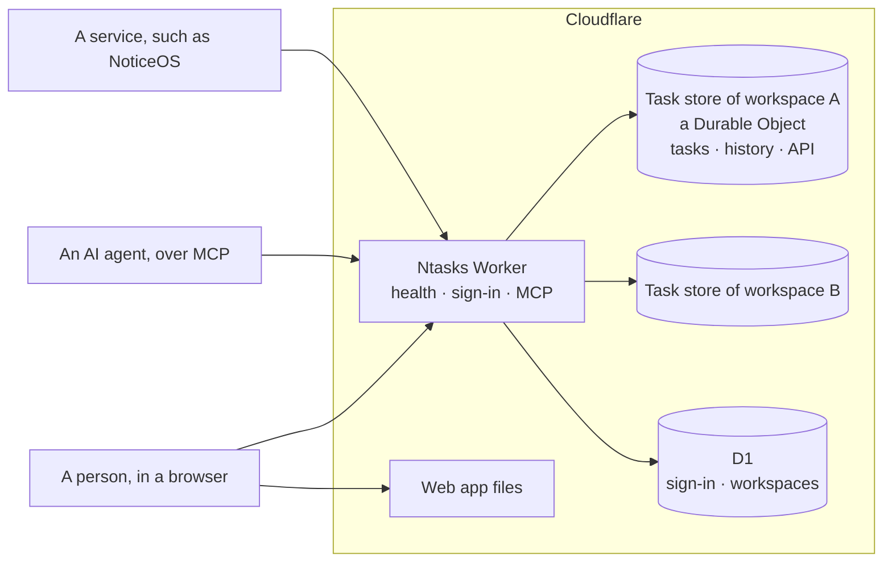

# Architecture

Ntasks is one Cloudflare Worker and a task store for each workspace. A
**workspace** is the set of projects, people, agents and services that work
together; one deployment holds several, and none reaches another's tasks. The
**task store** is a SQLite-backed Durable Object that holds one workspace's
tasks and runs the task engine beside them. Sign-in, the workspaces and their
members are in D1. The Worker answers the API, the MCP endpoint that AI agents
connect to, and sign-in; Cloudflare serves the web app's files from the same
deployment. This page shows how the parts fit, the limits the design keeps
to, and the rules every change keeps. Read [Concepts](concepts.md) first for
the task model itself.

## The parts

| Part | Code | Built |
|---|---|---|
| Worker | [`workers/api/src/worker.ts`](../workers/api/src/worker.ts), [`index.ts`](../workers/api/src/index.ts), [`workspaces.ts`](../workers/api/src/workspaces.ts) | The health check at `/healthz`, sign-in and the MCP endpoint; signs each API request in, picks the workspace it reaches, and hands it to that workspace's task store with its sender |
| Task store | [`workers/api/src/store/`](../workers/api/src/store/) | The Durable Object that holds one workspace's tasks, applies its schema and answers repeated reads from memory |
| Task store schema | [`workers/api/src/store/migrations/`](../workers/api/src/store/migrations/) | The tables and the rules the database enforces ([The task store](task-store.md)) |
| Sign-in schema | [`workers/api/migrations/`](../workers/api/migrations/) | The tables of sign-in and of workspaces, their members and invitations, in D1 ([Sign-in](sign-in.md#tables)) |
| Task model | [`packages/domain/src/`](../packages/domain/src/) | The task id format, the vocabulary and the engine contract |
| Task engine | [`workers/api/src/engine/`](../workers/api/src/engine/) | Every read and write of the engine contract, with retries and ready work |
| Web app | [`apps/web/`](../apps/web/) | The task pages, reading the Worker's routes; until they use the write routes, they change only invented tasks, on the server `pnpm --filter @ntasks/web dev` starts |
| API and MCP endpoint | [`workers/api/src/api.ts`](../workers/api/src/api.ts), [`mcp/`](../workers/api/src/mcp/), [`http/`](../workers/api/src/http/), [`task-writes.ts`](../workers/api/src/task-writes.ts), [`owner-answers.ts`](../workers/api/src/owner-answers.ts), [`agent-stats.ts`](../workers/api/src/agent-stats.ts) | The MCP tools and the HTTP routes that read and change tasks ([The API](api.md)), the rules of a person's decisions and of the owner answers agents record, and agent statistics |
| Sign-in | [`workers/api/src/access/`](../workers/api/src/access/) | Sign-in with GitHub for people, OAuth 2.1 for AI agents, service credentials, the workspace routes, and the token verifier every route calls ([Sign-in](sign-in.md)) |

**MCP**, the [Model Context Protocol](https://modelcontextprotocol.io), is how
AI agents call tools on a server. Ntasks offers its task operations, such
as listing ready work or claiming a task, as MCP tools.

## How a request is routed

The Worker's configuration, [`wrangler.jsonc`](../wrangler.jsonc),
lists the paths the Worker answers in `assets.run_worker_first`: `/healthz`,
every path under `/api/`, the sign-in pages and the OAuth discovery documents
([Sign-in](sign-in.md#routes)). Any other path is a file from the web app's
build. A page address with no file of its own returns the app's `index.html`,
and the app shows that page in the browser.
[`workers/api/test/node/routing.ts`](../workers/api/test/node/routing.ts)
checks this routing with the real configuration.

Cloudflare serves the web app's files without starting the Worker, so they do
not count against the Worker's request limit below. They hold no task data:
the app asks the API for everything it shows.

An API request goes from the Worker to one workspace's task store. The Worker
answers `404` for a path the API does not serve, signs the sender in, and
picks the workspace the request reaches ([below](#workspaces)). It then hands
an HTTP request to that workspace's store, with the sender as the store sees
it: its scopes and projects in that workspace and nothing of any other. The
store answers it with the task engine, whose queries run beside the data with
no network trip. Each workspace has its own store, the Durable Object named
`workspace:` followed by the workspace's id, so no query of one workspace can
read another's rows.

The Worker answers the MCP endpoint itself: the list of tools,
`list_workspaces` and `get_task_guide` come from the sender's sign-in, and
each other tool call goes, over Durable Object RPC, to the store of the
workspace its `workspace` argument names.

## Workspaces

A workspace has an id, a UUID, and a name. Its people belong to it as its
**owner** or as a **member**: both read, write and decide there, and an owner
also invites and removes its people, creates its projects, makes its service
credentials, and backs it up and loads it. The deployment's admins, the
GitHub account that ran the setup page and any in `OWNER_GITHUB_IDS`
([Sign-in](sign-in.md#settings)), create workspaces, and each becomes the
owner of the workspaces they create.
An owner invites people by their GitHub username, and an invited account
becomes a member when it signs in. Only admins, members and invited accounts
sign in; any other GitHub account is refused
([Sign-in](sign-in.md#members-and-invitations)).

A request reaches one workspace:

- A service credential belongs to one workspace and always reaches it.
- A person or an agent names one in the `x-ntasks-workspace` header, and an
  MCP tool call names one in its `workspace` argument.
- A sender that reaches exactly one workspace may leave the header out. One
  that reaches several and names none gets `400` with `workspace_required`.
- A workspace the sender does not reach answers as one that does not exist.

[The API](api.md#workspaces) lists the routes and answers.

## Who connects, and how they sign in

Ntasks is designed to be reachable from the internet, so authentication is its
boundary. Every API and MCP request names who sends it, and the Worker checks
which workspaces that sender reaches and what it may do in the project the
request names. Only the health check and the sign-in steps themselves answer
without it.

- **People** sign in in the browser with GitHub, as a deployment admin, a
  member of a workspace or an invited account, and reach the workspaces they
  belong to.
- **AI agents** connect with OAuth 2.1, the sign-in method MCP clients use,
  and the person who approves an agent chooses which projects of their
  workspaces it may reach.
- **Services**, such as a NoticeOS installation, use a named credential of
  one workspace with access to named projects, which the workspace's owner
  can revoke.

[Sign-in](sign-in.md) describes each, the check made on every request, and
how to cut a caller off; [SECURITY.md](../SECURITY.md) says what it means
for a deployment.

## The free-plan budget

Ntasks is designed to run on Cloudflare's free plan. These are the plan's
limits that shape the design, from Cloudflare's documentation in November
2026:

| Resource | Free plan |
|---|---:|
| Worker requests | 100,000 a day |
| Worker CPU time | 10 ms per request |
| Durable Object requests | 100,000 a day |
| Rows read, by the task store | 5,000,000 a day |
| Rows written, by the task store | 100,000 a day |
| Rows read, by D1 (sign-in) | 5,000,000 a day |
| Data stored, by Durable Objects | 5 GB in all |

Each API request is one Worker request and one request to a task store. The
MCP endpoint's list of tools, `list_workspaces` and `get_task_guide` reach no
store. When a daily limit is reached, operations of that kind fail until
00:00 UTC. To stay inside these limits, Ntasks:

- reads the sender's workspaces in the same D1 query that signs the sender
  in, so picking a workspace takes no further query; that query reads about
  two more rows for each of the sender's memberships or grants;
- answers a read it has answered since the last write from the store's
  memory, which reads no rows;
- reaches every row it reads through an index, and returns a task's labels
  and links in the same query ([what a read costs](api.md#what-a-read-costs));
- lets clients ask for the changes since their last read, instead of
  reloading whole lists;
- keeps CPU time per request low, because time spent waiting on the database
  does not count but parsing and serializing large answers does.

## Rules every change keeps

These rules hold for the task engine and for every route that changes a task.
They are what lets many agents work on one graph without corrupting it.

1. **One claim wins.** A claim checks and sets the holder in one statement. A
   second claimant is refused.
2. **A write names the version it read.** Every task has a version number
   that goes up with each change. A change carries the version it was based
   on, and a change based on an older version is refused.
3. **A retry never repeats a change.** A repeated idempotency key returns the
   first result, and a key reused for a different change is refused.
4. **A change and its history are written together.** Both commit in one
   transaction, or neither does.
5. **The server decides readiness and epic completion.** Dependencies,
   statuses and pending approvals are evaluated by the Worker, never by a
   client.
6. **Reopening keeps history.** A reopened task keeps its earlier closes and
   their evidence.
7. **Time alone never releases a claim.**

The task store runs a batch of statements as one transaction, but a
conditional update that matches no row does not fail the batch. The database's write guard turns
that case into a failure that rolls back the whole batch, so a refused write
leaves no history entry or retry record behind.
[The task store](task-store.md#the-write-guard) shows how.
