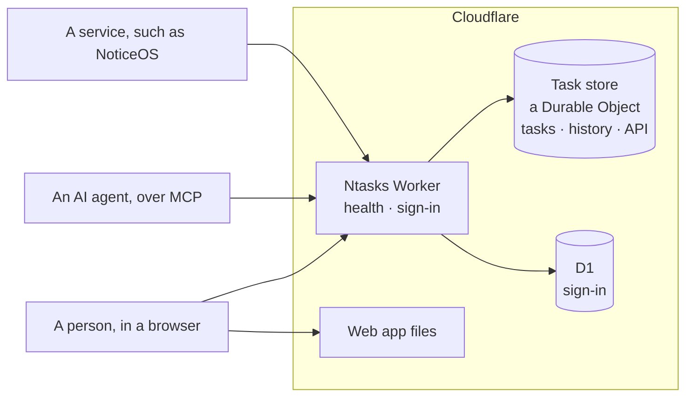

# Architecture

Ntasks is one Cloudflare Worker and one task store. A **Worker** is a program
Cloudflare runs on its servers in answer to web requests. The **task store**
is a Durable Object: a single Cloudflare object with its own SQLite database,
which holds every task and runs the task engine beside it. Sign-in keeps its
data in **D1**, Cloudflare's SQLite database service. The Worker answers the
API, the MCP endpoint that AI agents connect to, and sign-in; Cloudflare
serves the web app's files from the same deployment. This page shows how the
parts fit, the limits the design keeps to, and the rules every change keeps.
Read [Concepts](concepts.md) first for the task model itself.

## The parts

| Part | Code | Built |
|---|---|---|
| Worker | [`workers/api/src/worker.ts`](../workers/api/src/worker.ts), [`index.ts`](../workers/api/src/index.ts) | The health check at `/healthz` and sign-in; signs each API request in and hands it, with its sender, to the task store |
| Task store | [`workers/api/src/store/`](../workers/api/src/store/) | The Durable Object that holds the tasks, applies its schema and answers repeated reads from memory |
| Task store schema | [`workers/api/src/store/migrations/`](../workers/api/src/store/migrations/) | The tables and the rules the database enforces ([The task store](task-store.md)) |
| Sign-in schema | [`workers/api/migrations/`](../workers/api/migrations/) | Sign-in's tables, in D1 ([Sign-in](sign-in.md#tables)) |
| Task model | [`packages/domain/src/`](../packages/domain/src/) | The task id format, the vocabulary and the engine contract |
| Task engine | [`workers/api/src/engine/`](../workers/api/src/engine/) | Every read and write of the engine contract, with retries and ready work |
| Web app | [`apps/web/`](../apps/web/) | The task pages. Until sign-in and writes through the API are built they work only with invented tasks, on the server `pnpm --filter @ntasks/web dev` starts |
| API and MCP endpoint | [`workers/api/src/api.ts`](../workers/api/src/api.ts), [`mcp/`](../workers/api/src/mcp/), [`http/`](../workers/api/src/http/) | The read tools and the HTTP reads ([The API](api.md)); the write tools are not built yet |
| Sign-in | [`workers/api/src/access/`](../workers/api/src/access/) | Owner sign-in with GitHub, OAuth 2.1 for AI agents, service credentials, and the token verifier every route calls ([Sign-in](sign-in.md)) |

**MCP**, the [Model Context Protocol](https://modelcontextprotocol.io), is how
AI agents call tools on a server. Ntasks will offer its task operations, such
as listing ready work or claiming a task, as MCP tools.

## How a request is routed

The Worker's configuration, [`wrangler.jsonc`](../workers/api/wrangler.jsonc),
lists the paths the Worker answers in `assets.run_worker_first`: `/healthz`,
every path under `/api/`, the sign-in pages and the OAuth discovery documents
([Sign-in](sign-in.md#routes)). Any other path is a file from the web app's
build. A page address with no file of its own returns the app's `index.html`,
and the app shows that page in the browser.
[`workers/api/test/node/routing.ts`](../workers/api/test/node/routing.ts)
checks this routing with the real configuration.

Cloudflare serves the web app's files without starting the Worker, so they do
not count against the Worker's request limit below. They hold no task data:
the app asks the API for everything it shows.

An API request goes from the Worker to the task store. The Worker answers
`404` for a path the API does not serve, signs the sender in, and hands the
request with its sender to the store. The store answers it with the task
engine, whose queries run beside the data with no network trip. There is one
store per installation, named `tasks`.

## Who connects, and how they sign in

Ntasks is designed to be reachable from the internet, so authentication is its
boundary. Every API and MCP request names who sends it, and the Worker checks
what that sender may do in the project the request names. Only the health
check and the sign-in steps themselves answer without it.

- **The owner** signs in in the browser with an allowlisted GitHub account.
- **AI agents** connect with OAuth 2.1, the sign-in method MCP clients use,
  and the owner approves which projects each agent may reach.
- **Services**, such as a NoticeOS installation, use a named credential with
  access to named projects, which the owner can revoke.

[Sign-in](sign-in.md) describes each, the check made on every request, and
how to cut a caller off; [SECURITY.md](../SECURITY.md) says what it means
for a deployment.

## The free-plan budget

Ntasks is designed to run on Cloudflare's free plan. These are the plan's
limits that shape the design, from Cloudflare's documentation in November
2026:

| Resource | Free plan |
|---|---:|
| Worker requests | 100,000 a day |
| Worker CPU time | 10 ms per request |
| Durable Object requests | 100,000 a day |
| Rows read, by the task store | 5,000,000 a day |
| Rows written, by the task store | 100,000 a day |
| Data stored, by Durable Objects | 5 GB in all |

Each API request is one Worker request and one request to the task store.
When a daily limit is reached, operations of that kind fail until 00:00 UTC.
To stay inside these limits, Ntasks:

- answers a read it has answered since the last write from the store's
  memory, which reads no rows;
- reaches every row it reads through an index, and returns a task's labels
  and links in the same query ([what a read costs](api.md#what-a-read-costs));
- lets clients ask for the changes since their last read, instead of
  reloading whole lists;
- keeps CPU time per request low, because time spent waiting on the database
  does not count but parsing and serializing large answers does.

## Rules every change keeps

These rules hold for the task engine and for every route that changes a task.
They are what lets many agents work on one graph without corrupting it.

1. **One claim wins.** A claim checks and sets the holder in one statement. A
   second claimant is refused.
2. **A write names the version it read.** Every task has a version number
   that goes up with each change. A change carries the version it was based
   on, and a change based on an older version is refused.
3. **A retry never repeats a change.** A repeated idempotency key returns the
   first result, and a key reused for a different change is refused.
4. **A change and its history are written together.** Both commit in one
   transaction, or neither does.
5. **The server decides readiness and epic completion.** Dependencies,
   statuses and pending approvals are evaluated by the Worker, never by a
   client.
6. **Reopening keeps history.** A reopened task keeps its earlier closes and
   their evidence.
7. **Time alone never releases a claim.**

The task store runs a batch of statements as one transaction, but a
conditional update that matches no row does not fail the batch. The database's write guard turns
that case into a failure that rolls back the whole batch, so a refused write
leaves no history entry or retry record behind.
[The task store](task-store.md#the-write-guard) shows how.
