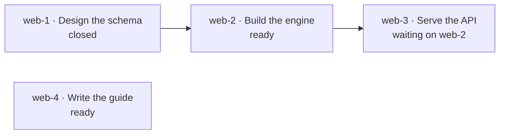
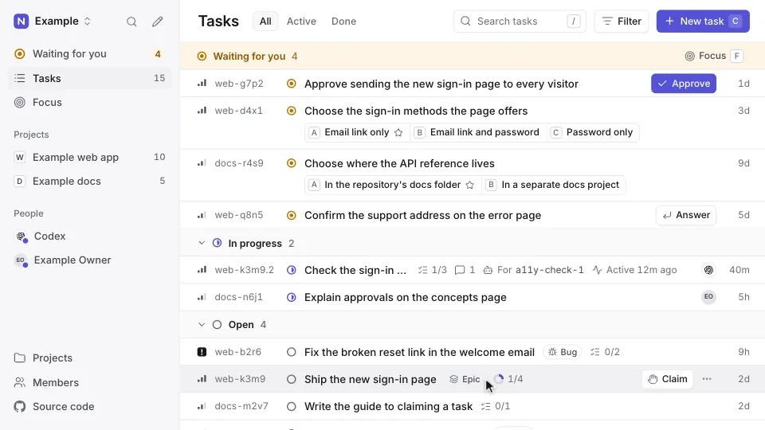
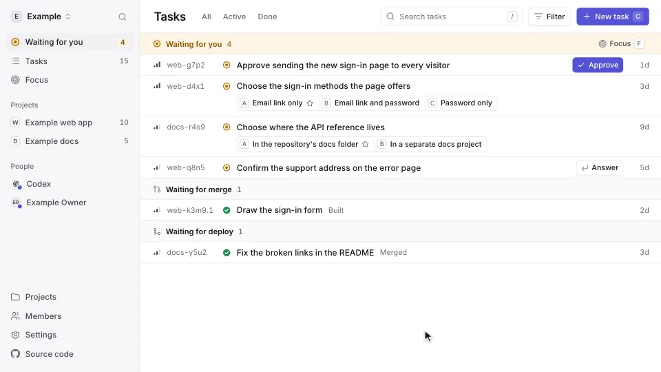
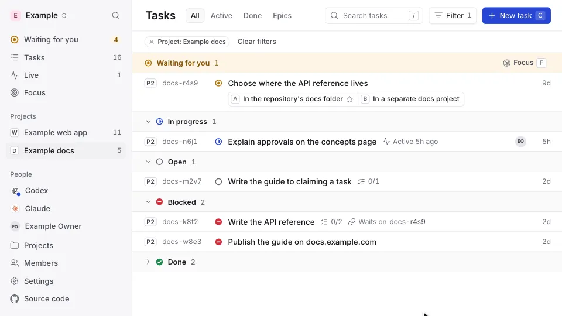
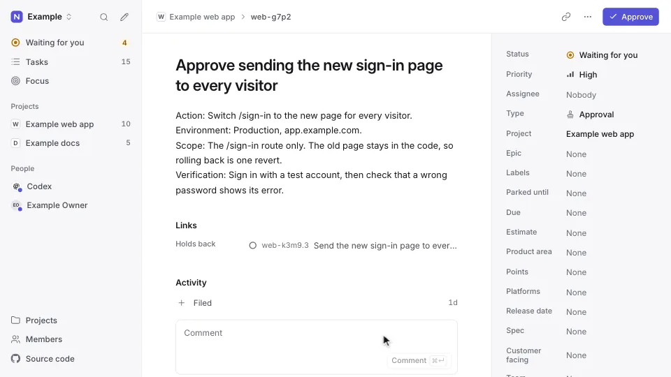

# Concepts

Ntasks keeps work as tasks that people and AI agents share. This page
introduces its ideas in the order you meet them, from a single task to the
rules that let many agents work on one graph at once.

It describes the task model. The [status table](architecture.md#what-is-built)
shows which parts of it run today.

## Projects

A **project** holds the tasks for one body of work, such as one repository or
one product. Each project has a short **prefix** of lowercase letters and
digits, such as `web`, and every task id in the project starts with it.

## Tasks

A **task** is one piece of work. It has:

- a **title**: the outcome, in plain words starting with a verb, of at most
  70 characters;
- a **description**: what to do, why, and where, in Markdown;
- **acceptance**: the proof that the work is done, as a short checklist;
- **notes**: what the people and agents working on it record as it moves,
  such as progress and findings;
- a **design**: how the work is to be built;
- an **estimate**: how long the work should take, in whole minutes;
- **external links**: pages outside Ntasks the work concerns, such as a pull
  request or a document, each a URL with a title;
- a **type**: `task`, `bug`, `feature`, `chore`, `epic` or `decision`;
- a **priority**, from `0`, the most urgent, to `4`;
- a **status**, one of:
  - `open`: not started;
  - `in_progress`: someone has claimed it and is working on it;
  - `blocked`: set aside because something outside the task graph stops it,
    such as a missing credential;
  - `deferred`: set aside until a date recorded on the task;
  - `closed`: finished, with a record of how it ended.

A task's **id** is its project's prefix, a hyphen and a short key of lowercase
letters and digits, such as `web-a1b2`. A task **moved** to another project
takes an id with that project's prefix, and keeps its comments, history and
links; its old id stays its **former id**, which still names it wherever a
task id is read ([API](api.md#moving-tasks)).

### Writing a task

A task is written for someone who was not in the conversation that filed
it. The web app shows the description, acceptance and comments as Markdown,
and [`get_task_guide`](api.md#the-mcp-endpoint) gives agents these rules:

- **Title.** The outcome, or for a person the ask, in plain words starting
  with a verb. At most 70 characters, with no commands, file paths, commit
  hashes or steps.
- **Description.** A first line of one sentence that says what and why, or
  for a person the ask. Then only the sections that apply:
  - work: `## Why`, `## Where` and `## Fix`, and for a bug
    `## Steps to Reproduce`;
  - steps a person does, asked with `request_human_action`: its context
    has `## What it changes` and `## How we'll confirm`, and the steps go in
    `steps`;
  - an approval, where an agent acts once the person allows it:
    `## Why this needs you`, `## What the agent will do`,
    `## What it changes`, `## How we'll confirm` and `## If you decline`.
- **Headings** say who acts, and never describe a pending action in the
  present tense as if it already happens.
- **What it changes.** Each line starts with a bold label naming what it
  measures, such as **Downtime:**, **Your time:**, **Cost:**, **Download:**,
  **Risk:** or **Undo:**, then the value with its unit and who or what it
  applies to. A bare number or duration is never enough: "about 2 minutes"
  becomes "**Downtime:** visitors can't reach the site for about 2 minutes".
- **Commands.** Every command, query, request or snippet a person might run
  or paste goes in its own fenced block with a language tag, such as `bash`,
  `sql` or `json`: one command per block, with no `$` prompt and no output. A
  command that spans lines stays one block. Inline backticks are only for
  names that are not run: file paths, identifiers and settings.
- **Inside the description.** Steps as a numbered list, one action each.
  Links with readable labels, and pull requests as `owner/repo#123`. Numbers
  with units. Paragraphs of at most three sentences, and bullets for three
  or more items.
- **Acceptance.** A short checklist of facts anyone can check on the day the
  work lands.
- **Approval.** The title is the action to approve, and the description has
  the approval's sections, with the exact commands under
  `## What the agent will do`.
- **An ask to a person**, to decide, approve or do, says in plain words what
  is waiting, why it is theirs to decide, and the exact place to act: the
  button on the task's page in Ntasks, a link, or the command to run. Internal terms such as store migration or gate stay out of
  it. For example, an approval titled "Approve merging Ntasks PR #88: Do
  checklists, one new database column" opens with "You: press Approve on this
  task to let the agent merge" and the pull request's link, where its first
  draft repeated one sentence about "store migration 0003_gate_steps" as both
  title and description.

Creating or changing a task answers with advice when:

- it is a bug whose description never names `## Steps to Reproduce`, or a
  bug, task, feature or epic with no acceptance;
- its title is longer than 70 characters or holds a command, a file path or
  a commit hash;
- its description writes a command inline, has a fenced block with no
  language tag, or has a `$` prompt in a block;
- its description's first line repeats the title;
- it asks a person and names no place to act, where a task with choices or
  steps to tick has one.

Nothing is refused for it.

## Custom fields

A project can define **custom fields**: the facts its own work tracks, such
as a severity or a number of points. Each field has a name and a type: text,
a number, a date, one option from a list, several options from a list, a
URL, or yes or no. Each task in the project can carry a value of each field,
and lists of tasks can be narrowed to those holding a value.

A field that is no longer wanted is **retired**: it takes no new values, and
the values tasks carry stay, with their history.

## Dependencies

Tasks connect to each other. When task B **depends on** task A, B waits until
A is closed. A dependency is also called a blocking link: A blocks B. B keeps
the status `open` while it waits; the `blocked` status is only for reasons
outside the graph.

Each arrow points from a task to the task that waits on it. Five more kinds
of link record context without making anything wait:

- **related** connects tasks about the same subject;
- **discovered from** points a new task at the task whose work turned it up;
- **duplicates** points a task at an earlier task for the same work;
- **supersedes** points a task at the task it replaces;
- **merges after** says a task's pull request lands only once the other
  task's has, though both can be worked on at once.

Both tasks show a link: the task that holds it among its dependencies, the
other among its dependents.

Two tasks hold at most one link: setting another kind, or the same kind the
other way round, replaces it.

A task closed as won't do or no longer needed is **dropped**. An open task
that links to a dropped task, other than one it replaces, or that a dropped
task waited on or related to, lists it under `reliesOnDropped` when the drop
came after the open task last changed. When a task is dropped, it also
relates to each open task whose description, acceptance, notes or design
names its id or a former id, up to 20 of them, so those tasks list it too. Whoever picks the
open task up checks that it still makes sense; any change to it clears the
list.

## Ready work

A task is **ready** when someone can start it now:

1. its status is `open`;
2. every task it depends on is closed;
3. its parent is not waiting either: a parent that waits on an open task holds
   every task under it, at any depth. A task labelled `human`, other than an
   epic, is the exception: only the tasks it depends on itself hold it, so the
   person is asked while the work above them waits;
4. neither it nor its parent is deferred to a later date;
5. no approval is pending on it.

In the graph above, `web-2` and `web-4` are ready and `web-3` is not. An
approval is never listed as ready work itself, because a person answers it.

Ntasks works out readiness on the server, from the whole graph. Every agent
that asks for work it can start gets the same answer, and no agent reads the
graph itself to decide.

## Epics

An **epic** is a task whose work is done by its children. A child's id adds a
number to its parent's: `web-a1b2` has the children `web-a1b2.1`, `web-a1b2.2`
and so on. Work too large for one working session becomes an epic with
children that each fit in one. An epic has no work of its own, so the write
that closes its last open child closes the epic too, whoever or whatever
closes that child: an agent, a person, a merge or a recorded answer. Its
history names `service:Ntasks` as the closer, and its reason names the child
that closed last. It closes as `no-longer-needed` when every one of its
children closed as `wont-do` or `no-longer-needed`, and as `done`
otherwise. An epic under another epic closes the same way, and the
one above it is checked next. When a child reopens, or an open task is filed
under it, an epic Ntasks closed reopens. An epic with no children never
closes on its own, and neither does one labelled `keep-open`, which its holder
closes or which closes once the label comes off. Closing an epic that Ntasks
closed records that close in place of Ntasks's, with its own reason and
proof.

The children of an epic share what they learn through the epic:

- A **pinned comment** on the epic holds a fact its other children need,
  such as a file they all change, a number one of them took, or the order in
  which their pull requests must merge. A comment is pinned when it is added.
  A later comment on the same task can unpin it, for example when it corrects
  the fact; the unpinned comment stays among the task's comments.
- Reading one child, or claiming it, also shows its **parent**: the epic's
  10 newest pinned comments and its 5 most recently closed children, each
  with how it ended, its close reason and its proof, with how many of each
  there are in all. Reading the epic itself shows all of its comments.

## Claiming a task

To start a task, an agent or a person **claims** it: the task becomes
`in_progress` and records who holds it. Only one claim succeeds: when two
agents claim the same task at the same moment, one gets it and the other is
told it is taken.

The holder can record the **work in hand** when it claims the task or
comments on it:

- **for**: the helper agent working under the holder, when the holder hands
  the work to one that cannot reach Ntasks itself. The holder still holds the
  task, and the task shows both, as `claude for page-rebuild-2`.
- **session**, **worktree**, **branch**, **pr**, **commit** and **next**: a
  link to or id of the agent session doing the work, its worktree and branch,
  its pull request, the commit last tested, and the next step.
- **touches**: the files or other things the work changes, such as a path, a
  folder or a migration number. When another task in progress touches the
  same, the claim or comment that records it says so, and the two holders
  agree which pull request merges first with a **merges after** link. It is
  advice: a claim is never refused for it.

Each new value replaces the one before it. Releasing or closing the task
clears them; its history keeps every value they had.

<picture>
  <source media="(prefers-color-scheme: dark)" srcset="images/walkthrough-live-work-dark.webp">
  
</picture>

- **Last activity** is when the holder last changed or commented on the task.
  The task guide asks an agent to comment after each push to the task's
  branch, with the commit when the agent tested it, so the task shows active
  for the hour after each push.
- **Stalled** is a task in progress whose holder has done nothing on it for
  a day, or never recorded anything. Ntasks works it out and shows it on the
  task, never stores it: the task stays in progress and its holder keeps it.
  **The Live page** groups the tasks in progress as **Active** within the
  last hour, **Quiet** until a day, and **Stalled** from then on, and agents
  list the same groups with `list_tasks` and `activity`, such as
  `activity: ["quiet", "stalled"]` to find work that may be done but not
  closed, or that stopped.
- **A claim does not expire.** Ntasks never gives a task to someone else
  because time passed, however old its last activity.
- **A person can free a task** someone holds, on their own call, with **Free
  it** in the Where it stopped block a stalled task's page shows: nobody holds
  it then, and a comment keeps who held it and where the work stopped. An
  agent frees one only with `reconcile_task`'s release, naming the holder,
  how it checked that they stopped, and the progress they left.
- **A new session carries on.** When an agent connects, the instructions it
  reads list the open tasks it holds, with each one's helper, branch, next
  step and last activity.

## Closing a task

Closing a task records how the work ended and the evidence for it, such as a
commit or a URL. Most tasks close as **done**. A task can also close as
`wont-do`, `duplicate` (naming the other task), `cant-reproduce`,
`already-handled` or `no-longer-needed`, still with the evidence that decided
it.

Work closed as done shows its **proof**: the commit or pull request that holds
the change, or a link to what shows it, such as a document. A task, bug,
feature or chore closed as done with none of them shows **No proof**.
Decisions, approvals and epics need none.

### Done on a person's call

A person can close a task as done on their own judgement, even when some of
its acceptance is unmet or no longer matters. Each line or list item of the
task's acceptance is one **criterion**. The person ticks the criteria that are
met; the rest are recorded as **waived**, with the person's reason if they
give one. The task shows who accepted it and how many criteria they waived,
and its history keeps the record. A person's acceptance counts as the task's
proof.

Only a person accepts a task this way. An agent's close as done names its
proof, and never waives a criterion. An agent may record a person's
acceptance given elsewhere, as it records an answer
([Who can answer](#who-can-answer)), and the person can dispute it: the task
opens again, and the tasks waiting on it are told to wait.

### Closed by a merge

A task someone holds is closed by its holder. When GitHub reports that a pull
request merged into its repository's default branch, though, a task in
progress whose work in hand names that pull request closes as done, even
after the agent that held it has stopped. A merge into any other branch
closes nothing. Its
proof is the pull request and the merge commit, its history names
`service:GitHub` as the closer, and a comment keeps the holder's last branch
and next step. An epic, a person's request, a task waiting on an open
approval or request to do steps, and a task with open tasks under it stay in
progress. A task whose pull request covers only part of its work carries the
label `keep-open`, and its holder closes it. A merge reported by an agent or
a workflow, rather than by GitHub, closes nothing.
[API](api.md#work-still-in-progress-when-its-pull-request-merges) gives the
rules.

A closed task can be reopened. Reopening keeps its history, including the
first close and its evidence.

## Where a change is

A task closed as done with a commit or a pull request has a **delivery**: the
stage its change has reached. A decision or an approval ships no code, so it
has none, and neither does a task closed with only a link.

- **Built** when the task closes.
- **Merged** once the change is on the default branch: its pull request
  merged, or its commit pushed there.
- **Live** once a deploy ships it.

The workspace's [GitHub App](github.md), a GitHub webhook, the repository's
automation, or the agent that merges or deploys, sends a signal naming the pull requests or commits that merged or
went live, and the tasks that carry them move to that stage. A task only moves forward. A
project whose changes do not go live by a deploy, such as a library, stops at
merged; the project's owner says which kind it is, or a deploy that GitHub
reports for one of its tasks says it the first time.

The web app's **Waiting for you** list shows built work, which waits for a
merge, and merged work of a project that deploys, which waits for a deploy.
[API](api.md#delivery) gives the rules.

<picture>
  <source media="(prefers-color-scheme: dark)" srcset="images/walkthrough-shipped-dark.webp">
  
</picture>

## Decisions, approvals and steps to do

Some steps only a person can take. Ntasks asks a person in three ways:

- A **decision** asks a person to choose between options. Each option has a
  short label, and at most one is marked as recommended. The person's choice
  is recorded on the task.
- An **approval** holds a task until a person approves a named action, such
  as a deployment. Its title names the action, and its description says what
  the agent will do and what it changes ([writing a task](#writing-a-task)). While the
  approval is pending, the task is not ready, so no agent starts it.
- A **request to do steps** holds a task until a person does steps only they
  can do, such as running a command on their own machine. Its steps are an
  ordered list, each with its text and the command it runs, shown as a block
  to copy, and its context says what doing them changes and how the agent
  will confirm the result. The person ticks each step, in any order, and can
  leave a note on one or say where they are stuck. When every step is
  ticked, the task is ready again, and the agent checks the result before it
  continues.

<picture>
  <source media="(prefers-color-scheme: dark)" srcset="images/walkthrough-decide-dark.webp">
  
</picture>

### What a person answers

A task's **proposal** is what a person answers: its title, description,
acceptance, type and options, and a request's steps. For an approval, that
is the exact action it asks for, with its environment, scope and
verification. The **proposal
version** is a short hash of the proposal, so it changes whenever the
proposal does.

An **answer** records:

- the option the person chose; for an approval, approve or decline; for a
  request to do steps, done or decline;
- the person's exact words, as a quote. Ntasks never reads the quote to
  decide what it means: a quote such as "maybe" is kept as given;
- where they said it, and who recorded it;
- the proposal version it answered.

### Who can answer

Only a person signed in to the web app answers a decision, approves an
approval, ticks a step or accepts a task as done on their own call directly.
An agent or a service cannot, whatever projects it was granted. Each tick
records the person and the time.

An agent may record an answer a person gave it somewhere else, such as in a
chat. It names the option, the quote, where it was said and the proposal
version it showed the person. Ntasks records that answer as relayed by that
agent, and refuses it when the proposal has changed since that version, so a
task edited after the person answered cannot borrow the answer.

The person can dispute a relayed approval: the approval opens again, and the
tasks waiting on it are told to stop until a new approval. A relayed
acceptance of a task as done can be disputed the same way.

<picture>
  <source media="(prefers-color-scheme: dark)" srcset="images/walkthrough-approve-dark.webp">
  
</picture>

## History and comments

Every change to a task is recorded with who made it and when: a person under
their name, made distinct from other people's when they first sign in, and an agent or a service under
its own ([Sign-in](sign-in.md#checking-every-request)). **Comments** add
notes and evidence while the work moves. A comment is never edited or deleted;
the one change it takes is being unpinned ([Epics](#epics)), which its task's
history records.

## Retrying safely

A network can fail after a request arrives but before its answer returns, so a
caller cannot always tell whether its change happened. Each change can carry
an **idempotency key**, a name the caller picks for that one change.

- Sending the same change again with the same key returns the first result;
  the change happens once.
- Sending a different change with a key already used is refused.

## Metadata

Other systems can attach structured **metadata** to a task. NoticeOS, for
example, attaches its estimate of what the work is worth. Ntasks stores and
returns metadata; it does not depend on any one system's fields.

## Ntasks and Beads

Ntasks started as the task hub inside
[NoticeOS](https://github.com/notice-cx/NoticeOS), an app for running a
portfolio of websites and software products, which kept its tasks in Beads.
[Beads](https://github.com/gastownhall/beads) is a command-line issue tracker
built for AI coding agents. Ntasks follows its task model: the dependency
graph, ready work, claims, epics, decisions and approvals. It implements that
model itself, in a Cloudflare Durable Object, instead of running Beads.

| | Beads | Ntasks |
|---|---|---|
| Runs as | A command-line tool over a Dolt database | A Cloudflare Worker and a Durable Object with its own SQLite database |
| Reached by | The `bd` command | HTTP and the Model Context Protocol |
| Task ids | A prefix may contain hyphens, as in `web-app-a3f8e9` | A prefix has no hyphens, so it ends at the first one |
| History | Dolt versions the whole database, with branches and merges | Each task records its own changes; there are no branches |
| Claims | Can expire as leases | Last until released or the task closes |
| Repeatable work | Templates for multi-step workflows (formulas and molecules) and short-lived tasks (wisps) | Not part of Ntasks |
