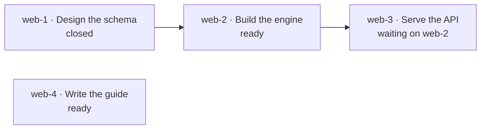

# Concepts

Ntasks keeps work as tasks that people and AI agents share. This page
introduces its ideas in the order you meet them, from a single task to the
rules that let many agents work on one graph at once.

It describes the task model. The [README's status table](../README.md#status)
shows which parts of it run today.

## Projects

A **project** holds the tasks for one body of work, such as one repository or
one product. Each project has a short **prefix** of lowercase letters and
digits, such as `web`, and every task id in the project starts with it.

## Tasks

A **task** is one piece of work. It has:

- a **title**: the outcome, in plain words;
- a **description**: what to do, why, and where;
- **acceptance**: the proof that the work is done;
- **notes**: what the people and agents working on it record as it moves,
  such as progress and findings;
- a **design**: how the work is to be built;
- an **estimate**: how long the work should take, in whole minutes;
- **external links**: pages outside Ntasks the work concerns, such as a pull
  request or a document, each a URL with a title;
- a **type**: `task`, `bug`, `feature`, `chore`, `epic` or `decision`;
- a **priority**, from `0`, the most urgent, to `4`;
- a **status**, one of:
  - `open`: not started;
  - `in_progress`: someone has claimed it and is working on it;
  - `blocked`: set aside because something outside the task graph stops it,
    such as a missing credential;
  - `deferred`: set aside until a date recorded on the task;
  - `closed`: finished, with a record of how it ended.

A task's **id** is its project's prefix, a hyphen and a short key of lowercase
letters and digits, such as `web-a1b2`.

## Custom fields

A project can define **custom fields**: the facts its own work tracks, such
as a severity or a number of points. Each field has a name and a type: text,
a number, a date, one option from a list, several options from a list, a
URL, or yes or no. Each task in the project can carry a value of each field,
and lists of tasks can be narrowed to those holding a value.

A field that is no longer wanted is **retired**: it takes no new values, and
the values tasks carry stay, with their history.

## Dependencies

Tasks connect to each other. When task B **depends on** task A, B waits until
A is closed. A dependency is also called a blocking link: A blocks B. B keeps
the status `open` while it waits; the `blocked` status is only for reasons
outside the graph.

Each arrow points from a task to the task that waits on it. Four more kinds
of link record context without making anything wait:

- **related** connects tasks about the same subject;
- **discovered from** points a new task at the task whose work turned it up;
- **duplicates** points a task at an earlier task for the same work;
- **supersedes** points a task at the task it replaces.

## Ready work

A task is **ready** when someone can start it now:

1. its status is `open`;
2. every task it depends on is closed;
3. its parent is not waiting either: a parent that waits on an open task holds
   every task under it, at any depth;
4. neither it nor its parent is deferred to a later date;
5. no approval is pending on it.

In the graph above, `web-2` and `web-4` are ready and `web-3` is not. An
approval is never listed as ready work itself, because a person answers it.

Ntasks works out readiness on the server, from the whole graph. Every agent
that asks for work it can start gets the same answer, and no agent reads the
graph itself to decide.

## Epics

An **epic** is a task whose work is done by its children. A child's id adds a
number to its parent's: `web-a1b2` has the children `web-a1b2.1`, `web-a1b2.2`
and so on. Work too large for one working session becomes an epic with
children that each fit in one. An epic can close once all of its children are
closed, and Ntasks lists the epics that can.

## Claiming a task

To start a task, an agent or a person **claims** it: the task becomes
`in_progress` and records who holds it. Only one claim succeeds. When two
agents claim the same task at the same moment, one gets it and the other is
told it is taken.

A claim is a reservation, not a timer. Ntasks never gives a task to someone
else because time passed. To release a task that someone holds, first check
that they stopped working on it, and keep the progress they recorded.

## Closing a task

Closing a task records how the work ended and the evidence for it, such as a
commit or a URL. Most tasks close as **done**. A task can also close as
`wont-do`, `duplicate` (naming the other task), `cant-reproduce`,
`already-handled` or `no-longer-needed`, still with the evidence that decided
it.

A closed task can be reopened. Reopening keeps its history, including the
first close and its evidence.

## Decisions and approvals

Some steps only a person can take. Ntasks has two kinds.

- A **decision** asks a person to choose between options. Each option has a
  short label, and at most one is marked as recommended. The person's choice
  is recorded on the task.
- An **approval** holds a task until a person approves a named action, such
  as a deployment. While the approval is pending, the task is not ready, so
  no agent starts it.

A task's **proposal** is what a person answers: its title, description,
acceptance, type and options. For an approval, that is the exact action it
asks for, with its environment, scope and verification. The **proposal
version** is a short hash of the proposal, so it changes whenever the
proposal does.

An **answer** records the option the person chose (for an approval, approve
or decline), the person's exact words as a quote, where they said it, who
recorded it, and the proposal version it answered. Ntasks never reads the
quote to decide what it means: a quote such as "maybe" is kept as given.

Only a person signed in to the web app answers a decision or approves an
approval directly; an agent or a service cannot, whatever projects it was
granted. An agent may record an answer a person gave it somewhere else, such
as in a chat: it names the option, the quote, where it was said and the
proposal version it showed the person. Ntasks records that answer as relayed
by that agent, and refuses it when the proposal has changed since that
version, so a task edited after the person answered cannot borrow the answer.
The person can dispute a relayed approval: the approval opens again, and the
tasks waiting on it are told to stop until a new approval.

## History and comments

Every change to a task is recorded with who made it and when. **Comments** add
notes and evidence while the work moves.

## Retrying safely

A network can fail after a request arrives but before its answer returns, so a
caller cannot always tell whether its change happened. Each change can carry
an **idempotency key**, a name the caller picks for that one change.

- Sending the same change again with the same key returns the first result;
  the change happens once.
- Sending a different change with a key already used is refused.

## Metadata

Other systems can attach structured **metadata** to a task. NoticeOS, for
example, attaches its estimate of what the work is worth. Ntasks stores and
returns metadata; it does not depend on any one system's fields.

## Ntasks and Beads

[Beads](https://github.com/gastownhall/beads) is a command-line issue tracker
built for AI coding agents. Ntasks follows its task model: the dependency
graph, ready work, claims, epics, decisions and approvals. It implements that
model itself, in a Cloudflare Durable Object, instead of running Beads.

| | Beads | Ntasks |
|---|---|---|
| Runs as | A command-line tool over a Dolt database | A Cloudflare Worker and a Durable Object with its own SQLite database |
| Reached by | The `bd` command | HTTP and the Model Context Protocol |
| Task ids | A prefix may contain hyphens, as in `web-app-a3f8e9` | A prefix has no hyphens, so it ends at the first one |
| History | Dolt versions the whole database, with branches and merges | Each task records its own changes; there are no branches |
| Claims | Can expire as leases | Last until released or the task closes |
| Repeatable work | Templates for multi-step workflows (formulas and molecules) and short-lived tasks (wisps) | Not part of Ntasks |
