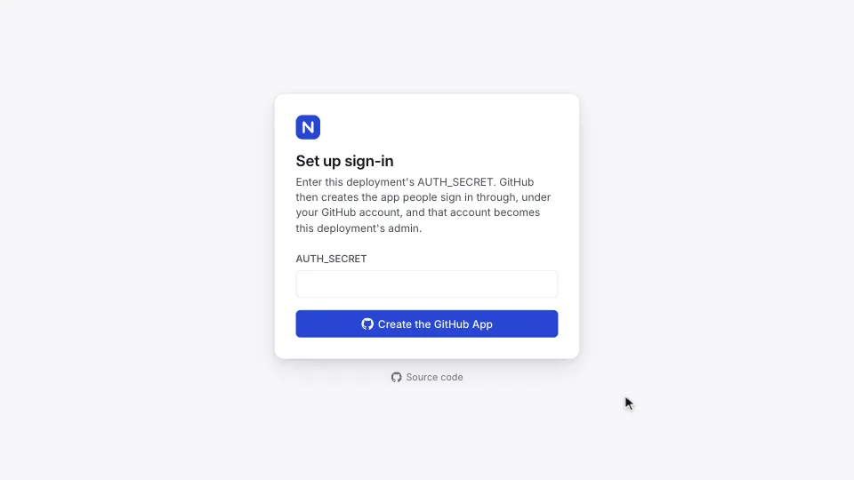

# Deploy and run Ntasks

How to deploy Ntasks to your own Cloudflare account, set it up the first
time, and run it on your machine.

## Deploy your own

```sh
npx ntasks deploy
```

This deploys the latest Ntasks release to your Cloudflare account: one
Worker, its D1 database and the Durable Object that holds the tasks.

- **You need** Node.js and a Cloudflare account, and no copy of this
  repository.
- **It ships** the npm package [`ntasks`](../tools/cli/README.md), which holds
  the built Worker, the web app and the D1 migrations, and deploys them with
  wrangler.

The first run:

1. Opens Cloudflare's login in your browser (`wrangler login`), unless
   wrangler is logged in already or `CLOUDFLARE_API_TOKEN` is set.
2. Creates a D1 database named `ntasks`, or uses the one of that name the
   account already has, as after a first run that stopped, and applies the
   D1 migrations it lacks. `--dry-run` names the database first; when it is
   not Ntasks's, choose another name with `--name`.
3. Makes an `AUTH_SECRET` and deploys a Worker named `ntasks` with it.
4. Prints the Worker's address and the `AUTH_SECRET`. Keep a copy: the
   [setup page](#set-up-sign-in) asks for it, and the command shows it only
   on this run.

| Option | What it does |
|---|---|
| `--dry-run` | Prints the plan and changes nothing in the account. |
| `--name <name>` | Names the Worker and its D1 database, when `ntasks` is taken. |
| `--account <id or name>` | Chooses the Cloudflare account when your login reaches several. |

The command stops without changing anything when:

- your login reaches several accounts and none is chosen;
- the account's Worker of that name is not an Ntasks deployment: its deployed
  version lacks the `TASK_STORE` Durable Object binding to the class
  `TaskStore` or the D1 binding `DB`, or it has no deployed version and no D1
  database of its name.

An update replaces the Worker's code and applies migrations to its database.
When the account holds other Workers, run it with `--dry-run` first: the plan
names the account, the Worker, the database and the migrations.

### Update

Run `npx ntasks deploy` again. It:

1. finds the Worker in the account by name, and keeps the D1 database the
   Worker is bound to;
2. applies the D1 migrations that database lacks;
3. deploys the latest release, and prints the release before and after.

The Worker's secrets stay as they are, and each workspace's task store applies
its own migrations when it next starts. `npx ntasks@<version> deploy` deploys
that release in place of the latest.

npx runs a global or project install of `ntasks` as it is, without looking
for a newer release. Such a copy reads the latest release from the npm
registry first. When that is newer, the command prints both releases and
`npx ntasks@latest deploy`, and deploys the older release only when you
confirm in the terminal. When the registry cannot be reached, it says the
check was skipped and deploys.

Nothing is kept on your machine between runs: each deploy tags the Worker's
version with its release, such as `v0.1.0`, and the next run reads the tag.

**Moving to `npx ntasks deploy`.** A deployment made with the button or from a
checkout can move to it, with `--name` set to its Worker's name when that is
not `ntasks`; the first run shows its current release as unknown. A Worker
connected to a repository still deploys that repository on each push, so
disconnect it in the Cloudflare dashboard under Workers & Pages, the Worker,
Settings, Builds.

### Deploy with the button

[](https://deploy.workers.cloudflare.com/?url=https://github.com/notice-cx/Ntasks)

The button copies this repository into your GitHub or GitLab account and
deploys that copy to your Cloudflare account. The copy has no link back to
this repository, so new releases reach it only when you bring them into it
yourself.

- **It asks for one secret,** `AUTH_SECRET`: a random value of at least 32
  characters. Make one with `openssl rand -base64 32`, and keep a copy for the
  setup page below.
- **On Cloudflare's deploy page,** the build command is `pnpm run build` and
  the deploy command is `pnpm run deploy`; set them if the page shows others.
  The build command builds the web app. The deploy command applies the D1
  migrations to the database, then deploys the Worker.
- **Each push** to your copy's `main` branch runs both again.

### Deploy from a checkout

To deploy a change of your own from a checkout of this repository, run these
from its root after `pnpm install`:

```sh
pnpm run build
pnpm --filter @ntasks/api exec wrangler login
pnpm --filter @ntasks/api exec wrangler secret put AUTH_SECRET
pnpm --filter @ntasks/api exec wrangler deploy
pnpm --filter @ntasks/api exec wrangler d1 migrations apply DB --remote
```

These deploy a Worker named `ntasks` with a D1 database named `ntasks`.

- **Names already taken.** If your Cloudflare account already has a Worker or
  a D1 database by that name that is not this deployment, change `name` and
  `database_name` in `wrangler.jsonc` first: `wrangler secret put` would set
  the secret on the existing Worker, and the deploy would bind the existing
  database. A `database_id` left in `wrangler.jsonc` by an earlier deployment
  wins over the name, so remove it too when you want a separate database.
- **What each command creates.** `wrangler secret put` asks for the secret
  and offers to create the Worker when it does not exist yet. The first
  `wrangler deploy` creates the D1 database, or connects to one of that name,
  creates the Durable Object that holds the tasks, and writes the database's
  id into `wrangler.jsonc` as `database_id`; the migrations step then finds
  the database by that id.
- **Before you commit.** The repository's `wrangler.jsonc` leaves the id out
  so it works in any account, so remove that `database_id` line before you
  commit anything in the file.
- **Deploying on each push.** Commit any `name` and `database_name` you
  changed, without the `database_id`, to the branch you deploy from. Then
  connect the Worker to the repository in the Cloudflare dashboard under
  Workers & Pages, the Worker, Settings, Builds, with the build and deploy
  commands above.

To update a deployment made from a checkout, bring the checkout to the latest
`main` and run `pnpm install`, `pnpm run build` and `pnpm run deploy` from its
root. `pnpm run deploy` applies any new D1 migrations, then deploys the
Worker. A deployment connected to Builds updates on each push instead.

### Set up sign-in

When the deploy finishes, set up sign-in with GitHub on the deployment's
setup page:

1. Open `/sign-in` at the Worker's address, such as
   `https://ntasks.<your subdomain>.workers.dev/sign-in`. `npx ntasks deploy`
   prints the address, and the Workers & Pages page of the Cloudflare
   dashboard shows it.
   - Sign-in is bound to the address the setup runs at, so use the one
     people will use.
   - On a custom domain, use one that
     [Google Safe Browsing](https://transparencyreport.google.com/safe-browsing/search)
     does not list as unsafe: Chrome blocks GitHub's return to the sign-in
     callback on a domain it lists, even when the deployment's own address
     is not listed.
2. Enter `AUTH_SECRET`, the one `npx ntasks deploy` printed or the one you
   made, and choose **Create the GitHub App**.
3. GitHub shows the app it will create under your GitHub account. Create it.
4. GitHub returns to Ntasks and asks you to authorize the app. You are
   signed in as the deployment's admin.

<picture>
  <source media="(prefers-color-scheme: dark)" srcset="images/walkthrough-setup-dark.webp">
  
</picture>

[The setup page](sign-in.md#the-setup-page) describes what each step
checks, and [Settings](sign-in.md#settings) the optional secrets that
replace it with a GitHub OAuth app you register yourself.
[How an AI agent connects](sign-in.md#how-an-ai-agent-connects)
describes the steps an MCP client takes.

## First run

A new deployment, or `pnpm dev`, needs `AUTH_SECRET` first
([Sign-in](sign-in.md#settings)). Then:

1. **Set up sign-in.** Open `/sign-in` at the deployment's address and run
   the [setup page](sign-in.md#the-setup-page). The GitHub account
   that creates the app is the deployment's admin.
2. **Create a workspace.** An admin who belongs to no workspace sees one
   step, New workspace, and owns the workspace it creates. A workspace keeps
   its own projects, tasks and members apart from every other. Its owner
   renames it in Settings, Workspace.
3. **Create a project.** Settings, Projects opens with New project: a name and
   a prefix, the letters and digits that start every task id in the project
   (`web` gives `web-a1b2`). In Settings, Members, an owner invites people by
   GitHub username; each joins when they first sign in.
4. **Connect an agent.** Run
   `curl -fsSL https://raw.githubusercontent.com/notice-cx/Ntasks/main/install.sh | bash`
   on the agent's machine, or add the MCP endpoint, `<address>/api/mcp`, to
   an MCP client by hand ([Connect an agent](agents.md)). The client signs in
   with OAuth, and you allow it and choose its projects on the approval page
   ([How an AI agent connects](sign-in.md#how-an-ai-agent-connects)).

A person in two or more workspaces switches between them from the workspace
name at the top of the sidebar.

## Run it locally

You need Node.js at the version in [`.node-version`](../.node-version) and pnpm
at the version in `package.json`'s `packageManager` field;
[CONTRIBUTING.md](../CONTRIBUTING.md#set-up) shows how to install them. No
Cloudflare account is needed: local runs and tests use a local database.

```sh
pnpm install
pnpm --filter @ntasks/api exec wrangler d1 migrations apply DB --local
pnpm dev
```

The second command creates the local D1 database's tables. Run it again after
pulling a change that adds a D1 migration.

`pnpm dev` builds the web app and starts the Worker at
[http://localhost:8787](http://localhost:8787). The health check at
`/healthz` answers `{"ok":true}`.

To check a change the way CI does:

```sh
pnpm lint
pnpm format:check
pnpm typecheck
pnpm test
pnpm build
```
