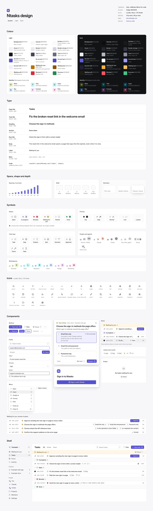

# Design system

The web app's tokens, symbols and components, and the rules for using them.
The code is in three places in [`@notice-cx/ntasks-ui`](../packages/ui/README.md), the
package that holds the web app's pages:

| Path | Holds |
|---|---|
| [`packages/ui/src/index.css`](../packages/ui/src/index.css) | The tokens: colours for light and dark, the type scale, radii, shadows and motion, as CSS variables that Tailwind reads through `@theme inline` |
| [`packages/ui/src/components/ui/`](../packages/ui/src/components/ui/) | The components and the symbols that draw tasks, people and agents |
| [`packages/ui/src/lib/symbols.ts`](../packages/ui/src/lib/symbols.ts) | Which status, priority and type mark a task gets, and which avatar a person or agent gets |

The gallery, the page `/design` of the web app, draws every token, symbol and
component from that code. Open it at http://localhost:5173/design with
`pnpm --filter @notice-cx/ntasks-ui dev`, or at http://localhost:8787/design with
`pnpm dev`. Its theme switch draws it in light or dark whatever the system
prefers. `pnpm screenshots design` captures it in both themes
([tools/screenshots](../tools/screenshots/README.md)):

<picture>
  <source media="(prefers-color-scheme: dark)" srcset="images/design-dark.webp">
  
</picture>

## The rules

- Body text is 14 px. A list row is one line, 36 px tall.
- Greys order the text: Text for titles and values, Text 2 for body and
  labels, Text 3 for ids, ages and other facts.
- Accent, the Notice blue that [notice.cx](https://www.notice.cx) uses,
  marks the one primary action in a view, the focused control, the selected
  item and work in progress. Nothing else is that blue.
- Amber means only Waiting for you. Red means only Blocked. Green means only
  Done. No other state, warning or error uses these colours.
  One host exception: a host page that draws Precise beside alerts of its own
  keeps amber for a warning and red for an error
  on those alerts, always beside a word or a symbol that says the same. A
  task's state there keeps the meanings above.
- Plum means only a task's priority, and only Top and High: the work to do
  first.
- Every action has a key, and the control shows it in a `Kbd`.
- A row shows its task's id.

## Colour

Light is the root's theme. `.dark` on the app's root element switches every
token, and [`NtasksApp`](../packages/ui/src/NtasksApp.tsx) sets it while its
theme is dark: always, never, or while the system prefers dark. The
package's stylesheet applies only inside that root element, `[data-ntasks]`
([the package's styles](../packages/ui/README.md#styles)). `.light` or `.dark` on any element draws that element's subtree in that
theme, which the gallery uses to show both palettes side by side. A part of a
page drawn in a theme of its own goes in a `ThemeScope` (`popover.tsx`), so the
popovers opened inside it render inside it and take its theme too.

A token's variable name, without `--`, is its Tailwind colour: `--ink-3` is
`text-ink-3`, `--canvas` is `bg-canvas`. Components use the utilities and never
a hex value.

| Name | Variable | Light | Dark | Role |
|---|---|---|---|---|
| Background | `--background` | `#FFFFFF` | `#111216` | Main content |
| Canvas | `--canvas` | `#F6F6F8` | `#0B0C0F` | The sidebar and page edges |
| Surface | `--surface` | `#FAFAFB` | `#17181D` | Group headers, code, panels |
| Hover | `--hover` | `#F1F1F4` | `#1D1E24` | A hovered row or item, the current sidebar item |
| Border | `--border` | `#E8E8ED` | `#25262D` | Dividers, the edges of fields and buttons |
| Border strong | `--border-strong` | `#D4D4DC` | `#363741` | The Normal priority tag's ring, keys |
| Text | `--ink` | `#17171C` | `#EDEDF1` | Titles, values |
| Text 2 | `--ink-2` | `#474852` | `#B3B5BF` | Body, labels |
| Text 3 | `--ink-3` | `#696B76` | `#8A8D98` | Ids, ages, counts, placeholders, icons in controls |
| Accent | `--accent` | `#2745D4` | `#4565EF` | Primary buttons, focus, in progress |
| On accent | `--on-accent` | `#FFFFFF` | `#FFFFFF` | Text and icons on Accent |
| Accent text | `--accent-text` | `#2745D4` | `#B0B9FF` | Links, task ids in text, code keywords |
| Accent soft | `--accent-soft` | `#EEF0FF` | `#1C2347` | The selected option, the focus halo of a field |
| Waiting for you | `--wait` | `#B57100` | `#F0B13C` | The Waiting for you mark |
| Waiting text | `--wait-text` | `#8A5300` | `#F3C062` | Amber words: the Waiting for you heading and count |
| Waiting soft | `--wait-soft` | `#FDF5E6` | `#221C10` | The Waiting for you group's background |
| Blocked | `--block` | `#D22F3D` | `#F2565F` | The Blocked mark |
| Success | `--done` | `#1E8A4F` | `#46C486` | The Done mark, strings in code |
| Priority | `--priority` | `#9429A5` | `#A441B3` | The Top priority tag |
| On priority | `--on-priority` | `#FFFFFF` | `#FFFFFF` | The Top tag's figure |
| Priority text | `--priority-text` | `#9429A5` | `#DE9BE9` | The High tag's figure |
| Priority soft | `--priority-soft` | `#FCE9FE` | `#36193A` | The High tag's fill |

The marks have four tokens of their own:

| Variable | Light | Dark | Role |
|---|---|---|---|
| `--avatar` | `#E3E3EA` | `#30313B` | A person's circle |
| `--avatar-ink` | `#33343C` | `#E6E6EC` | A person's initials |
| `--mark-bg` | `#FFFFFF` | `#1B1C22` | An agent's circle |
| `--blossom` | `#000000` | `#FFFFFF` | Codex's mark |

The identity palette gives each workspace's icon a colour of its own, and
nothing but a workspace's icon uses it. Its six hues stay apart from Accent,
amber, red and green, so none reads as a state. Fuchsia shares Priority's
hue, and the two never meet: a workspace's icon shows in the sidebar, the
workspace menu and Settings, where no priority tag does. Each letter is at least
4.5:1 on its fill in both themes, which `packages/ui/test/design.test.tsx`
checks. These tokens have no Tailwind names: `WorkspaceIcon` reads them with
`var()`, so no other component can draw with them through a utility.

| Hue | Fill, letter | Light | Dark |
|---|---|---|---|
| Olive | `--identity-olive`, `--identity-olive-ink` | `#E5EFCA`, `#4C5A01` | `#2F3710`, `#CCDE9A` |
| Teal | `--identity-teal`, `--identity-teal-ink` | `#C5F5EE`, `#046059` | `#003C37`, `#8CE8DD` |
| Cyan | `--identity-cyan`, `--identity-cyan-ink` | `#C8F2FE`, `#035C6F` | `#033946`, `#8DE3FC` |
| Sky | `--identity-sky`, `--identity-sky-ink` | `#DAECFF`, `#085491` | `#193550`, `#B4D8FF` |
| Fuchsia | `--identity-fuchsia`, `--identity-fuchsia-ink` | `#F9DFFF`, `#6F397B` | `#402846`, `#EFC2F9` |
| Pink | `--identity-pink`, `--identity-pink-ink` | `#FFE0ED`, `#81315C` | `#492537`, `#FFBFDC` |

An error, such as a field the server refused or a request that failed, is
not red: its words are in Text after a `circle-alert` icon, and a refused
field is ringed in Text.

These are the only colour names `index.css` defines.

## Type

Two typefaces, both served with the app from exactly pinned packages and
never from a font service:

- **Inter**, variable, with its optical-size axis
  (`@fontsource-variable/inter`, `opsz.css`). The body turns on two of its
  character variants: `cv05`, a lowercase l with a tail, and `cv08`, a
  capital I with serifs, so `l`, `I` and `1` differ.
- **JetBrains Mono**, variable (`@fontsource-variable/jetbrains-mono`), for
  code.

The Worker's own pages (sign-in, agent approval, an expired link) are HTML
the Worker writes, outside the app's build. They load Inter's Latin file
from `/fonts/inter-latin-opsz-normal.woff2`, which the build copies from the
same pinned package (`packages/ui/server-fonts.config.ts`), and fall back to the
system's sans serif for other scripts. Their colours are copies of the tokens
in `workers/api/src/access/page-look.ts`; `packages/ui/test/design.test.tsx`
fails when one differs from `index.css`.

`nums` sets tabular figures and turns off Inter's contextual alternates, so a
hyphen between figures stays a hyphen. Ids, ages and counts use it.

| Utility | Size / line height | Weight | Use |
|---|---|---|---|
| `text-task-title` | 26 / 34, tracking −0.018em | 600 | A task page's title |
| `text-page-title` | 20 / 28, tracking −0.012em | 600 | A page's title in its top bar |
| `text-heading` | 18 / 26, tracking −0.01em | 600 | A card's title, such as a decision's |
| `text-body` | 15 / 25 | 400 | Task text: description, Done when, comments |
| `text-sm` | 14 / 20 | 500 for row titles, 600 for sections | The interface's body: rows, sections, option labels |
| `text-nav` | 13.5 / 20 | 500 | Sidebar items |
| `text-label` | 13 / 20 | 500 | Labels, buttons, fields, menu items, group headings |
| `text-code` | 13 / 21 | 400 | Code, with `font-mono` |
| `text-meta` | 12.5 / 16 | 400 | Ids, ages, row facts, small buttons |
| `text-xs` | 12 / 16 | 500 | Counts, the sidebar's section headings |
| `text-chip` | 11.5 / 16 | 500 | Badges |
| `text-kbd` | 11 / 16 | 500 | Keys |

Text is sentence case. Nothing is set in capitals for emphasis.

Task text is Markdown (`src/routes/tasks/task-markdown.tsx`), at `text-body`.
Its headings sit below the page's own in the outline (`#` is an `h3`) and
above the text in size: `#` is `text-heading`, `##` 16 / 24, and the rest
`text-body`, all 600. Code blocks are `text-code` on Surface with a Border
ring; links and task ids are Accent text; a checklist's box is 15 px, ringed
in Border strong, and filled in Accent with a white tick once ticked.

An http or https address written out in a task's title, its text, a comment,
a code block, inline code or a step's command is a link that opens in a new
tab with no opener and no referrer (`LinkedText` in
`src/components/ui/linked-text.tsx` for plain text). Its words stay as
written, so a code block's Copy button copies them unchanged. No other
scheme becomes a link.

## Spacing and radius

Spacing is a 4 px grid: Tailwind's steps, where `1` is 4 px. The steps in use
are 2, 4, 6, 8, 12, 16, 20, 24, 32 and 40 px (`0.5` to `10`), with half
steps, such as 5, 7, 9 and 22 px, where a component's alignment needs them.

| Utility | Radius | Use |
|---|---|---|
| `rounded-sm` | 4 px | Keys, project badges, menu items |
| `rounded-md` | 6 px | Buttons, fields, tabs |
| `rounded-lg` | 8 px | Menus, popovers, decision options |
| `rounded-xl` | 12 px | Panels and cards |
| `rounded-full` | | Avatars, badges, counts |

## Borders and elevation

A border is 1 px of Border. A control or panel draws it as an inset ring
(`inset-ring inset-ring-border`), which takes no layout space; a divider
between rows or regions is `border-b border-border`.

| Elevation | Classes | Use |
|---|---|---|
| Flat | `inset-ring inset-ring-border` | Rows, fields, panels |
| Raised | `inset-ring inset-ring-border shadow-raise` | Secondary buttons |
| Popover | `shadow-pop` | Menus, popovers, cards that stand above a page |

`shadow-pop` starts with a 1 px ring, so a popover needs no border of its own.

## Motion

Motion shows a change and nothing else:

- a hover or a press recolours in 120 ms (`duration-120 ease-out`);
- a menu or popover appears in 120 ms, fading in and settling 2 px
  (`motion-safe:animate-pop-in`);
- a page arrives by fading in and rising 6 px (`page-arrive`);
- a loading block shimmers after 180 ms (`skeleton`).

Under `prefers-reduced-motion`, nothing moves: components gate movement with
`motion-safe:`.

## Icons

Icons are [Lucide](https://lucide.dev), through `lucide-react`. `App.tsx`
sets every icon to 16 px with a 1.75 stroke (`LucideProvider`). A control
sizes the icons inside it:

| Size | Where |
|---|---|
| 16 px | Sidebar items, icon-only buttons, top bars |
| 15 px | Inside `md` buttons, menu items and fields |
| 14 px | Inside `sm` buttons, row facts, a group heading's chevron |
| 12 px | Inside badges, the Recommended star |

An icon inside a control is Text 3; on Accent it is white. An icon is
decorative (`aria-hidden`) unless it is the control's only content, and then
the control has a label (`IconButton`). The icons the app uses: `search`,
`plus`, `list-filter`, `chevron-down`, `chevron-right`, `ellipsis`, `check`,
`x`, `list`, `target`, `activity`, `bell`, `settings`, `hand`, `user-plus`,
`tag`, `calendar`, `clock`, `moon`, `link`, `git-pull-request`, `git-merge`,
`git-branch`, `message-square`, `corner-down-left`, `pencil`, `copy`, `undo-2`,
`paperclip`, `keyboard`, `command`, `arrow-up-right`, `send-horizontal`,
`star`, `inbox`, `circle-alert`, `bot`, `chevrons-up-down`, `folder`,
`folder-input`, `users`,
`building-2`, `arrow-up-down`, `arrow-up-narrow-wide`,
`arrow-down-wide-narrow`, `chart-no-axes-column` and
`git-commit-horizontal`.

## Symbols

Every symbol is coloured by tokens, so it follows the theme. Each is an
inline SVG, apart from the priority tag, which is text.
A mark that carries meaning on its own has an accessible name, such as
"Blocked" or "High priority"; next to words that say the same, it takes
`label={null}` and is hidden from screen readers.

### Status

Six circles, 14 px in rows and 20 px in headings. `statusMarkFor` picks one
for a task, testing these in order:

| Mark | Name | A task shows it when |
|---|---|---|
| Green circle with a tick | Done | it is closed. A close where nothing shipped (won't do, duplicate, can't reproduce, already handled, no longer needed) draws the same mark in Text 3 (`muted`) |
| Dashed grey circle | Parked | it is set aside until a date (stored status `deferred`) |
| Amber ring with a dot | Waiting for you | a person must answer it: an approval or a request to do steps, or a ready task labelled `human` that nobody has answered (see [decisions, approvals and steps to do](concepts.md#decisions-approvals-and-steps-to-do)) |
| Red disc with a bar | Blocked | its stored status is `blocked`, or it is open and depends on a task that is not closed |
| Blue ring, half filled | In progress | someone has claimed it |
| Grey ring | Open | none of the above, including a status the app does not know |

A list groups its rows in the order Waiting for you, In progress, Open,
Blocked, Parked, Done.

### Activity

Three marks for a task in progress on the Live page, 14 px in rows and in
the group headings. `activityOf` (`src/lib/live.ts`) picks one from the
task's last activity, when its holder last changed or commented on it:

| Mark | Name | A task in progress shows it when |
|---|---|---|
| Blue disc in a faint blue ring | Active | its holder wrote to it within the last hour |
| Blue ring, half filled (the In progress mark) | Quiet | its holder last wrote to it an hour ago or more, and less than a day ago |
| Grey ring, half filled | Stalled | its holder has not written to it for a day or more, or nothing is recorded: the server's rule, `isStalled` in `@ntasks/domain` |

The marks differ in fill and lightness as well as colour, so they read apart
without colour. They use Accent and greys only: amber, red and green keep
their single meanings.

### Priority

A tag that says the priority's figure, P0 to P4: 22 by 16 px, 4 px corners,
11 px semibold figures. Plum goes only to Top and High, the work to do first;
the others are grey, and the figure tells every level apart without colour.

| Priority | Word | Tag |
|---|---|---|
| 0 | Top | `P0` in On priority on Priority |
| 1 | High | `P1` in Priority text on Priority soft |
| 2 | Normal | `P2` in Text 2, ringed in Border strong |
| 3 | Low | `P3` in Text 3 |
| 4 | Lowest | `P4` in Text 3 |

A priority outside 0 to 4 takes the nearest figure and word.

`PriorityMark` with a name is a button: its accessible name is the word ("High
priority"), and its [tooltip](#tooltip-tooltiptsx) says the figure and the
word, "Priority 1 · High". Pressing it shows the tooltip and does nothing else.
With `label={null}`, beside the word in a fact or a menu, it is only drawn and
takes no focus. `packages/ui/test/design.test.tsx` holds the Top and High
tags' figures at 4.5:1 on their fills, and the Top tag at 3:1 on Background
and Hover, in both themes.

### Type

A Lucide icon in Text 3. A type the app does not know shows `square-dashed`
and its own word.

| Type | Word | Icon |
|---|---|---|
| `task` | Task | `list-checks` |
| `bug` | Bug | `bug` |
| `feature` | Feature | `lightbulb` |
| `epic` | Epic | `layers` |
| `decision` | Decision | `split` |
| `gate` a person answers | Approval | `stamp` |
| `chore` | Chore | `wrench` |
| `gate` a system answers | Gate | `hourglass` |

### Avatars

`Avatar` draws a person or an agent at 18 px (sidebar), 20 px (rows), 28 px
(headings) or 40 px. `avatarFace` decides what it shows. An actor is an
agent when the API records it as one (`agent:<name>`, or `service:<name>`
and `service:<name>/<agent>` for a service and the agent it acts for; see
[Sign-in](sign-in.md)) or its name is one the old task hub recorded for an
agent, such as `codex/root`, when it named a model, or when the caller
passes `agent`. Only an agent gets a mark:

- **Claude**, an agent whose name or model mentions Claude or Anthropic: the
  Simple Icons Claude mark in `#D97757`, on a ringed circle.
- **Codex**, an agent whose name or model mentions Codex, OpenAI or GPT:
  OpenAI's Blossom, its path unchanged, black on light and white on dark, on
  a ringed circle.
- **Any other agent**: Lucide's `bot` in Text 2, on a ringed circle.
- **A person**, whatever their name says: up to two initials, the first
  letters of the first and last words of their name, in Avatar text on
  Avatar.

Every mark is drawn at 62% of the circle's width (`avatarMarkSize`). Claude's
mark fills its box, and the Blossom's box is cropped with a margin around
its drawing, so Codex's mark is never drawn larger than Claude's;
`packages/ui/test/symbols.test.tsx` checks both. `live` adds an Accent dot for an actor
active now: in the sidebar, one who changed or commented on a task in progress
within the last hour. `AvatarGroup` overlaps avatars by 6 px, each ringed in Background.

### Workspaces

`WorkspaceIcon` draws a workspace: the first letter or digit of its name,
uppercase and semibold, on a square with 5.5/20 corners, 20 px in the
sidebar, 16 px in the workspace menu and 32 px on Settings. `workspaceMark`
(`src/lib/symbols.ts`) picks its hue from the [identity palette](#colour)
by a hash of the workspace's id, so a rename changes the letter and keeps
the colour, and about one pair of workspaces in six shares a colour. The
workspace's name always stands beside it, so it is hidden from screen
readers.

### Logo and brand marks

`NtasksLogo` is a white N on an Accent square with 5.5/20 corners, 28 to 32 px
on a page of its own, such as New workspace. `GitHubMark` draws GitHub's mark
in the text colour, for Sign in with GitHub. The brand paths live in
[`brand-marks.ts`](../packages/ui/src/components/ui/brand-marks.ts) with their
sources.

## Components

Each is in `packages/ui/src/components/ui/`.

### Button and IconButton (`button.tsx`)

| Variant | Look | Use |
|---|---|---|
| `primary` | Accent, white text | The one action a view is for: New task, Approve, Answer |
| `secondary` (default) | Background, Border ring, raised | Every other labelled action |
| `ghost` | No fill until hovered, Text 2 | Actions in a bar or a row where a border would be noise |

| Size | Height | Text | Use |
|---|---|---|---|
| `md` (default) | 30 px | 13 px | Top bars, forms, cards |
| `sm` | 26 px | 12.5 px | Rows, dense bars |

On a touch screen (`pointer: coarse`), `md` is 36 px and `sm` 30 px.

States: hover lightens a primary button by 8% and puts Hover under the others;
keyboard focus draws a 2 px Accent outline 2 px outside the button; disabled
is 45% opacity and takes no pointer events; a button whose action is running
keeps its size and changes its words ("Filing…"). `asChild` gives a link the
button's look.

`IconButton` is square, `ghost` by default, and requires `label`: it is the
accessible name and the tooltip, with the key appended when `shortcut` is
set.

### CopyButton (`copy-button.tsx`)

A small `ghost` button with the Copy icon that copies a text. `label`, such
as "Copy the code", is its accessible name and its tooltip, and stays its
name. After a copy it shows a check and Copied for two seconds, and a status
region beside it says Copied for a screen reader. Where the browser cannot copy, it selects the text instead and a
toast says to copy it with the keyboard. Every code block in task text has
one in its top-right corner, shown on hover, on keyboard focus and always on
a device with a touch screen. A task page's path ends with one that copies the task's id.

### Tooltip (`tooltip.tsx`)

A short line about a control, above it, on Background with `shadow-pop`,
6 px corners and `text-meta`. It shows after a mouse rests on the control for
300 ms, while the control holds focus, and after a press, so a mouse, a
keyboard and a touch screen all reach it. It hides when the mouse leaves,
focus moves on, Escape is pressed or a press lands elsewhere, and it never
takes focus. While it shows, it describes the control (`aria-describedby`);
the control keeps its own name. The priority tag uses it. A control whose
tooltip only repeats its name, such as an `IconButton`, keeps the browser's
own (`title`).

### Kbd (`kbd.tsx`)

A key: 18 px tall, 11 px text in Text 3, a Border strong ring, 4 px corners.
`size="sm"` (16 px) sits inside segmented options. On a primary button it is
white on a translucent white fill. A key is drawn for the eye and hidden from
screen readers, so it never joins the control's name; the control states its
key with `aria-keyshortcuts` (`IconButton` does this from `shortcut`).

### Field, Input, Textarea and Select (`field.tsx`)

A field is 30 px tall (36 px on a touch screen), Background with a Border
ring, 13 px text and a Text 3 placeholder. On a touch screen every text
field, text area and select draws its text at 16 px, because Safari on a
phone zooms in on a field under 16 px when it takes focus and the page then
scrolls sideways. `Input` takes an `icon` at the
start and an `end`, such as the `Kbd` of the key that focuses it.

| State | Look |
|---|---|
| Focused | Accent ring and a 3 px Accent soft halo |
| Refused | Text ring; the error under it after `circle-alert` |
| Disabled | 45% opacity |

`Field` labels a control: the label is a noun in Text 2 above it. A required
field's label ends in an asterisk and its control has `required` and
`aria-required`; other fields carry no mark and are never labelled optional.
`error` is tied to the control with `aria-describedby` and sets
`aria-invalid`. `FieldError` draws an error the same way under a control
that has no `Field`, such as the field in a fact's menu. `Select` is a native
choice among a few fixed values, drawn like a field with the theme's chevron,
as the board's Filter menu uses it.

### Menu (`menu.tsx`)

A list of actions on a popover, 232 px wide: each item is a 15 px icon in
Text 3, a label and its key, 30 px tall; `MenuSeparator` divides groups; an
item with `submenu` ends in a chevron and keeps the menu open, and so does
an item with `keepOpen`, such as Back. On open, focus goes to the first item.
↑ and ↓ move, Enter runs the focused item, an item's letter runs it directly,
and Escape closes the menu. `MenuPanel` draws the list in place, without the
popover.

A menu that picks a value, such as a fact's, gives each value `checked`: the
value held ends in an Accent tick, and the menu opens on it. `MenuContent`'s
`footer` holds what is not an item, such as the field for a value the list
does not hold, under a divider and outside the menu's own keys. A menu with
no items is its footer alone.

The Close menu (`src/components/CloseResolution.tsx`) is a button, Close or
Close as, with a chevron: Done first where the task can be closed as
done, then Done, my call for a person who may accept a task as done on their
own call, then each close where nothing shipped, each with its glyph. A pick
opens the form that finishes it under the task's title. Done, my call's form
lists each criterion of Done when as a box, ticked to start with where its box
on the page is ticked; its button names how many criteria the close waives.

`popover.tsx` is the popover itself: Radix places it and handles focus,
Escape and outside clicks. It renders on the document's body, or inside the
nearest `ThemeScope`.

### Choosing an option (`choice.tsx`)

A decision's options are named by letter, `a` to `f`.

- `Segmented` answers in place on a row: the options side by side in one
  ringed strip, each its key, its label and a star when recommended; one press
  is the answer. On a phone the options wrap, each in its own ring, and a
  label longer than the screen takes more lines.
- `OptionList` is a decision card's list: each option is its key, its label
  in 14 px semibold, its detail in Text 3, and Recommended with a star at the
  end of its line. A press or the option's letter selects it, and the card's
  Answer sends it. The selected option is ringed in Accent on Accent soft.
  `readOnly` draws a choice already made: nothing to press, the chosen option
  ringed with Chosen and a tick.
- `Tabs` switches a page's view, such as All, Active and Done: the current
  view is ringed on Surface, the others are Text 3. `TabLinks` draws a page's
  sections the same way, each a link to its own address, the current one
  marked as the page: Settings's tabs.

`choiceForKey` maps a key press to an option on offer.

The decision card (`DecisionAnswer` in `src/routes/tasks/decision-card.tsx`)
is the question, an `OptionList`, then a Note field, whatever the page seats
beside it (Not now on Focus) and Answer with its `↵`. Answer is disabled
until an option is selected; Enter sends the selected option, and Enter on a
focused option sends that one. Focus draws it on a card with `shadow-pop`,
headed by Your choice, the id, the project and the age; a task's page draws
it under the description.

### Rows (`row.tsx`)

`Row` is one line, 36 px, divided by Border, Hover under the pointer. Its
parts, left to right:

`PriorityMark`, `RowId` (84 px column), `StatusMark`, `RowTitle` (cut with an
ellipsis), `RowMeta` facts (checks `1/3`, comments, `Waits on web-k3m9.2`,
`Until 11 Nov`, on a ready task that is not an epic `Estimate 1h 30m` or
`No estimate` after a `clock` icon from 1024 px wide, where the title keeps
room beside it, on a held task `For page-rebuild-2` and
`Active 12m ago`, and on a closed task how a close where nothing shipped
ended, or where its change is: Built, Merged or Live, and `No proof` on work
done without a commit, pull request or link) and badges,
`RowSpacer`, then `RowActions`, the assignee's `Avatar` and `RowAge` (34 px,
right-aligned), how long since the task last changed. In Waiting for you and
Waiting for merge it is how long since the task was created, so an edit does
not reset how long it has waited, and its tip says so (`Created 3d ago`).

`RowActions` (Claim, the row's menu) show while the row is hovered or holds
focus, and never on a phone; every one is also in the row's menu. A waiting
row puts its answer in `RowAnswer`: Approve, a `Segmented` choice, or
Answer. A row whose answer is a choice is `answer="wide"`: below 1240 px wide
its options take a line of their own under the title, so the title is never
cut to make room for them. When this sign-in cannot answer, the controls are
disabled and each carries the reason as its description (`aria-describedby`;
`Segmented` takes `describedBy`), shown to a pointer as a tip.

`GroupHeader` heads a group: its status mark, its name and its count on
Surface, 36 px. The Waiting for you group is Waiting text on Waiting soft.
The Waiting for you view ends with two groups of closed tasks headed in Text
with a 14 px icon in Text 3: Waiting for merge (`git-pull-request`), the
built ones, and Waiting for deploy (`git-merge`), the merged ones of a project
whose changes go live by a deploy. A
group that folds starts with a chevron and is a button with `aria-expanded`.

### Badges and counts (`badge.tsx`)

- `Badge`: a fact on a row, 20 px, round, Border ring, 11.5 px Text 2: a task
  label after a grey dot, or a type after its 12 px mark. It is never a
  button.
- `Count`: a number in Text 3, or for Waiting for you, Waiting text on
  Waiting soft.
- `Progress`: an epic's or checklist's share done, a 14 px ring filling in
  Accent, then `1/4`.
- `ProgressBar`: an epic's tasks as one bar, 80 px by 6 px, a part per mark,
  each as wide as its share: Done in green, In progress in Accent, Waiting for
  you in amber, Blocked in red, Open in Border strong and Parked hatched, 1 px
  apart. Its name says each part ("222 of 263 done, 5 waiting for you, 14
  blocked"). An epic with no tasks is an empty ring.

### The frame (`shell.tsx`)

`AppShell` puts a 236 px `Sidebar` on Canvas beside the page on Background.
The sidebar holds `SidebarHeader` (the workspace's icon and name, and the
search button), `NavItem`s (a 16 px icon, a name and a count; the current
one on Hover), `NavSection`s with their headings (Projects, People),
`ProjectBadge` (the icon read from a project's website, or its prefix's
first letter in a ringed square) and `SidebarSpacer`, which pushes Settings
and Source code to the foot. `NavItem asChild` makes a router link the item. For a person in
two or more workspaces, and for a deployment admin, the name is a `WorkspaceButton`: the name and a
14 px `chevrons-up-down` in Text 3, Hover under the pointer and while its
menu is open. Its menu lists the workspaces, each with its icon and the open
one ticked, then Settings under a divider, and for a deployment admin New
workspace, which shows the first step's New workspace form in place of the page.

`TopBar` is a page's 56 px header: its title, its `Tabs`, `BarSpacer`, then
search and actions. Below 768 px the board's views leave the top bar for a
row of their own under it. On a phone a task page's top bar holds the task's
id alone as its path, since the project and the epic are facts on the page,
and Close or Close as shows its icons alone when another button is the main
action; an id longer than the room left ends in an ellipsis rather than
widening the page.

On a phone the sidebar is hidden, and inside an `AppShell` the top bar starts
with a Sidebar button (`panel-left`, with `aria-expanded`) that opens it as a
sheet over the page, with focus on its first link. The sheet closes on
Escape, which puts focus back on the button, on a press outside it, on a link
inside it, and when the browser goes back or forward.

### EmptyState (`empty-state.tsx`)

What a list or page shows when it has nothing: a 20 px icon in Text 3 in a
ringed circle, one line that names what is empty ("No tasks waiting for
you"), and the action that fills it, when there is one.

### A task's page

The top bar holds the task's path: its project's badge and name, its epic's
id, then its id. Its end holds Copy link, the More menu (add or edit the
description, Done when, design and notes, add a link, move the task to
another project or epic, copy the id or the link) and the task's verbs, the primary one last: Claim, or Close once
someone holds it; Approve or Answer on a task waiting for you, beside Close
as.

The page is two columns. The left is the reading column, 720 px of text: the
title in `text-task-title`, the form an action opened (in a Surface panel),
how a closed task ended (with where its change is: Built, Merged or Live,
its pull request as a link and its commit, or the link that shows the work,
or No proof), the description, a decision's card or its recorded
choice, Done when as a checklist with its count, Design, Notes, Links, an
epic's Tasks with their `Progress`, and Activity. A section's heading is
`text-sm` semibold with its count in Text 3; an empty description, Done
when, Design, Notes or Links takes no room, and the More menu adds it. The
description, Done when, Design and Notes are Markdown, each edited in place
in a field of `text-code` with Save and Cancel; a pointer finds Edit beside
each one. Links are quiet lines grouped under their relation in Text 3
(Waits on, Holds back, Related, Duplicates, Replaces, a pull request, a
document): a status mark, the id and the title, or for a page outside
Ntasks its icon, title and host, opening in a new tab. A page's line, and
the line of a link the task itself holds, end in Remove, and the heading in
Add link, while pointed at; a link another task holds onto this one (Holds
back, Merges before) is removed from that task's page. Add link opens a
Surface panel under the links: Kind first, a page's (Link, Pull request or
Document) and a task's (Waits on, Related, Duplicates, Replaces or Merges
after), then for a page URL\* and Title\*, both required, or for a task
Task\*, its id. Two tasks hold one link, so a new kind replaces the one the
pair had. Activity is one line per moment, oldest
first: the actor's 20 px avatar (an icon where the read names nobody), what
they did, and its age at the end; a comment's words sit under its line. The
comment box ends the page, with Comment and its `⌘↵`.

The right column is 300 px on Canvas, ruled off by Border: each fact as a
line (`Fact` in `src/components/Fact.tsx`), its name in Text 3 and its value
in Text, an absence such as None or Nobody in Text 3, then when the task was
created and last changed. A fact this sign-in may change is pressable along
its whole line, which turns Hover and shows a chevron while pointed at or
focused, and opens a menu of values; a fact it may not change is only its
words. Below 1024 px wide the facts sit between the title and the text.

A fact's menu is one of four kinds: a value to pick (Status, Priority,
Assignee, Epic), values to turn on and off (Labels), a date with Tomorrow,
In a week and In a month (Parked until, Due), or a value to type, with
presets where there are some (Estimate takes `90`, `45m`, `1h 30m`, `1.5h`
or `1:30` and shows hours and minutes). A typed value that does not fit
shows what is wrong under its field, as `FieldError` draws it, and is not
saved. None takes a value off.

Under Assignee, which names the helper its holder works through (`claude for
page-rebuild-2`), a held task that is not closed shows its holder's work in
hand as facts it may not change: Last activity (`12m ago`), Next step,
Branch, Pull request (a link), Commit, Worktree and Session (a link when it
is a URL), each only when recorded.

After the task's own facts come the custom fields the task holds a value
for, under the names the project gave them, in the order it defined them.
Each field in use opens the menu its type takes: its options for a single
choice, its options to turn on and off for a multiple choice, Yes and No, a
date with Today, Tomorrow and In a week, or a field for text, a number or a
URL, which shows as a link. None takes the value off and the field's line
with it, as turning off the last option of a multiple choice does. Add field, a line in Text 3 under the custom fields, lists the
fields in use that the task holds no value for; picking one shows that
field's menu in its place, and the value saved gives the field its line. It
takes no room when the task holds a value for every field, or when the
sign-in may not change fields. A retired field shows the value a task keeps
as words. Until the project's fields are read, a value is named from its key
(`story_points` is Story points) and is not pressable.

The board's Filter menu offers the custom fields of the one project in view
(the Project filter's, or the only project there is), after the other
filters: a choice of a field's options, or of Yes and No, each with its
count, a date, or a typed value that applies on Enter. Each filter by a
field is part of the address (`field.<key>=<value>`, as the API takes it),
shows as a badge that clears it, and is dropped when another project is
picked.

The Sort menu (`src/routes/tasks/sort-menu.tsx`), a secondary button before
Filter, in every view of the board and on the Epics view, orders each group's
rows by Priority, Created, Last change, Closed or Title, with the one chosen
ticked, then its two directions in its own words: Most urgent first or Least
urgent first, Newest first or Oldest first, A to Z or Z to A. A dated sort
reads newest first until told otherwise; a task without the date it reads,
such as an open task by Closed, comes last either way; a tie keeps the most
urgent first, then the oldest. The button names the order chosen after an
arrow showing its direction, or reads Sort while each list keeps its own
order, which Default order brings back. The order is part of the address
(`sort=created&dir=asc`, the direction only when it is not the sort's own)
and survives Clear filters. The board holds every task it shows, so a new
order reads nothing again; `list_tasks` takes the same orders as `sort` and
`direction` (`@ntasks/domain`'s `taskComparator` is the one copy of the rule).

### Where it stopped

A stalled task's page shows, under its title, a block in the surface of a
closed task's summary: a pause mark, Where it stopped, and how long its holder
has done nothing on it; then the next step, branch, pull request and the
holder's last comment, each on its own line; then Free it, a primary button,
beside one line saying what freeing does. A board row of a stalled task says
Stalled, with the holder's last activity, in place of Active.

### Live

`/tasks/live` lists every task in progress under a `TopBar` titled Live. The bar
holds each group's count after its activity mark (`6 active`, `3 quiet`,
`50 stalled`, from 640 px wide).

The page is three groups, each a `GroupHeader` with its activity mark, its
name, its count and, at its end from 640 px wide, what it holds in Text 3
(Changed in the last hour; Last change 1 hour to 1 day ago; Nothing for 1 day
or more). A group with no tasks takes no room, and a page with none shows
`EmptyState`'s No tasks in progress. In each group the latest activity comes
first and a task with none recorded last. Stalled shows five rows, then Show
more, a `ghost` button with the count it adds.

In each group, a task in an epic sits under its epic's line, 24 px further
in: the `layers` icon in Text 3, the epic's id, its title as a link in Text
2, and at the end its `ProgressBar` and its tasks done of all, as the Epics
view counts them. The epics come in the order of their latest task, and the
tasks in no open epic come last under No epic. A group where no task is in
an epic draws no epic lines.

A row is its activity mark, `RowId`, the title as a link to the task, then
`RowMeta` facts: Next and the next step in Text 2, the pull request's number
as a link after `git-pull-request` or else the branch after `git-branch`, the
helper after `bot`, and Nothing recorded when the holder never wrote to it.
The next step and the branch give way before the title when the row is
narrow. The holder's `Avatar` and `RowAge`, how long since their last
change, end the row. On a phone the row takes two lines: the mark, the
title, the avatar and the age, then the holder's name and the next step in
Text 3.

### Epics

While one project is in view, the board's views end with Epics
(`?view=epics`): the project's open epics, one line each. An epic counts the
tasks directly in it and the tasks of its open sub-epics, all the way down; a
closed sub-epic counts as one done task. The top bar holds how many of the
project's top epics wait for you, move and do not move (from 1024 px wide),
the search, which lists every epic, sub-epics included, whose id or title
holds its words, and New task; the Filter menu's filters narrow tasks, so the
view leaves it out and keeps them in the address for the other views.

The epics fall in five groups, worked out on the page and never written to
the epic, testing these in order (`epicState` in `src/lib/epics.ts`):

| Group | Mark | An epic falls in it when |
|---|---|---|
| No tasks | Open | nothing is filed in it |
| Every task done | Done | it has tasks and none is open: it is ready to close |
| Waiting for you | Waiting for you | a task in it waits for a person |
| Moving | Active | a task in it closed this week or is in progress |
| Not moving | Stalled | none of the above |

This week is the board's own window of closes, which starts seven days back;
the Moving and Not moving headings name its first day ("A task done since
Nov 2"). Each group's heading carries its mark, its name, its count and, from
640 px wide, that rule. In a group, unless the Sort menu names another order, the highest priority comes first, then
the latest change.

An epic's line is a `Row`: a chevron that shows and hides its sub-epics when
it has some, its `PriorityMark`, `RowId`, its group's mark, its title as a
link to the epic, `2 sub-epics` in Text 3, then its facts in columns: the
tasks waiting for you (an amber count after the Waiting for you mark), the
blocked tasks (after the Blocked mark), its `ProgressBar`, its tasks done of
all (`222/263`, all-time), the tasks done this week (`+33 this week` in Text
3), and `RowAge`, how long since it, a task in it or a sub-epic last changed.
A zero leaves its column empty. A sub-epic's line sits 24 px further in under
its parent's. On a phone the facts take a second line.

After the groups, Closed this week folds the epics closed in the board's
window, each with its age, and No epic is one line for the open tasks in no
open epic: how many wait for you and are blocked, how many are open, and how
many closed this week. A project with neither epics nor such tasks shows
`EmptyState`'s No epics in this project; a search that matches no epic, No
epics match this search with Clear search.

### Productivity

`/tasks/productivity` shows what people and agents got done that matters,
day by day, from `GET /api/tasks/wins` ([Wins](api.md#wins)). A win is a
change that merged or went live (a pull request counts once, however many
tasks it closed), an answer a person gave to a task's choices, or an epic
closed as done. No win is a task closed, and nobody is ranked; the chart of
open tasks below shows closes only as context for the open work. The
`TopBar` titled Productivity says Last 7 days (from 640 px wide) and ends
with the project menu: All projects, then each project, the one in view
ticked; a project chosen is kept in the address as `?project=`.

Under the bar, the seven days, today and the six before it in the person's
time zone ([Dates](#dates)), form a strip
of cells (`ol`, named Wins by day). Each cell names its day (`Tue 10`) and its
count of wins, then one bar: shipped in green (Done) under decided in Text
2, each part as tall as its count against the busiest day, and above it a
green ring for each epic finished. A day with no wins says Nothing in Text 3;
it is never red. Today's cell is ringed in Accent. Under the strip, the
week's counts beside their colour keys (shipped, decided, epics finished),
the approvals closed as done in Text 3, and in Text 3 the first day merges
were recorded on when none shipped before.

Between the counts and the feed, between two Border lines, Open tasks
(`BurndownChart.tsx`, from `GET /api/tasks/burndown`,
[Burn-down](api.md#burn-down)) shows the open workload of the last eight
weeks for the project in view: context for the wins, not a score. Its
heading says Last 8 weeks and ends with its key, on a line of its own on a
phone: Open, Created, Done and Closed, not done. Under it, the open count now in
`text-heading` and, in Text 3, how it changed since the first recorded day
(`163 fewer than on Sep 16`). A line in Text 3 under that says today's
tasks created and done, or the day pointed at, or stepped to with ← and →,
Home and End once the chart has focus: `Sat, Oct 24: 12 open, 2 created, 4
done`.

The chart is two panels over one row of dates, each panel with its own
scale, so no two measures share an axis:

| Panel | Draws |
|---|---|
| Open, 112 px | The open count at each day's end as a 2 px line in Text, over a wash of it at 8%, on hairline gridlines at 0, half and the top of a whole-number scale; a dot at today |
| Created and closed, 73 px | Each day's tasks created as a bar in Text 3 rising from a middle line in Border strong, and below it the tasks closed as done in green (Done), then the tasks closed any other way in Text 3 at 60%, 2 px apart. Both halves share one scale, so a day's inflow and outflow compare by length |

The dates under the panels are today and each day a week before it, every
other one on a phone. A day that ended before anything was recorded is a band
in Surface across both panels, which says Not recorded where it spans eight
days or more; the line starts after it, and the band is never drawn as zero.
A project with no tasks in the eight weeks shows No tasks in the last 8 weeks
in Text 3 instead of the chart. A visually hidden table, Open tasks by day,
last 8 weeks, holds every day's counts for a screen reader. While it loads, a
skeleton the chart's height holds its place; a failed read shows
`ReadFailed` there, with Retry, and the wins stay; another project's chart
keeps the last one dimmed until it arrives.

Then each day with wins, newest first, under a `GroupHeader` naming the day
(`Tue, Nov 10`), its count and, from 640 px wide, its wins in words (`42
shipped, 10 decided`). A day shows eight wins, then Show more, a `ghost`
button with the count it adds. Each win is a `Row` ending in `RowAge`:

| Win | Row |
|---|---|
| Shipped | The `git-merge` icon, its first task's `RowId` and title as a link, `and 2 more` when it closed more, the pull request's number as a link after `git-pull-request`, or else the commit's first seven characters after `git-commit-horizontal`, and Merged or Live |
| Decided | The `split` icon, the Decision type's, `RowId`, the title as a link, `Chose` and the option's label, and the person's `Avatar` |
| Epic finished | 48 px tall: the Done mark at 20 px, `RowId`, the title as a link in semibold, and `Epic finished · 33 tasks done` |

At the foot, Show the 7 days before, a `ghost` button, reads the seven days
before the oldest shown, back to eight weeks; there the foot says The feed
reaches back 8 weeks. Seven days with no wins show `EmptyState`'s No wins in
the last 7 days, and an earlier seven days with none a line in Text 3, No wins
from Oct 28 to Nov 3.

### Settings and the first workspace

Settings is one tab at a time under a `TopBar` whose `TabLinks` name the
tabs: Workspace, Projects, Members, GitHub, Apps, Services and You, each at
its own address; a member has no Members, GitHub or Services tab. Below 1024 px the tabs leave
the top bar for a row of their own under it, which scrolls sideways with the
current tab in view. Each tab is a `SettingsSection` (`settings.tsx`), 720 px
at most: its title in `text-heading`, one line in Text 2 saying what it
controls, the tab's one primary button at the end with its key, then its
`SettingsGroup`s, flat panels with `rounded-xl` whose `SettingsRow`s hold a
label on the left and its control on the right, under the label on a phone.
A refusal shows under the row, as `Field` draws an error.

Workspace is the workspace's 32 px icon beside the title, then Name and ID.
An owner's Name is a required field with Save, which stays disabled until the
name changes; a member sees the name as words. ID is the id in `text-code`
with a Copy ID `IconButton`. You is the person's name and Time zone, a
`Select` of every time zone the browser knows and UTC, led by Your browser’s
with the browser's zone named; it applies to the person in every workspace,
is saved with their account as soon as it is picked, and a toast names the
zone dates now show in.

Projects lists each project as a `Row`: its 20 px `ProjectBadge`, its name as
a link to its board, its prefix in Text 3, a Deploys `Badge` when its changes
go live by a deploy and a Disabled one when it takes no new tasks. An owner's
New project (`N`) opens a Surface panel above the list: Name\* and Prefix\*.
Each row's Edit opens a Surface panel under it: Name\* and Website side by
side, then the checkboxes Changes go live by a deploy and Enabled, 15 px
native boxes filled in Accent once ticked, then Save and Cancel. Save sends
only what changed; a website with no icon the server keeps ends with a toast
naming the host. Members is Invite (`I`), which opens GitHub username\* and
Role (Member or Owner) above the list, then a group of member rows and,
while any are pending, one of invitation rows: a member's row is an
`Avatar`, the name, the GitHub username, a role `Badge` and Remove, which
asks again in the row before it removes; an invitation's row is the
username, its role, its age and Revoke.

`ProjectBadge` draws the icon read from a project's website, through
`ProjectIcon`, which reads it with the page's sign-in, and the prefix's
letter in a ringed square until it is read or when there is none.

A sign-in in no workspace sees a page of its own on Canvas, outside the
frame: a 400 px card on Background with `shadow-pop`, the 28 px logo, New
workspace, Name\* and Create workspace, then Source code under the card. A
sign-in that may not create one sees `EmptyState`'s No workspace there
instead.

## Density and layout

| Element | Size |
|---|---|
| Row, group heading | 36 px |
| Top bar | 56 px (52 px on a phone) |
| Sidebar | 236 px |
| Button, field, menu item | 30 px (`sm` button 26 px) |
| Key | 18 px |
| Badge | 20 px |
| Priority tag | 22 by 16 px |

On a touch screen, buttons, fields, tabs and menu items grow one step.
Below 640 px wide, the sidebar is hidden behind the top bar's Sidebar
button, rows drop their id, facts and actions, and a waiting row wraps its
answer onto a second line under the title.

## Keyboard

- Every action has a key, shown in a `Kbd` on its control or in its menu.
- `useShortcut` (`src/hooks/useShortcut.ts`) runs a page's single-key
  shortcut. It ignores a key typed into a text field and a key pressed with
  Ctrl, Alt or Command (`isShortcut` in `src/lib/symbols.ts`).
- Keyboard focus is always visible: a 2 px Accent outline on buttons, links
  and options, an Accent ring with a halo on fields, Hover under the focused
  menu item.
- Menus and option lists move with ↑ and ↓, and their items run or select by
  letter.

Each action's key:

| Key | Action |
|---|---|
| `C` | New task |
| `/` | Search |
| `F` | Focus, the decisions one at a time |
| `L` | Live, the tasks in progress by their holders' last activity |
| `↵` | Open the task; answer a decision with the option selected; approve on the Focus page |
| `⌘↵` | Send a comment; file a task from the composer |
| `M` | Claim |
| `A` | Assign to |
| `P` | Priority |
| `Z` | Park |
| `N` | New project, in Settings, Projects |
| `I` | Invite, in Settings, Members |
| `a` to `f` | Select a decision's option, on the Focus page or where a decision has focus |
| `→` | Skip a decision on the Focus page |
| `Esc` | Close a menu, a popover, the composer or an open form |

## Dates

Every date a page shows is in the person's own time zone: the one the app is
given (`timeZone` on `App`), else the one they chose under Your time zone in
Settings, else their browser's. `src/lib/dates.ts` is the one
place that turns an instant into a day and a day into words, so a win at 6 pm
in Los Angeles falls on that day there, not the next. A day is written as
`Nov 6`, with the year when it is not this year's, or `Tue, Nov 10` where the
weekday helps; how long ago something happened stays `2h`, `3d`.
`packages/ui/test/productivity.test.tsx` fails when a page formats a date
any other way.

## Page titles

Each page sets the browser tab's title with `usePageTitle`
(`src/lib/page-title.tsx`), the most specific part first and `— Ntasks`
last: a task's id then its title (`web-b2r6 · Fix the broken reset link …`),
a view then its count then the one project in view (`Waiting for you (3) ·
Example web app`), a search (`Search “sign-in”`), `Live (6)`, `Focus (2)`,
`Productivity · Example docs`, `Settings`. What follows the first part is cut with an ellipsis so the title
before `— Ntasks` stays within 60 characters; the first part is never cut.
`NtasksApp`'s `onTitle` receives the titles in place of the document, so a
host keeps its own tab title.

## Copy

- Controls carry labels, not sentences: buttons are verbs (Claim, Approve,
  Park), headings and fields are nouns (Done when, Title).
- No text explains a control. An icon-only control's label is its tooltip.
- No apologetic or reassuring filler: no "just", "simply", "don't worry", "no
  pressure", "only takes a second".
- A required field ends its label in an asterisk and is marked required;
  other fields carry no mark and are never labelled optional.
- An empty state names what is empty; an error says what failed, in the
  server's words when it sent some.
- The words for states and priorities are the ones above: Open, In progress,
  Blocked, Waiting for you, Parked, Done; Top, High, Normal, Low, Lowest.
- Ages are figures and a unit, `40m`, `9h`, `12d`; counts are figures.
- The product's own words stay consistent with the copy tests in
  `packages/ui/test/`: [`ui-lexicon.test.ts`](../packages/ui/test/ui-lexicon.test.ts)
  fails on an internal word in a shown string (bead, hub, lane, pulse, tile
  and the rest, each with the word to use), and
  [`ui-noun.test.ts`](../packages/ui/test/ui-noun.test.ts) fails on "site" or
  "property" for an asset.
