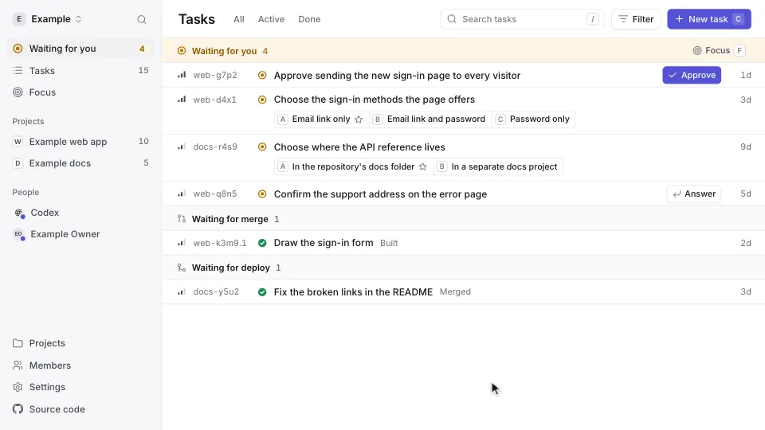

# Connect GitHub

Connect GitHub once, and each task your agents close with a pull request or
a commit moves on by itself: to **Merged** when the pull request merges or
the commit is pushed to the default branch, and to **Live** when its deploy
passes. No agent reports either step, so a task
moves on even after the agent that did the work has stopped.

A workspace's owner connects it on the web app's **Settings** page. It takes
one button and an install on each GitHub account or organization whose
repositories your agents work in.

<picture>
  <source media="(prefers-color-scheme: dark)" srcset="images/walkthrough-shipped-dark.webp">
  
</picture>

The site's [Built to live diagram](https://ntasks.notice.cx/#built-to-live)
shows a task going through the three stages.

## Connect it

1. In **Settings**, under **GitHub**, press **Connect GitHub**.
2. On GitHub, press **Create GitHub App**. GitHub makes an app for the
   workspace and returns you to Ntasks, which opens the app's install page
   for your own GitHub account.
3. Choose **All repositories** and press **Install**.

For each organization, press **Install on an organization** in Settings, pick
the organization, and press **Install**. Installing on an organization takes
an owner of it on GitHub.

Settings then lists each account and organization under **Installed on**.
You copy no secret, add no webhook and type no name.

Install the app while signed in to GitHub with the account you sign in to
Ntasks with. Ntasks reads events only from installations a workspace owner
made, because anyone can install a public GitHub App.

## What moves a task

A task starts at **Built** when an agent closes it as done with its pull
request ([Where a change is](concepts.md#where-a-change-is)). GitHub's events
move it from there:

| On GitHub | The task moves to |
|---|---|
| Its pull request merges into the repository's default branch | Merged |
| Its commit is pushed straight to the default branch | Merged |
| A deploy of the merge or the push passes | Live |

- **A deploy** is a passing check whose name starts with `Workers Builds:` or
  `Cloudflare Pages`, the checks Cloudflare's builds report, or a successful
  deployment to the production environment. Each one counts from the first
  time it is seen, and Settings then lists it under **Deploys**, with a box
  that switches it off for later events.
- **More than one deploy on a commit.** A merge that changes both an app
  and its website carries a deploy check for each, such as
  `Workers Builds: app` and `Workers Builds: site`. Its tasks move to Live
  once all of them passed; while one still runs, they stay at Merged
  ([API](api.md#more-than-one-deploy-on-a-commit)).
- **A check with another name** counts once it is typed under **Deploy
  checks**, in **Set up by hand** under GitHub in Settings, and saved. Saving
  needs a secret: press **Make a secret** only when none is saved, since a
  new one replaces it. With the app connected, nothing is added on GitHub. A
  typed name isn't added to **Deploys**. To stop it counting, remove it, save,
  and switch off its entry under **Deploys** if it has one. A name that is
  also a deploy by the rules above still counts the first time it is seen
  ([API](api.md#set-up-by-hand)).
- **A project that deploys.** The first deploy seen for a project's tasks
  turns on **Changes go live by a deploy** for that project, in Settings,
  Projects. A project with no deploy, such as a library, stops at Merged. An
  owner who turns the setting off keeps it off.
- **A pull request merged before its task closed.** Its merge event came too
  early to move the task, so Ntasks asks GitHub about 5 seconds after the
  close, and moves the task to Merged then. Installing the app does the same
  for tasks already waiting for a merge, such as those closed before GitHub
  was connected.
- **A merge whose event never came.** A task still in progress whose work
  names a pull request closes as done when Ntasks asks GitHub and finds it
  merged, as the merge event would have closed it. Ntasks asks when the app
  is installed and on each of its other checks.

## Projects without pull requests

Where you and your agents commit straight to the default branch and push it
yourself, a task moves through the same stages:

1. **Built** when an agent closes it with its commit. The Live page says
   Not pushed yet.
2. **Merged** when you push: GitHub sends the push, and every task closed
   with one of its commits moves on. The Live page says Not deployed yet.
3. **Live** when the deploy of the push passes, such as Cloudflare's
   `Workers Builds:` check on its newest commit. That check ships every
   commit of the push, so it moves all of their tasks.

A rebase before the push gives a commit a new name, so its task's commit no
longer matches. Name the task on a `Refs:` line at the end of the commit
message, `Refs: web-a1b2`, and the push moves it all the same. Only a
`Refs:` line counts; a task id anywhere else in the message moves nothing.
GitHub lists up to 2,048 commits of one push, and Ntasks reads every one.

An app connected before Ntasks read pushes asks GitHub for neither. To add
them, open the app's page on GitHub (**Settings**, **Developer settings**,
**GitHub Apps**, the app, **Edit**), and under **Permissions and events**:

1. Set **Repository permissions**, **Contents**, to **Read-only**.
2. Tick **Push** under **Subscribe to events**, and press **Save changes**.
3. Accept the new permission on each installation: GitHub lists the request
   under **Settings**, **Applications**, **Installed GitHub Apps**, the app,
   **Review request**.

## When a task stays at a stage

- **Closed with only a commit from a pull request's branch.** GitHub's
  events name the pull request and its merge commit, so a task closed with a
  commit from its branch matches neither. Close tasks with their pull
  request, or name them on a `Refs:` line of the merge's commit message.
- **Closed more than a day after its commit was pushed.** Ntasks keeps a
  push's commits for a day, so a task closed with one of them within that day
  moves to Merged at its close, and a task closed later stays at Built. Send
  a `merged` signal for its commit (below) to move it.
- **A deploy on its commit failed.** The task stays at Merged, whatever the
  commit's other deploys did, until that check passes on a rerun (press
  **Re-run** on it in GitHub) or a later merge's deploy ships it.
- **One deploy shipped several merges.** A deploy names the one commit it
  ran on, so it moves the task merged as that commit. Tasks merged before it
  stay at Merged unless their own merge was deployed too.
- **The deploy passed before the task closed.** The check after the close
  asks GitHub only about the merge, so the task stops at Merged. Redeliver
  the deploy's event from **Recent Deliveries** ([below](#check-that-it-works))
  to move it to Live; GitHub keeps them for 3 days, and after that a signal
  (below) does it. The event turns on **Changes go live by a deploy** for
  a project no deploy has turned it on for; where an owner turned it off,
  turn it on again in Settings, Projects first.
- **Many tasks waiting at once.** Each check reads up to about 40 pull
  requests, starting from the newest waiting task, within the free plan's
  limit on requests. While many newer tasks wait, an older one can stay at
  Built.

In each case, a signal that names the pull request or commit moves the task:
`report_delivery` from an agent, or `POST /api/delivery`
([Delivery](api.md#delivery)). A `live` signal moves a task to Live only in
a project with **Changes go live by a deploy** turned on, in Settings,
Projects; in any other project it stops at Merged.

## Check that it works

Close a task with a pull request and merge the pull request. The task leaves
**Waiting for merge** in Waiting for you, and the Done view marks it Merged.
After its deploy passes, it shows Live.

GitHub keeps each event the app sent, with Ntasks's answer, on the app's
page on GitHub, under **Advanced**, **Recent Deliveries**, where
**Redeliver** sends one again. An event Ntasks set aside names why, such as
a check that is not a deploy; one that matched no task answers with an empty
`moved` list.

## Disconnect

In Settings, under GitHub, press **Disconnect**. Ntasks forgets the app and
its installations and refuses its events from then on. The app stays on
GitHub until you delete it there, on the app's page under **Advanced**.

## Without the app

- A webhook added to a repository or an organization by hand:
  [Set up by hand](api.md#set-up-by-hand), under Settings, GitHub.
- A workflow that sends the signals itself, for a deploy GitHub doesn't
  report: [Delivery](api.md#delivery) has one.

The [API](api.md#from-github) gives the full rules: the events the app
receives, how each delivery is checked, and every answer.
