# The web app

The pages people use, and animated walkthroughs of its main features, drawn
from the web app's invented example data. Regenerate the pictures with
`pnpm screenshots` and the walkthroughs with `pnpm screenshots walkthroughs`
([tools/screenshots](../tools/screenshots/README.md)).

## Pages

**Tasks board.** Waiting for you, answered on each row, then every task by
status. The Sort menu orders each group by priority, creation, last change,
close or title, either way, and the address keeps the order.

<picture>
  <source media="(prefers-color-scheme: dark)" srcset="images/board-dark.webp">
  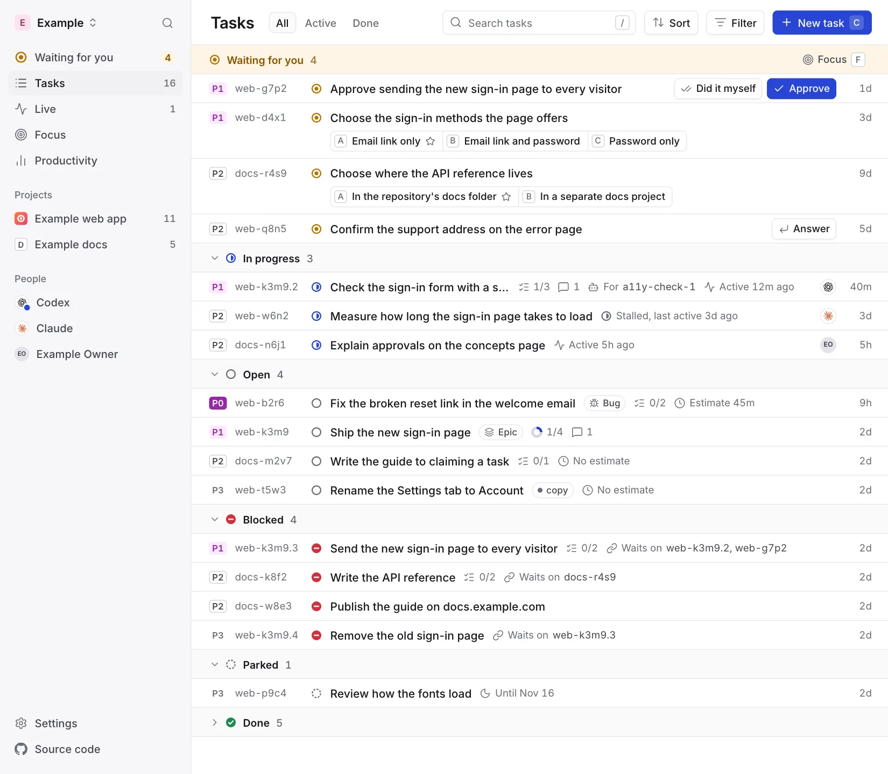
</picture>

**Epics.** With one project in view, the Epics tab lists the project's open
epics, one line each, grouped by what they need: Waiting for you, Moving, Not
moving, Every task done and No tasks. Each line shows how many of its tasks
wait for you or are blocked, a bar of its tasks by status, its tasks done of
all, and how many closed this week, counting its sub-epics' tasks too. An
epic closes itself when its last task closes ([Epics](concepts.md#epics)), so
Every task done lists only epics labelled `keep-open` and epics someone
reopened.

**Task page.** Markdown text, Done when, activity and the task's facts. A
task in an epic also shows From the epic: the comments pinned on the epic
for its tasks, and the epic's most recently closed tasks with their close
reasons. A pinned comment is marked Pinned among its own task's comments.
An open task that relies on a dropped task, one closed as won't do or no
longer needed since the task last changed ([Dependencies](concepts.md#dependencies)),
shows a line for each under its title, such as "Check: Remove the old landing
page, which this relies on, closed as no longer needed", with the dropped
task linked; its board row shows "Relies on dropped" and the dropped task's
id. Any change to the task clears both.

**Move to…**, in a task page's More menu, picks a project and one of its open
epics, or No epic, and moves the task there with every task under it. A task
moved to another project takes a new id that starts with that project's
prefix, and the address with its old id opens its page under the new id.

<picture>
  <source media="(prefers-color-scheme: dark)" srcset="images/task-dark.webp">
  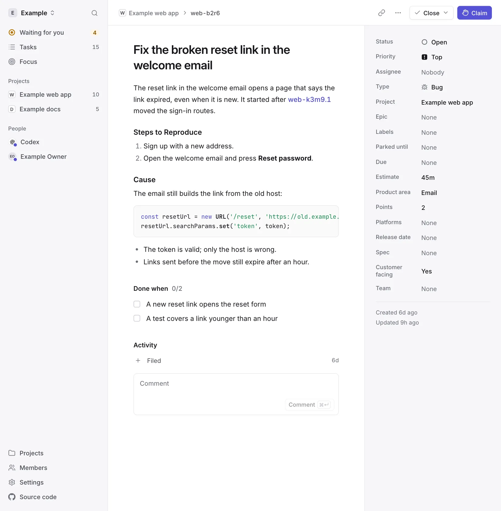
</picture>

**Focus.** The decisions waiting for you, one at a time.

<picture>
  <source media="(prefers-color-scheme: dark)" srcset="images/focus-dark.webp">
  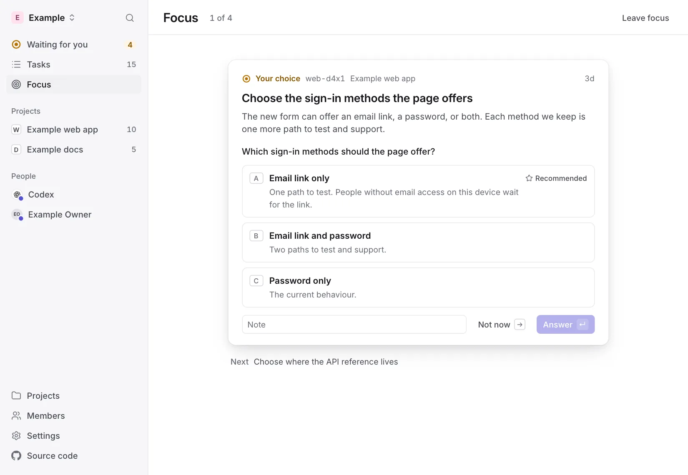
</picture>

**Live.** A board of work moving to production, in three columns: In
progress, Waiting to ship, for closed work not yet merged or not yet
deployed, and Live, as GitHub reports each merge and deploy. When a task
moves to the next column, its card travels there, and for a moment it shows
who changed it and how, such as "Claude pushed a commit" or "GitHub merged
#42". A card leads with its project's icon and ends with the icon of who
holds it, whose name and model show on hover. A card in progress is tinted
by how recently its holder worked on it: strongly while Active, faintly while
Quiet, and not at all once Stalled, after a day without activity. While the page is open it checks for
changes every 5 seconds. **List** shows the tasks in progress grouped as
Active, Quiet and Stalled, each under its epic with the epic's progress bar.
A stalled task's page shows where its work stopped and **Free it**, which
hands it back for another agent to claim, keeping that record as a comment.

<picture>
  <source media="(prefers-color-scheme: dark)" srcset="images/live-dark.webp">
  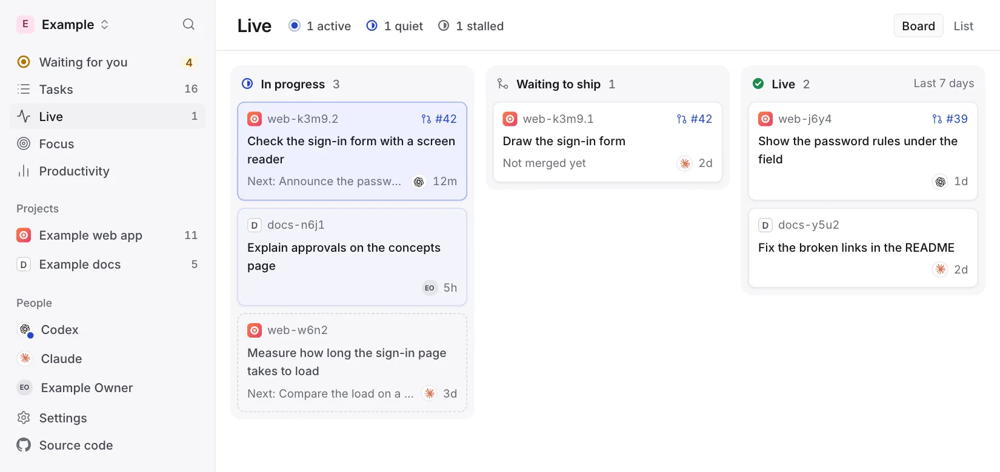
</picture>

**Productivity.** What you and your agents got done that matters, day by
day: changes merged or live, decisions you answered and epics finished, with
a strip of the last seven days at the top. The wins never count tasks
closed, and reach back eight weeks. Under the strip, a chart of the last
eight weeks shows the tasks open at the end of each day, with the tasks
created and closed that day, so you can see whether the open work is
shrinking; its closes are context for the open work, not a score.

**Phone.**

<picture>
  <source media="(prefers-color-scheme: dark)" srcset="images/phone-dark.webp">
  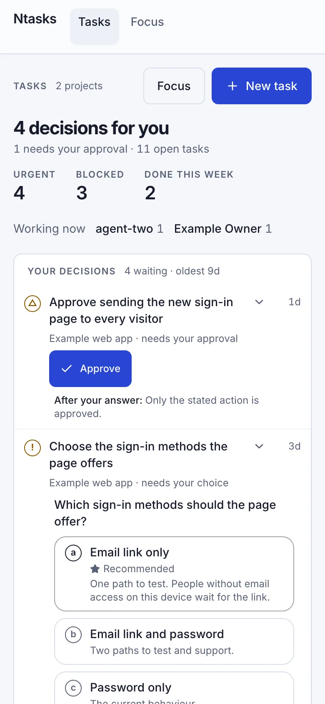
</picture>

**Sign-in and agent approval.** Pages the Worker serves itself.

<picture>
  <source media="(prefers-color-scheme: dark)" srcset="images/sign-in-dark.webp">
  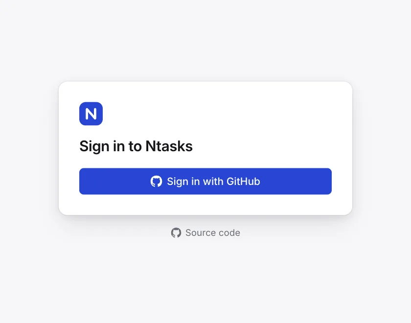
</picture>
<picture>
  <source media="(prefers-color-scheme: dark)" srcset="images/agent-access-dark.webp">
  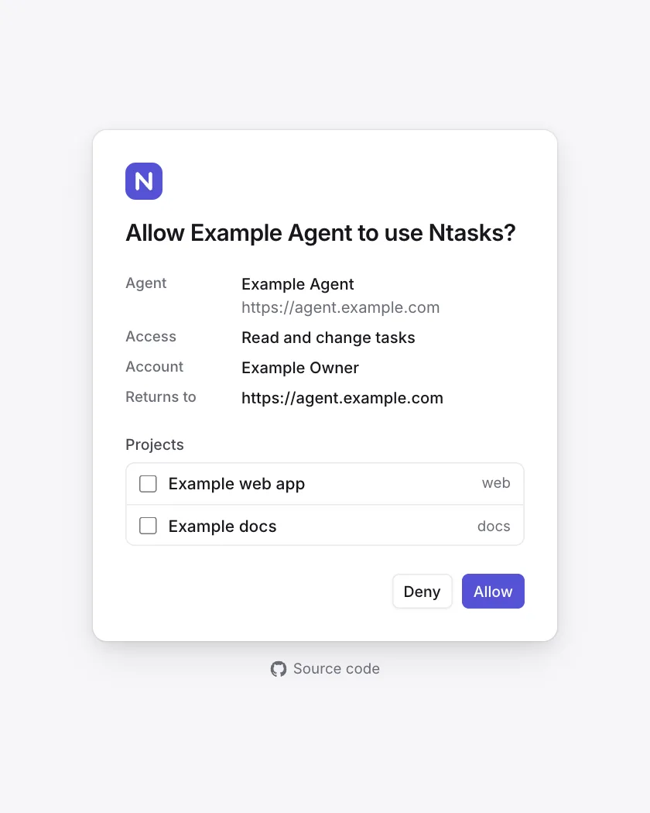
</picture>

## Walkthroughs

### Answer a decision

<picture>
  <source media="(prefers-color-scheme: dark)" srcset="images/walkthrough-decide-dark.webp">
  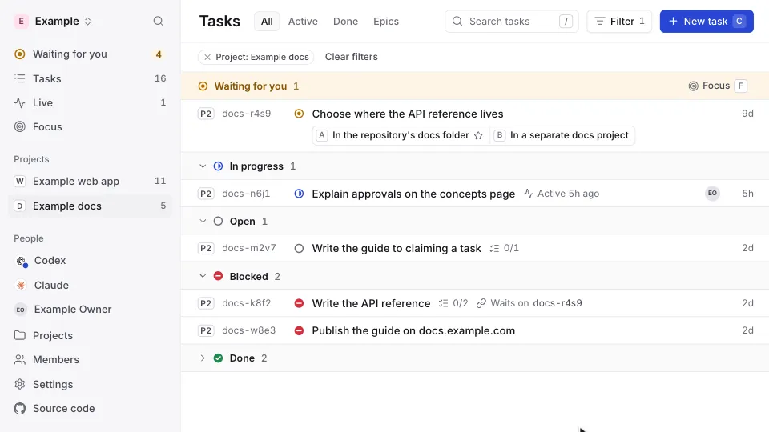
</picture>

Pick an option and answer. The work your decision held becomes ready for an
agent to claim.

### See who works on what

<picture>
  <source media="(prefers-color-scheme: dark)" srcset="images/walkthrough-live-work-dark.webp">
  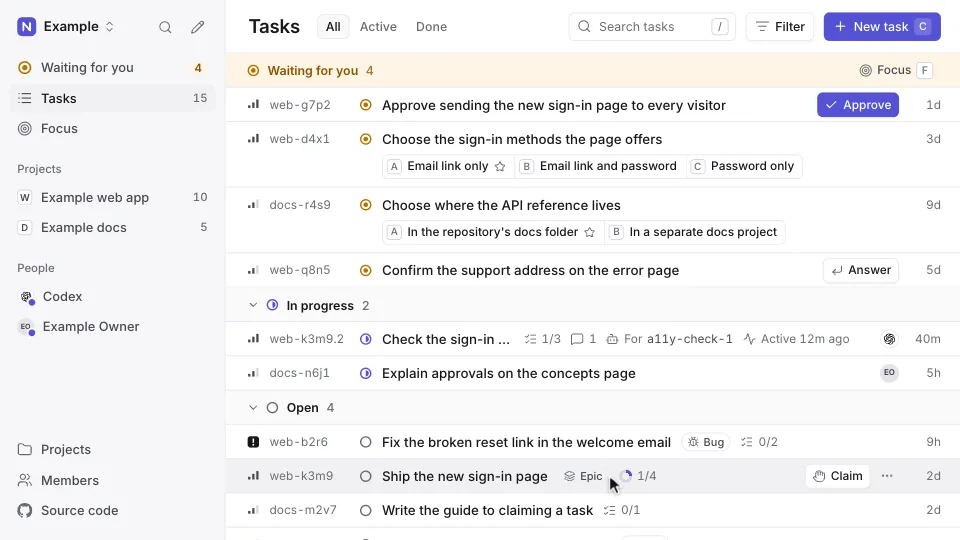
</picture>

Each task shows the agent that holds it, the helper doing the work, its
branch, its pull request, its next step and when it last moved.

### Know what shipped

<picture>
  <source media="(prefers-color-scheme: dark)" srcset="images/walkthrough-shipped-dark.webp">
  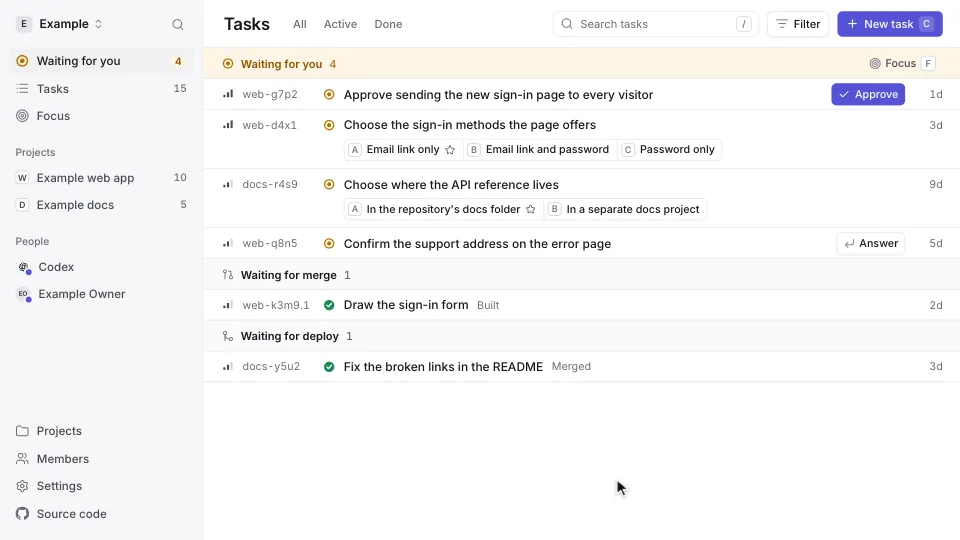
</picture>

Work closed with a commit or a pull request shows whether its change is
built, merged or live, moved on by the merge and deploy signals your
repository sends ([Delivery](api.md#delivery)). Work closed with no proof
says so.

**Done, my call** in the Close menu closes a task as done on your own
judgement. Its form lists each line of Done when as a box: you tick the
criteria that are met, and the rest are recorded as waived, with your reason.
The task then shows who accepted it and what they waived. Only a person can
close a task this way; an agent that records your acceptance from a chat is
shown as having relayed it, and you can dispute it.

### Approve exactly what you saw

<picture>
  <source media="(prefers-color-scheme: dark)" srcset="images/walkthrough-approve-dark.webp">
  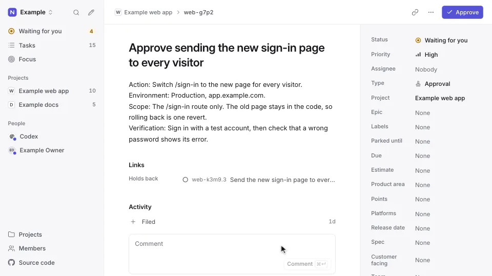
</picture>

An approval covers the action, environment and scope you read, and nothing
beyond it. An answer an agent relays from a chat shows your words, and you
can dispute it.

**Did it myself**, beside Approve, is for an action you already did. It
takes a note, and closes the approval as done by you, not approved: no agent
does the action. Each task that waited on it gets a comment to check the
result, and those labelled `human` go back to agents.

### Tick off your steps

When an agent needs something only you can do, such as running a command on
your own machine, it asks for your steps. Each step is a box to tick, with its
command as a block to copy. Tick them in any order, leave a note when the
agent asked for a value, or press **Stuck here** and say why. Ticking the last
step hands the waiting task back to the agent, which checks the result before
it continues.

### Set it up in one step

<picture>
  <source media="(prefers-color-scheme: dark)" srcset="images/walkthrough-setup-dark.webp">
  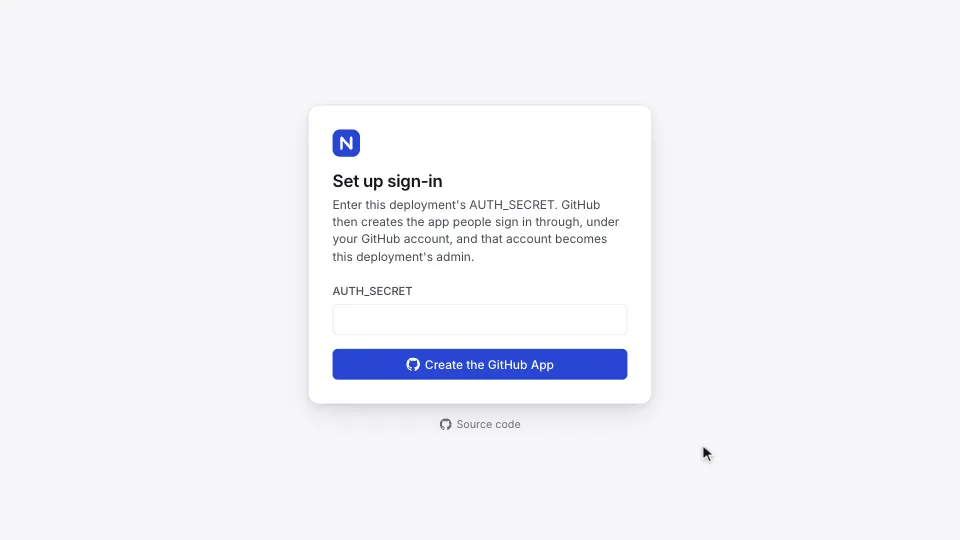
</picture>

A new deployment asks for one secret. Its first page creates the GitHub app
people sign in with.
