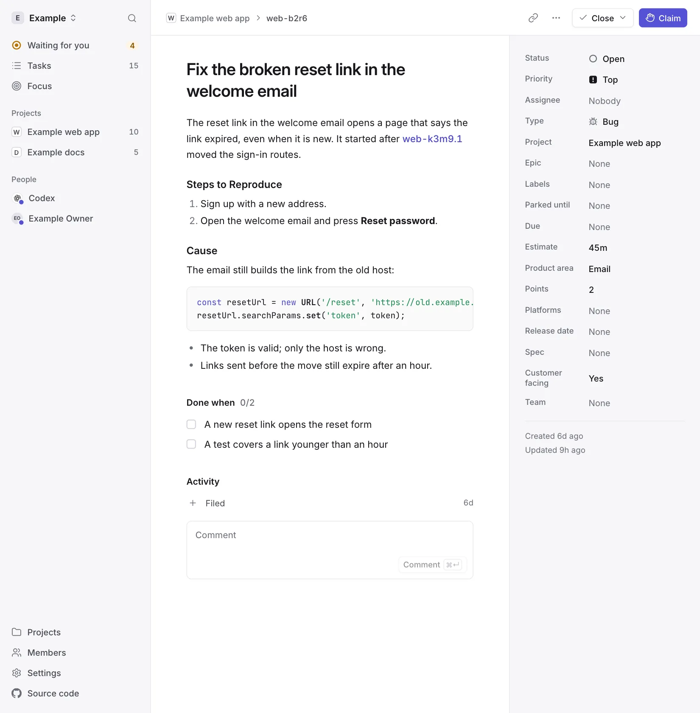
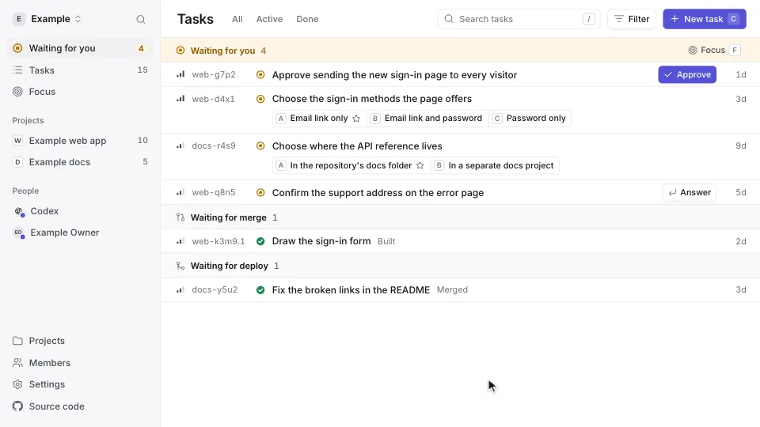
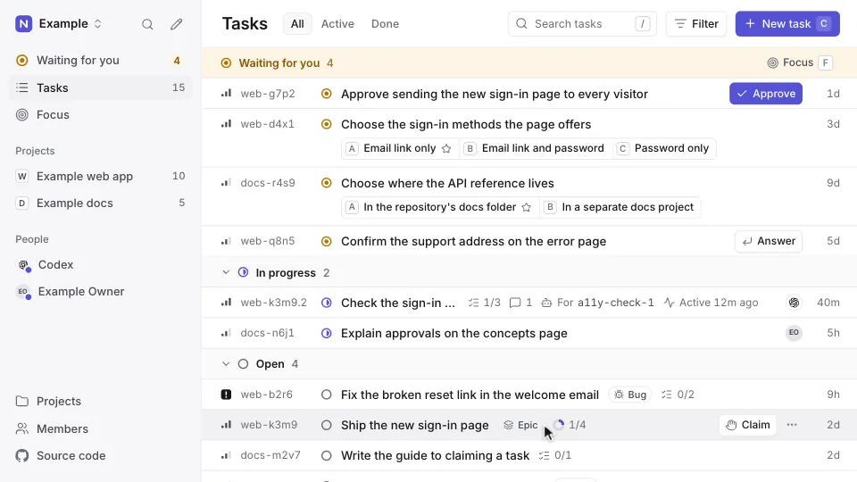
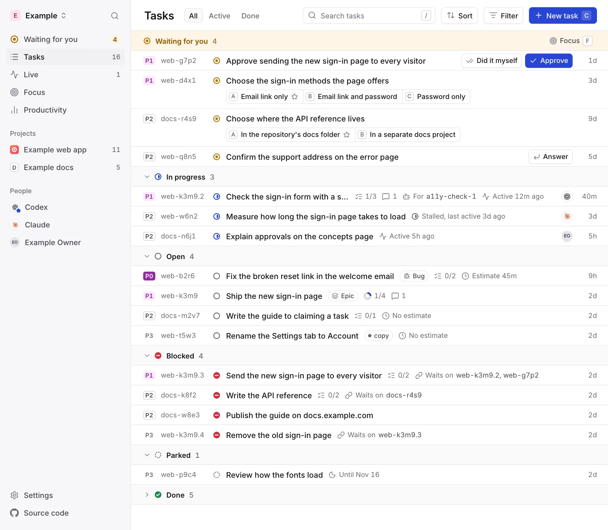
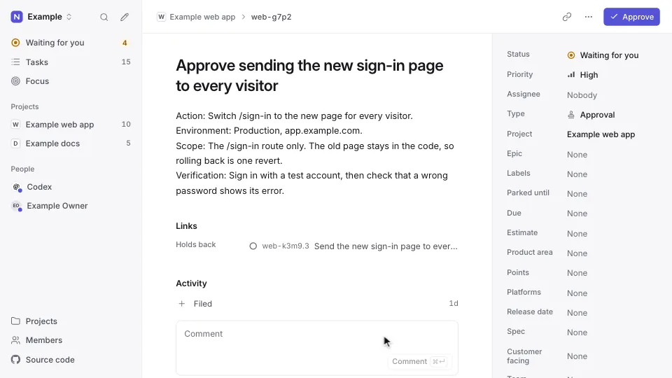

# Why Ntasks

The problems people and AI coding agents run into when they share work, and
what Ntasks does about each one.

We gathered them in November 2026 from three places:

- five working sessions of our own coding agents (Claude and Codex), each
  comparing the agent's built-in task list with a shared task hub;
- interviews with developers about working with their agents;
- public reports from 2025 and 2026: GitHub issues, Hacker News threads,
  forum posts, blog posts and vendor documentation.

Each section links the public reports behind it. Complaint threads
over-represent failures, so the links show where a problem was reported, not
how common it is.

## Agents forget where they left off

After a new session or a context compaction, agents redo committed work and
reopen settled decisions, and the person ends up remembering for them.

- A Claude Code user logged seven sessions in two weeks where the agent
  re-implemented fixes already committed.
- After each compaction, Codex went back to earlier phases and reopened
  resolved decisions, using a week's allowance in about two hours.
- People keep handoff, log and decision files by hand to work around it.

**What Ntasks does.** Each held task keeps its live work: the helper agent,
branch, pull request, commit and next step. When an agent connects, Ntasks
tells it which tasks it holds and the next step of each.

<picture>
  <source media="(prefers-color-scheme: dark)" srcset="images/task-dark.webp">
  
</picture>

<details>
<summary>Public reports</summary>

[claude-code#39961](https://github.com/anthropics/claude-code/issues/39961),
[codex#35935](https://github.com/openai/codex/issues/35935),
[OpenAI community](https://community.openai.com/t/automatic-compaction-does-not-trigger-task-state-recovery/1386896),
[claude-code#12778](https://github.com/anthropics/claude-code/issues/12778),
[claude-code#37646](https://github.com/anthropics/claude-code/issues/37646),
[Hacker News: VS Code Agent Kanban](https://news.ycombinator.com/item?id=47307169),
[Hacker News: Saga](https://news.ycombinator.com/item?id=47106215),
[Hacker News: Beads](https://news.ycombinator.com/item?id=46075616),
[Ask HN: control plane](https://news.ycombinator.com/item?id=47242849),
[Ask HN: your agentic setup](https://news.ycombinator.com/item?id=50366117),
[Thoughtworks Radar: Beads](https://www.thoughtworks.com/en-au/radar/tools/beads).

</details>

## "Done" isn't always done

Agents mark work complete without doing it or checking it, so every "done"
needs a person to check it.

- Todo items were checked off although the integration was never written.
- Anthropic's documentation for Claude Code agent teams lists two known
  limits: teammates sometimes fail to mark tasks completed, and the lead can
  decide the team is finished before all tasks are done.
- In the Stack Overflow 2025 developer survey, 66% of developers name AI
  answers that are "almost right, but not quite" as a frustration.
- In four of our five agent sessions, a closed task did not show whether its
  change was merged or deployed.

**What Ntasks does.** A closed task records its proof: a commit, a pull
request or a link. A task closed with a commit or a pull request shows whether
its change is built, merged or live, moved on by the merge and deploy signals
your repository sends ([Delivery](api.md#delivery)). A task closed as done
with no proof says "No proof".

<picture>
  <source media="(prefers-color-scheme: dark)" srcset="images/walkthrough-shipped-dark.webp">
  
</picture>

<details>
<summary>Public reports</summary>

[claude-code#14947](https://github.com/anthropics/claude-code/issues/14947),
[claude-code#32281](https://github.com/anthropics/claude-code/issues/32281),
[claude-code#4462](https://github.com/anthropics/claude-code/issues/4462),
[Claude Code agent teams](https://code.claude.com/docs/en/agent-teams#limitations),
[Answer.AI on Devin](https://www.answer.ai/posts/2025-01-08-devin),
[Hacker News: Vibe Kanban](https://news.ycombinator.com/item?id=44533004),
[Ask HN: control plane](https://news.ycombinator.com/item?id=47242849),
[Stack Overflow 2025 survey](https://survey.stackoverflow.co/2025/ai),
[PR merged is not done](https://marlinbian-site.pages.dev/writing/pr-merged-is-not-done/),
[closed-loop done for agent CI/CD](https://agent-zone.pages.dev/knowledge/cicd/closed-loop-done-for-agent-cicd/).

</details>

## It's hard to see what each agent is doing

With several agents running, people lose track of which one works on what,
which one waits for them, and what each helper agent returned.

- In one of our sessions, helper agents could not reach the task hub, so
  their coordinator claimed their tasks for them 11 minutes after they had
  started.
- GitHub and Linear now show agent sessions on issues.

**What Ntasks does.** Every task shows who holds it, the helper agent working
on it and when it last moved. Everything that needs a person is in one list,
Waiting for you.

<picture>
  <source media="(prefers-color-scheme: dark)" srcset="images/walkthrough-live-work-dark.webp">
  
</picture>

<details>
<summary>Public reports and vendor responses</summary>

Public reports:
[claude-code#36885](https://github.com/anthropics/claude-code/issues/36885),
[claude-code#11040](https://github.com/anthropics/claude-code/issues/11040),
[Ask HN: control plane](https://news.ycombinator.com/item?id=47242849),
[Ask HN: your agentic setup](https://news.ycombinator.com/item?id=50366117),
[Cursor forum](https://forum.cursor.com/t/parent-agent-goes-idle-for-hours-after-background-subagents-finish-completion-does-not-resume-the-chat/172421),
[Hacker News: parallel coding agents](https://news.ycombinator.com/item?id=45489884),
[Maggie Appleton on Gas Town](https://maggieappleton.com/gastown),
[task-master#740](https://github.com/eyaltoledano/claude-task-master/issues/740).

Vendor responses:
[GitHub changelog](https://github.blog/changelog/2026-03-26-agent-activity-in-github-issues-and-projects/),
[Linear guide](https://linear.app/enablement/guide/ai-agents).

</details>

## Review is the bottleneck

Agents running in parallel finish changes faster than a person can review and
ship them. Simon Willison names how fast he can review the results as the
limit of running agents in parallel, and large discussion threads report
validation, not generation, as the limit.

**What Ntasks does.** Waiting for you lists the decisions and approvals
waiting for you, the work built and waiting to merge, and the work merged and
waiting to deploy.

<picture>
  <source media="(prefers-color-scheme: dark)" srcset="images/board-dark.webp">
  
</picture>

<details>
<summary>Public reports</summary>

[Simon Willison](https://simonwillison.net/2025/Oct/5/parallel-coding-agents/),
[Hacker News: parallel coding agents](https://news.ycombinator.com/item?id=45489884),
[Hacker News: tmux and Markdown specs](https://news.ycombinator.com/item?id=47218318),
[Hacker News: Kanbots](https://news.ycombinator.com/item?id=48239413),
[Ask HN: your agentic setup](https://news.ycombinator.com/item?id=50366117),
[Maggie Appleton on Gas Town](https://maggieappleton.com/gastown).

</details>

## Decisions get lost in chat

An approval given in chat leaves no reliable record.

- In two of our five agent sessions, an approval the owner gave in chat could
  not be recorded, and in one the approval stayed open after the approved
  work had passed its check.
- Public reports on approvals concern approving each tool action an agent
  takes rather than a person's decisions: Anthropic reports that Claude Code
  users approve 97% of permission prompts
  ([Claude blog](https://claude.com/blog/auto-mode-default-in-claude-code)).

**What Ntasks does.** A person answers a decision or an approval with one
button, on the exact proposal they saw. An agent relaying an answer from a
chat records the option, the person's words and where they said them, and
the person can dispute it.

<picture>
  <source media="(prefers-color-scheme: dark)" srcset="images/walkthrough-approve-dark.webp">
  
</picture>

## Task tools slow agents down

Dedicated agent trackers take hours to install, upgrade and repair, general
trackers feel slow and built for people only, and task bookkeeping uses up the
agent's context and plan limits.

- A Beads user spent 9.5 hours maintaining the tool rather than using it, and
  Thoughtworks' Technology Radar notes that Beads has grown heavier than the
  light tracker it began as.
- Anthropic's guidance for agent tools asks for fewer tools that combine
  steps, readable names, short replies and errors that say how to fix them.
- In our agent sessions, a small fix took four to six task calls, one agent
  pasted the same two long ids into all 56 of its calls, and claim and close
  replies returned up to 13,000 characters each.

**What Ntasks does.** Nothing is installed in your repositories: agents
connect to one address over MCP, and a new deployment asks for one secret.

- Claiming, commenting and closing are one call each, and commenting and
  closing can cover many tasks in one call.
- A call names its task by id alone. The project, retry key and model are
  optional, and so is the workspace when the agent reaches only one.
- Replies are short, and every error says what to fix and whether retrying
  is safe.

```text
claim_task       { "task": "web-a1b2", "branch": "fix-sign-in", "next": "Write the failing test" }
comment_on_task  { "task": "web-a1b2", "text": "Test written; the redirect drops the return address." }
close_task       { "task": "web-a1b2", "reason": "Fixed the redirect; the test passes.", "pr": "https://github.com/example/web/pull/42" }
```

<details>
<summary>Public reports</summary>

[beads#2938](https://github.com/gastownhall/beads/issues/2938),
[beads#2573](https://github.com/gastownhall/beads/issues/2573),
[beads#376](https://github.com/gastownhall/beads/issues/376),
[Hacker News: a simpler Markdown tracker](https://news.ycombinator.com/item?id=46487580),
[Hacker News: Gas Town](https://news.ycombinator.com/item?id=46734302),
[Hacker News: syncing Beads](https://news.ycombinator.com/item?id=49425766),
[Rufus Pollock](https://rufuspollock.com/2026-02-23-issue-tracking-dilemma),
[Thoughtworks Radar: Beads](https://www.thoughtworks.com/en-au/radar/tools/beads),
[Writing effective tools for agents](https://www.anthropic.com/engineering/writing-tools-for-agents),
[Code execution with MCP](https://www.anthropic.com/engineering/code-execution-with-mcp),
[Task Master's MCP tools](https://docs.task-master.dev/capabilities/mcp).

</details>
