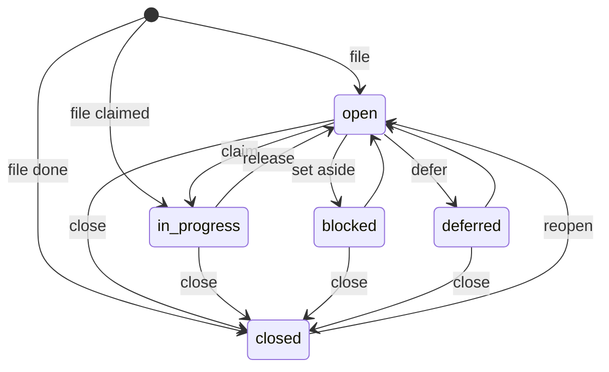
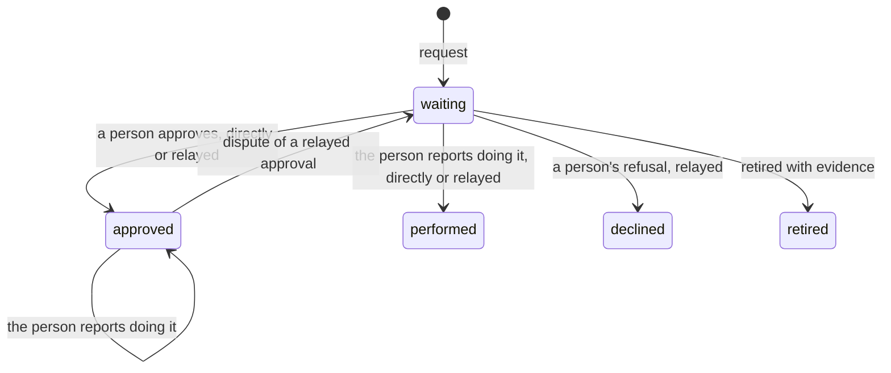
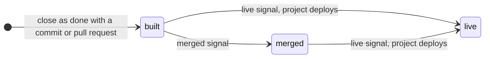

# The Shared Work Protocol

**An open contract for shared work between people and AI agents. Draft,
v0, 2026-11-10.**

The Shared Work Protocol defines a record of work that people and AI
agents read and write together: tasks, who holds each one, the decisions
and approvals only a person can give, the proof that work is done, and
where a finished change has reached. Any task tool, agent harness or
adapter can implement it. [Ntasks](https://github.com/notice-cx/Ntasks) is
its reference implementation.

## Status of this document

- This is a draft. Version 0 promises nothing beyond itself: any part of
  it may change before version 1.
- It was extracted from what Ntasks does at commit `f7bb8a3`, not designed
  afresh. Ntasks's task tools were reshaped in November 2026, and this
  draft describes them as they stand.
- Where Ntasks's behavior is unclear, looks accidental or has no test, the
  draft records an open question (`OQ-n`, listed in
  [open-questions.md](open-questions.md)) instead of a rule.
- The protocol's name is its own, separate from Ntasks's, so another tool
  can say it implements the Shared Work Protocol without naming Ntasks.
  The name is always written in full.
- The text is licensed [CC BY 4.0](LICENSE-CC-BY-4.0); the schemas, samples
  and tests are licensed [Apache-2.0](LICENSE-APACHE-2.0). Ntasks's code
  stays AGPL-3.0.

## Contents

1. [Overview and motivation](#1-overview-and-motivation)
2. [Conventions and terminology](#2-conventions-and-terminology)
3. [Objects](#3-objects)
4. [The state machine](#4-the-state-machine)
5. [Authority rules](#5-authority-rules)
6. [Invariants](#6-invariants)
7. [Conformance levels](#7-conformance-levels)
8. [Extensions](#8-extensions)
9. [Versioning](#9-versioning)
10. [Security considerations](#10-security-considerations)
11. [The MCP tool profile](mcp-profile.md)
12. [The HTTP binding](http-binding.md)
- Appendix A: [each rule and the Ntasks test that proves it](tests.md)
- Appendix B: [open questions](open-questions.md)

## 1. Overview and motivation

People increasingly run several AI agents against one body of work: coding
agents in a few terminals, a review bot, a scheduled job. They share a task
list, and four failures recur:

| Failure | What this protocol does about it |
|---|---|
| An agent says work is done and nothing shows it. | A close as done carries its proof: a commit, a pull request or a link. A task closed as done without one is shown as having no proof ([INV-7](#inv-7)). A commit or pull request then moves through built, merged and live as the repository reports it ([STATE-12](#state-12)). |
| An agent approves its own action, or stretches a person's earlier yes. | Only a person answers a decision, grants an approval, ticks a step or accepts a task as done over criteria it does not meet ([AUTH-1](#auth-1), [AUTH-11](#auth-11)). An answer an agent passes on is recorded as relayed, pinned to the exact text the person saw, and can be disputed ([AUTH-3](#auth-3), [AUTH-5](#auth-5)). An approval covers its own request and nothing else, and retiring one grants nothing ([AUTH-6](#auth-6), [AUTH-7](#auth-7)). |
| A new session loses what the last one was doing. | A claim records the holder's branch, pull request, session and next step, and a connecting agent is told the tasks it holds ([INV-10](#inv-10)). When the repository's host reports that the recorded pull request merged, the task closes even if its holder's session has stopped ([STATE-18](#state-18)). Each task in progress shows whether its holder is active, quiet or stalled, so work that stopped, or finished without a close, can be found ([STATE-20](#state-20)). |
| Two agents do the same work. | One claim wins ([INV-1](#inv-1)), a claim never expires by time ([INV-2](#inv-2)), and the server works out which tasks are ready, so every agent asking gets the same answer ([INV-8](#inv-8)). |

### 1.1 Scope

In scope: the durable record of work and the rules for changing it. Tasks,
their links, claims and work in hand, comments, history, decisions,
approvals, proof and delivery, and who may change what.

Out of scope:

- how an agent calls a server's tools, which MCP defines;
- how one agent delegates a task to another, which A2A defines;
- how a sender signs in, which OAuth and the server define;
- how work is carried out, scheduled or verified.

### 1.2 Adjacent protocols

- **[Model Context Protocol](https://modelcontextprotocol.io/specification/latest)
  (MCP)**, revision 2026-07-28, is a JSON-RPC protocol through which an AI
  application calls the tools, resources and prompts a server offers. Its
  optional [Tasks extension](https://modelcontextprotocol.io/extensions/tasks/overview)
  (`io.modelcontextprotocol/tasks`) lets a server answer one long-running
  request with a durable handle, which the client polls through the states
  `working`, `input_required`, `completed`, `failed` and `cancelled`.
- **[Agent2Agent](https://a2a-protocol.org/latest/specification/) (A2A)**,
  version 1.0.0, is a protocol through which one agent system sends work to
  another. Its Task is the unit of that work, in the states `submitted`,
  `working`, `input-required`, `auth-required`, `completed`, `failed`,
  `canceled` and `rejected`.

Both are projects of the Linux Foundation's Agentic AI Foundation.

An MCP task or an A2A task belongs to one request between one client and
one server, or between two agents, and ends with that request. This
protocol's task is a record that many people and agents share over weeks:
anyone with access can find it, at most one of them holds it at a time, a
person may have to decide on it, and it keeps its history after it closes.
The protocol does not replace either protocol. Its [MCP tool
profile](mcp-profile.md) is a set of MCP tools, so any MCP client can use it;
an agent that runs work over MCP Tasks or A2A can record that work here.

## 2. Conventions and terminology

The key words "MUST", "MUST NOT", "REQUIRED", "SHALL", "SHALL NOT",
"SHOULD", "SHOULD NOT", "RECOMMENDED", "NOT RECOMMENDED", "MAY" and
"OPTIONAL" in this document are to be interpreted as described in
[BCP 14](https://datatracker.ietf.org/doc/html/bcp14)
([RFC 2119](https://datatracker.ietf.org/doc/html/rfc2119),
[RFC 8174](https://datatracker.ietf.org/doc/html/rfc8174)) when, and only
when, they appear in all capitals, as shown here.

Each normative rule has an id, such as `INV-1`, which the
[test appendix](tests.md) and the [conformance suite](conformance/README.md)
cite.

| Term | Meaning |
|---|---|
| Server | A system that implements this protocol and keeps the record. |
| Client | Any program that reads or writes the record through a binding: an agent, the server's own interface, a service. |
| Binding | A way to reach a server: the [MCP tool profile](mcp-profile.md) or the [HTTP binding](http-binding.md). |
| Sender | The signed-in identity a request comes from. |
| Person | A human sender, signed in to the server's own interface. |
| Agent | An AI program acting for a person, such as a coding agent. |
| Service | A program with its own credential, such as a repository's automation. A service may act for an agent it names. |
| Actor | The name a server records for the sender of a change ([3.1](#31-actor-and-provenance)). |
| Model | The AI model an agent says it runs as, recorded beside its actor. |
| Display name | The name a reader is shown for an actor or a model, worked out from it ([3.1.1](#311-display-names)). |
| Workspace | The set of projects, people, agents and services that work together. A request acts in one workspace; nothing reaches across two. |
| Project | The tasks of one body of work, such as one repository. Its **prefix** starts every task id in it. A server MAY let an owner disable a project: a disabled project refuses new tasks, and its tasks stay readable. |
| Task | One piece of work ([3.2](#32-task)). |
| Epic | A task whose work is done by its children. |
| Link | A connection from one task to another ([3.5](#35-links)). A **blocking link** (`blocks`) makes the task wait until the other closes. |
| Ready | A task someone can start now ([STATE-3](#state-3)). |
| Claim | Taking a task: it becomes `in_progress` and records its **holder**. |
| Work in hand | What the holder records while working: its helper agent, session, worktree, branch, pull request, last tested commit and next step ([3.3](#33-claim-and-work-in-hand)). |
| Last activity | When the holder last changed or commented on the task. |
| Activity | How recently the holder of a task in progress worked on it, as of a read: active, quiet or stalled ([STATE-20](#state-20)). It is shown only. |
| Active | A task in progress whose holder changed or commented on it within the hour before the read ([STATE-20](#state-20)). |
| Quiet | A task in progress that is neither active nor stalled: its holder still holds it, and has not changed or commented on it within the hour ([STATE-20](#state-20)). |
| Stalled | A task in progress whose holder has no activity for a period the server states, or none recorded ([STATE-16](#state-16)). It is shown only. |
| Close | Ending a task with a **resolution** and a reason. |
| Criterion | One line or list item of a task's `acceptance`, which says what shows the task done ([3.10](#310-acceptance-as-done)). |
| Acceptance as done | A person closing a task as done on their own call, recording each criterion as met or **waived** ([3.10](#310-acceptance-as-done)). |
| Proof | What shows work closed as done: a commit, a pull request, a link or a person's acceptance as done. |
| Delivery | Where a done task's change is: built, merged or live ([3.8](#38-delivery)). |
| Signal | A message from a repository's automation, or an agent, that named pull requests or commits merged or went live. |
| Human request | A task only a person can answer: an approval, a request to do steps, or a task labelled `human`. |
| Decision | A task that asks a person to choose between options. |
| Approval | A task of type `gate` that holds the tasks waiting on it until a person approves the action it names ([3.7](#37-approval)). |
| Request to do steps | A task of type `gate` with `steps` that holds the tasks waiting on it until a person ticks every step: steps only that person can do ([3.7](#37-approval)). |
| Proposal | The text a person answers: a task's id, title, description, acceptance, type and choices, and a request's steps without their marks. Its **proposal version** is a hash of it. |
| Answer | A person's recorded decision on a human request: **direct** when the person made it in the server's own interface, **relayed** when another sender records what the person said elsewhere. |
| Dispute | A person withdrawing an approval, or an acceptance as done, that was relayed for them. |
| Idempotency key | A name a caller gives one change, so that sending it again does not repeat it. |
| Refusal | A write the server turns down. Nothing of it is stored. |

## 3. Objects

Each object has a JSON Schema in [`schemas/`](schemas/), and sample
objects that pass and fail it in [`examples/`](examples/). Field names are
the ones the [MCP tool profile](mcp-profile.md) returns. A field a server
leaves out reads as its empty value: null, `[]`, `{}` or `""`.

### 3.1 Actor and provenance

Schemas: [`actor`](schemas/actor.schema.json),
[`provenance`](schemas/provenance.schema.json).

An **actor** is the name a server records as a task's filer, holder or
closer, a comment's author, or a history event's actor. The server derives
it from the sender's sign-in, never from the request's arguments. Its
prefix names the sender's kind:

| Actor | Kind |
|---|---|
| `agent:<name>` | An agent |
| `service:<name>` | A service |
| `service:<name>/<agent>` | A service acting for an agent it names |
| `visitor:<name>` | A reader with no credential, who changes nothing |
| `person:<name>` | A person whose own name starts with one of these prefixes |
| any other name | A person, unless the server's imported names hold it as an agent or a service ([3.1.1](#311-display-names)) |

**Provenance** is the actor, the model it named, and the time the server
recorded. Every change carries it ([INV-12](#inv-12)). The work-in-hand
detail `session` records which agent session made a change while it held
the task.

#### 3.1.1 Display names

Schema: [`actor-identity`](schemas/actor-identity.schema.json).

A reader is shown each actor by its **display name**. An actor's
**identity** is its id, its kind and that name. The id is the actor as the
server recorded it, which never changes ([INV-6](#inv-6)); the kind and the
name are worked out from it each time it is shown, so the record keeps
what each sender sent.

| Actor | Kind | Display name |
|---|---|---|
| `agent:<name>` | agent | The product the name spells, such as Claude Code or Codex, also when its client adds a label in parentheses as it registers, as in `Claude Code (ntasks)`; else the name as registered |
| `service:<name>/<agent>` | agent | The agent's display name |
| `service:<name>` | service | The name |
| `person:<name>` | person | The name |
| `visitor:<name>` | visitor | The name |
| any other name | person, or agent or service when the server's imported names hold it | The name, or the agent's product or the service the imported name stands for |

A server MAY keep a list of **imported names**: names recorded before it
prefixed actors, such as by a task hub its tasks were imported from, each
with the agent's product or the service that wrote under it, as
`codex/root` for Codex and `beads` for the old task hub's own changes. The
list MUST NOT give a person's kind to an agent or a service, so no agent or
service is shown as a person ([AUTH-2](#auth-2)).

A **model** likewise has an id and a display name, worked out from the words
the sender gave, which the server keeps as given ([AUTH-2](#auth-2)). The id
is the maker's own name for the model with any transport prefix, date or
effort level dropped, such as `claude-opus-5-5`, and the display name is
how the maker writes it, such as Claude Opus 5.5: `Opus 5.5`,
`claude-opus-5.5` and `Claude Opus 5.5` all name that one model. A model
no rule knows has no id and is shown as given.

[`naming.json`](naming.json) lists actors and models with the identity
each is shown by; Ntasks's rule passes every one.

### 3.2 Task

Schemas: [`task`](schemas/task.schema.json),
[`project`](schemas/project.schema.json).

| Field | Holds |
|---|---|
| `id` | The project's prefix, a hyphen and a key of lowercase letters and digits; a child adds `.n` to its parent's id, as `web-a1b2.3` ([OQ-13](open-questions.md#oq-13)) |
| `title` | The outcome, or for a person the ask, in plain words starting with a verb. It SHOULD be at most 70 characters and hold no commands, file paths, commit hashes or steps |
| `description`, `acceptance`, `notes`, `design` | What to do, why and where; what proves it done, as a short checklist of observable facts; what those working on it record; how it is to be built. Markdown. A description SHOULD open with one sentence that says what and why, or for a person the ask and the exact place to act, followed by only the sections that apply: `## Why`, `## Where` and `## Fix` for work; `## What it changes` and `## How we'll confirm` for a request to do steps, whose steps are kept apart from it; `## Why this needs you`, `## What the agent will do`, `## What it changes`, `## How we'll confirm` and `## If you decline` for an approval. Headings SHOULD say who acts. Each command, query or snippet a person might run or paste SHOULD be in its own fenced block with a language tag |
| `type` | `task`, `bug`, `feature`, `chore`, `epic`, `decision` or `gate` |
| `status` | `open`, `in_progress`, `blocked`, `deferred` or `closed` ([4.1](#41-status)) |
| `priority` | `0`, the most urgent, to `4` |
| `labels` | Words that group tasks. The label `human` marks a human request ([OQ-12](open-questions.md#oq-12)), and `keep-open` keeps a task in progress when its pull request merges ([STATE-18](#state-18)) and an epic open when its last child closes ([STATE-22](#state-22)) |
| `parent` | The epic it belongs to |
| `estimateMinutes` | How long the work should take |
| `ready`, `awaitingHuman` | Whether someone can start it now, and whether it waits on a person, as the server worked them out |
| `assignee`, `for`, `work`, `lastActivityAt`, `stalled`, `activity` | Its claim ([3.3](#33-claim-and-work-in-hand)) |
| `dependencies`, `dependents`, `externalLinks` | Its links, and the links other tasks hold onto it ([3.5](#35-links)) |
| `choices`, `choice`, `answer` | A decision's options, the pick and the recorded answer ([3.6](#36-decisions)) |
| `deferUntil` | The time it is hidden from ready work until |
| `fields`, `metadata` | Custom field values and other systems' facts ([8](#8-extensions)) |
| `closedAt`, `closeReason`, `resolution`, `duplicateOf`, `closeLink`, `closeAcceptance` | Its close: when, why, how it ended (`done`, `wont-do`, `duplicate`, `cant-reproduce`, `already-handled` or `no-longer-needed`), the task it duplicates, the link that shows work done, and a person's acceptance as done ([3.10](#310-acceptance-as-done)) |
| `delivery`, `proof` | Where its change is ([3.8](#38-delivery)); `none` when it closed as done without proof |
| `version` | Raised by exactly one with every change ([INV-4](#inv-4)) |
| `createdAt`, `updatedAt`, `startedAt` | When it was filed, last changed and first claimed |

### 3.3 Claim and work in hand

Schema: [`claim`](schemas/claim.schema.json).

A claim names the task's holder in `assignee`. The holder MAY record its
work in hand when it claims the task or comments on it:

- `for`: the helper agent working under the holder, when the holder hands
  the work to an agent that cannot reach the server itself. The holder
  still holds the task.
- `work`: `session`, `worktree`, `branch`, `pr`, `commit` (the commit last
  tested), `next` (the next step) and `touches`: a list of the files or
  other things the work changes, such as a path, a folder or a migration
  number. Two entries **meet** when they are the same path, or one is a
  folder that holds the other; a leading `./` and a trailing `/` are
  ignored.

Each new value replaces the one before it. `lastActivityAt` is the time of
the holder's latest change or comment on the task. It is shown only and
never releases a claim ([INV-2](#inv-2)).

**STATE-16.** A server MUST mark a task `stalled` when
it is in progress and held, and its holder has no activity for the period the
server states, or none recorded; and only then. Ntasks's period is 24 hours.
A server MUST work it out at the time of the read, MUST let a reader list
only stalled tasks, and MUST NOT change the task because it is stalled
([INV-2](#inv-2)): a person frees it ([AUTH-9](#auth-9)).

**STATE-20.** A server MUST give each task in
progress an `activity`, from its holder's last activity at the time of the
read, the first of these that applies:

1. `stalled` when the task is stalled ([STATE-16](#state-16));
2. `active` when its holder changed or commented on it less than one hour
   before the read;
3. `quiet` otherwise.

A task that is not in progress MUST have no activity, however recently its
holder changed it. A server MUST work out every activity a read answers at
one time, the time of the read, which the answer names as `readAt`, from
the `lastActivityAt` and `stalled` it answers. It MUST NOT store an
activity or let any sender set one, and MUST NOT change a task because of
its activity ([INV-2](#inv-2)): a quiet task stays its holder's, and a
stalled one is freed only as [AUTH-9](#auth-9) allows, by a person on their
own call or by an agent with evidence that the holder stopped.

**STATE-21.** A server MUST let a reader list the
tasks in progress in one or more groups of activity, such as the quiet and
stalled ones: work that may be finished and not closed, or stopped. The
answer of such a list MUST count the tasks in progress in each of the three
groups, among those its other filters keep, across every page and before it
narrows them to the groups named, so a reader asking for some groups also
sees the size of the others. A server MAY count them on other lists too.

**STATE-13.** Only the holder MAY set `for` and
`work`, and only while the task is not closed. A server MUST clear both in
the write that releases the task, gives it to someone else or closes it,
and its history keeps every value they had. Work details that change
nothing MUST leave the task's version as it was.

**STATE-19.** A server MUST NOT refuse a claim or a
write because another task touches the same files or other things. When a
claim records `touches`, its answer MUST list, as `overlaps`, each other
task of the project that is held and in progress or blocked whose `touches`
meet them, with the entries that meet and the order a `merges-after` link
between the two records, if any. A held task that is open or deferred is
not at work, so it is left out.

### 3.4 Comment

Schema: [`comment`](schemas/comment.schema.json).

A comment adds a note or evidence to a task: its `id`, `author` (an actor),
`text` of at most 4,096 characters and `createdAt`. A comment never changes
the task's version, and is never edited or deleted ([INV-6](#inv-6)).

A comment MAY be **pinned** when it is added, as a fact that later work
needs; a server at the Live work level answers `pinned` on every comment. A
later comment on the same task MAY unpin pinned comments, such as the facts
it corrects. A task's **parent context** is what its parent holds for it:
the parent's `id`, `title`, `type` and `status`; its newest pinned comments,
as `pinned`, with `pinnedTotal`; and its most recently closed other children,
as `closedSiblings`, each with its `id`, `title`, `resolution`, `closedAt`,
`closedBy`, `closeReason` and its proof (`commit`, `pullRequest`,
`closeLink`), with `closedSiblingsTotal`. Ntasks shows the 10 newest pinned
comments and the 5 most recently closed children
([OQ-26](open-questions.md#oq-26)).

**STATE-17.** Pinning a comment and unpinning one MUST
leave the task's version as a comment does, and its history MUST record who
pinned or unpinned which comment. A server MUST refuse to unpin a comment
that is not pinned on the task, adding nothing, and MUST NOT pin a comment
again once it is unpinned. A read of one task that has a parent MUST answer
its parent context, newest first in each list, without the parent's comments
that are not pinned; the totals MUST count every pinned comment and every
other closed child.

### 3.5 Links

Schema: [`link`](schemas/link.schema.json).

A link between two tasks reads from the task that has it to the other one:

| `type` | The task … the other |
|---|---|
| `blocks` | waits on: it is not ready until the other closes |
| `related` | is about the same subject as |
| `discovered-from` | was found from the work of |
| `duplicates` | is the same work as, filed later |
| `supersedes` | replaces |
| `merges-after` | merges after: its pull request lands only once the other's has |

Only `blocks` holds a task out of ready work. A task's `parent` is a field,
not a link. An approval holds the task that waits on it through a `blocks`
link ([3.7](#37-approval)).

**INV-11.** Two tasks MUST hold at most one link
between them: setting another kind, or the same kind the other way round,
replaces it. A server MUST refuse a `blocks` link or a parent that would
make tasks wait on each other in a loop. A read of either task MUST show the
link: the task that holds it among its `dependencies`, the other among its
`dependents`, each entry with the other task's `id`, `title` and `status`
and the link's `type`.

An **external link** is a page outside the server that the work concerns:
an http or https `url`, a `title`, and optionally a `kind`
(`pull-request`, `document` or `other`). A task links to a URL once, kept
as the URL standard writes it.

### 3.6 Decisions

Schemas: [`choices`](schemas/choices.schema.json),
[`pick`](schemas/pick.schema.json), [`answer`](schemas/answer.schema.json).

A **decision** asks a person to choose. Its `choices` hold a question and
two to six options keyed `a`, `b`, `c`… in the order they are shown, each
with a one-line label and an optional detail, and exactly one of them
marked `recommended` ([OQ-10](open-questions.md#oq-10)). A task that asks
a person to choose SHOULD carry the `human` label, which makes it a human
request that waits on a person ([OQ-12](open-questions.md#oq-12)).

The **proposal** is what a person answers: the task's id, title,
description, acceptance, type and choices. Its **proposal version** is the
first 32 hexadecimal characters (128 bits) of the SHA-256 of the proposal,
so it changes whenever the proposal does, and nobody can write two
proposals with one version. A server returns it with every read of a task
that waits on a person ([OQ-14](open-questions.md#oq-14)).

A **pick** (`choice`) records the option chosen, its label, who chose it,
when, and their note. An **answer** (`answer`) is the latest answer
recorded on the task:

| Field | Holds |
|---|---|
| `option` | A letter on a task with choices; `approve`, `done` or `decline` on an approval; `done` or `decline` on a request to do steps; null when the answer chose none. `done` on either is the person's report that they did it themselves |
| `quote` | The person's exact words, recorded as given; null for a direct answer made without words |
| `source` | Where the person said it, as the relaying sender named it, such as a conversation URL; null for a direct answer |
| `recordedBy` | The person who answered directly, or the sender that relayed the answer |
| `relayed` | `false` only for a person's own answer in the server's own interface |
| `proposalVersion` | The proposal version the answer named |
| `at` | When it was recorded |
| `disputedBy` | The person who disputed it, or null |

### 3.7 Approval

Schema: [`approval`](schemas/approval.schema.json).

An **approval** is a task of type `gate`. Its title names the action to
approve, and SHOULD be at most 70 characters. Its description is the
request: what the agent will do, with the exact commands; what it changes,
each line a labelled measure such as downtime, cost, risk or how to undo it;
how the result will be confirmed; and what happens if the person declines.
The task that asked for it waits on it through a `blocks`
link, so it is not ready while the approval is open. An approval is never
ready work itself, since only a person answers it.

The permission an approval grants is recorded with its answer
([OQ-9](open-questions.md#oq-9)): `approved-scope-only` while it stands,
`none` once disputed, declined, retired, or reported as done by the person
themselves.

A **request to do steps** is a gate with `steps` (schema:
[`do-request`](schemas/do-request.schema.json)). It asks a person to do steps
only they can do, such as running a command on their own machine. Its title
names what the person gets done, and SHOULD be at most 70 characters. Its
description says what doing the steps changes and how the result will be
confirmed. Each step holds its text, the exact command it runs in a field of
its own or null, and what the person recorded on it: who ticked it and when,
a note, and where they stopped and why. The task that asked for it waits on
it through a `blocks` link, as on an approval, and it grants no permission.

### 3.8 Delivery

Schema: [`delivery`](schemas/delivery.schema.json).

A task closed as done with a commit or a pull request has a delivery, unless
it is a decision or an approval:

| Stage | Means |
|---|---|
| `built` | The task closed as done with a commit or a pull request. |
| `merged` | A signal said the change merged. |
| `live` | A signal said a deploy shipped it. |

A delivery records its `commit` (7 to 64 lowercase hexadecimal characters),
`pullRequest`, `mergeCommit`, and the times `builtAt`, `mergedAt` and
`liveAt`. A project says whether its changes go live by a deploy
(`deploys`); for one that does not, such as a library, merged is the last
stage.

### 3.9 History

Schema: [`history-event`](schemas/history-event.schema.json).

Every change to a task is a history event: its provenance, its place in the
order of every change in the workspace (`revision`), what it did
(`created`, `updated`, `claimed`, `status_changed`, `closed`, `reopened` or
`commented`), and each field it set with its old and new values. A server
MAY also return each version of the task whole.

### 3.10 Acceptance as done

Schema: [`acceptance`](schemas/acceptance.schema.json).

A task's **criteria** are read from its `acceptance`, in order, numbered
from 1:

- each list item, with its marker (`-`, `*`, `+`, `1.` or `1)`) and any
  task-list box (`[ ]` or `[x]`) taken off;
- each other line that is not blank and not a Markdown heading;
- an indented line that is not a list item continues the criterion before
  it, as a list item wrapped over two lines does.

`acceptance` stays free Markdown; the criteria are a reading of it
([OQ-24](open-questions.md#oq-24)).

A person MAY close a task as done on their own call: they judge it done,
although some of its criteria are unmet or no longer matter. The task's
`closeAcceptance` records that close:

| Field | Holds |
|---|---|
| `by` | The person who accepted it |
| `app` | The connected app they accepted it through, when they used one |
| `relayed` | When another sender passed the acceptance on: who (`by`), where the person gave it (`source`) and their exact words (`quote`) |
| `criteria` | Each criterion's `text`, and `met`: `true` when the person found it met, `false` when they waived it |

A task accepted as done has proof ([INV-7](#inv-7)). A reopen clears its
acceptance, and its history keeps it ([STATE-8](#state-8)).

## 4. The state machine

### 4.1 Status

**STATE-1.** A task's status MUST be one of `open`,
`in_progress`, `blocked`, `deferred` and `closed`. A task MUST reach
`closed` only through a close, which records its resolution and reason,
and MUST leave it only through a reopen.

**STATE-2.** A task that waits on another through a
`blocks` link keeps the status `open`. A server MUST NOT set `blocked`
because of a link; `blocked` records a reason outside the task graph, such
as a missing credential ([OQ-5](open-questions.md#oq-5)). `deferred` sets a
task aside until a time ([OQ-4](open-questions.md#oq-4)).

### 4.2 Ready work

**STATE-3.** A server MUST work out readiness itself,
from the whole graph, and every client that asks MUST get the same answer.
A task is ready when:

1. its status is `open`;
2. every task it has a `blocks` link onto is closed;
3. its parent is not waiting either: a parent that waits on an open task
   holds every task under it, at any depth, except a task labelled `human`
   that is not an epic. Only its own `blocks` links hold such a task, so a
   person is asked while the work above them waits; the tasks under it stay
   held;
4. neither it nor its parent is deferred to a later time;
5. no approval it waits on is open; and
6. it is not an approval.

### 4.3 Claim, release and hand-over

**STATE-4.** A claim MUST succeed only on an `open`
task that nobody else holds. It MUST be refused when someone else holds the
task, when the task is closed, and when its status is `blocked`, `deferred`
or `in_progress` with nobody holding it
([OQ-3](open-questions.md#oq-3)). A claim sets the status `in_progress` and
records the sender as the holder, with its model.

**STATE-5.** The holder MAY release the task: it
becomes `open` with nobody holding it. Anyone else MAY release it only as
[AUTH-9](#auth-9) allows.

**STATE-6.** A task someone holds MUST go to someone
else only from its holder.

### 4.4 Close

**STATE-7.** A close MUST name a resolution and a
reason, and a close as `duplicate` MUST name the task it duplicates, which
the server links as `related`. A server MUST refuse a close:

- of a task someone else holds, except a close a verified merge makes
  ([STATE-18](#state-18));
- of a task that waits on an approval that is still open;
- of a task with children that are not closed; and
- of a human request, which only a person's answer closes
  ([AUTH-8](#auth-8)).

A task it depends on MAY still be open. A commit, a pull request or a link
MUST be refused on a close with any resolution but `done`.

**STATE-8.** Setting a status on a closed task reopens
it. The reopen clears the close, its link and its delivery from the task;
its history keeps them ([INV-9](#inv-9)).

**STATE-9.** An epic MAY close once every child is
closed, and a server SHOULD list the epics that can.

**STATE-22.** An epic is a container with no work of
its own. When a change to an epic's children (a close, a reopen, a new
child, or a child moved in or out) or the removal of the epic's `keep-open`
label leaves the epic with at least one child and every child closed, the
server MUST close the epic in the same transaction ([INV-5](#inv-5)),
whoever made the change: a sender, a person, a verified merge
([STATE-18](#state-18)) or a recorded answer. A child is a task directly
under the epic; an epic under it counts as one child. Two changes that each
close one of an epic's last two open children MUST still leave it closed.
The close:

- MUST record the actor the server records its own changes under as its
  closer, never the sender of the change ([AUTH-2](#auth-2)), with a reason
  that names the change that closed it: the child that closed last, the
  last open child moving out, a closed child moving in, or the removal of
  `keep-open`;
- is as `no-longer-needed` when every child closed as `wont-do` or
  `no-longer-needed`, and as `done` otherwise;
- carries no proof ([INV-7](#inv-7)), clears the epic's work in hand
  ([STATE-13](#state-13)), and is not refused because someone holds the
  epic or because of its acceptance.

An epic with no children, and an epic labelled `keep-open`, MUST NOT close
this way. When the epic is a child of another epic, the server MUST then
apply this rule to that epic in the same transaction. When a change leaves
an epic the server closed this way with a child that is not closed, such
as a reopened child or a new one, the server MUST reopen the epic in the
same transaction, and then do the same for the epic above it. An epic a
sender closed stays closed. An epic a sender reopened stays open until one
of these changes closes it again. A sender's close of an epic the server
closed this way MUST NOT be
refused because the epic is closed: it replaces the server's close, and the
epic then no longer reopens this way.

**STATE-15.** An acceptance as done
([3.10](#310-acceptance-as-done)) MUST name the criteria the person found
met, by number, and the proposal version shown to them. A server MUST
record every other criterion as waived, MUST refuse a number the task has
no criterion at, and MUST refuse the acceptance when the proposal changed
since. It closes the task as `done` with the person's reason, and carries
no commit, pull request or link. A server MUST refuse it on a closed task,
an approval, a request to do steps, a task that waits on an open approval
and a task with children that are not closed. Unlike other closes
([STATE-7](#state-7)), it is not refused because someone else holds the
task.

**STATE-18.** A server MAY close a task in progress
when the repository's host reports that the pull request its work in hand
names (`pr`, [3.3](#33-claim-and-work-in-hand)) merged into the
repository's default branch. Only a report the server verified came from
the host, through a credential an owner of the workspace set up, such as a
signed webhook delivery from an app an owner installed, MAY close one. A
signal a sender reports ([STATE-12](#state-12)) MUST NOT close a task. The
close:

- is as `done`, with the pull request and the merge commit as its proof,
  and the same report then moves its delivery to `merged`. A report that
  names no merge commit MUST NOT close a task;
- MUST record the actor the server records the host's reports under as its
  closer, never the holder ([AUTH-2](#auth-2)), with a reason that names the
  pull request and the merge commit;
- MUST keep on the task what the holder left, since the close clears its
  work in hand ([STATE-13](#state-13)), such as in a comment the close adds;
- MUST NOT happen to an epic, a human request ([AUTH-8](#auth-8)), a task
  labelled `keep-open`, a task that waits on an approval or a request to do
  steps that is still open, or a task with children that are not closed.
  Each of these stays in progress, held as it was.

A report sent again finds the task closed, and closes nothing twice. Unlike
other closes ([STATE-7](#state-7)), this one is not refused because
someone else holds the task.

### 4.5 Approvals

`waiting` is an open gate; `approved`, `performed`, `declined` and
`retired` are a closed gate, as `done`, `done`, `wont-do` and
`already-handled`, `no-longer-needed` or `duplicate`.

**STATE-10.** An approval:

- opens when a task asks for one. Asking again with the same request while
  it is open MUST return the open approval rather than open a second one, so
  a person is never asked twice. A request that names a title is the same
  only as an approval with that title;
- closes as `done` when a person approves it ([AUTH-1](#auth-1),
  [AUTH-3](#auth-3)). Each waiting task labelled `human` that is neither a
  decision nor an approval and offers no options goes back to agents: open,
  unassigned, without the label, with a comment to keep within the
  approval;
- closes as `done` when the person reports that they did the action
  themselves, directly or relayed. The answer is recorded as theirs, with
  `option` `done` rather than `approve`, and records no permission: no agent
  does the action ([AUTH-7](#auth-7)). Each waiting task is told that the
  person did it, and to check the result, and each labelled `human` that is
  neither a decision nor a gate and offers no options goes back to agents:
  open, unassigned, without the label;
- closes as `wont-do` when a person's refusal is relayed, and each waiting
  task is told that the action must not happen. In Ntasks a person declines
  an approval only through a relayed answer
  ([OQ-21](open-questions.md#oq-21));
- closes with evidence when it is retired ([AUTH-7](#auth-7));
- opens again when a person disputes a relayed approval
  ([AUTH-5](#auth-5)).

After an approval closes, the only further answer it takes is the person's
report that they did the action themselves, and only while the approval it
follows still stands and still covers the request as written.

**STATE-14.** A request to do steps:

- opens when a task asks for one. Asking again with the same title and
  steps while it is open MUST return the open request rather than open a
  second one;
- records each tick, note and stuck mark with the person who made it and
  the time ([AUTH-1](#auth-1)). A person MAY tick the steps in any order,
  and MAY untick one while the request is open. A tick clears the step's
  stuck mark, and a stuck mark clears its tick. A stuck mark tells each
  waiting task which step stopped the person and why;
- closes as `done` when its last step is ticked, with that person as its
  closer. Each waiting task is told to check the result, and each labelled
  `human` that is neither a decision nor a gate and offers no options goes
  back to agents: open, unassigned, without the label;
- keeps each step's text and command as the request was filed: a server
  MUST refuse a change to them;
- takes no approval and no option: a server MUST refuse one;
- closes as `done` on the person's relayed report that they did the steps,
  leaving the steps unticked, and as `wont-do` on a relayed refusal; a
  relayed report MAY be disputed, which opens it again ([AUTH-5](#auth-5)).

### 4.6 Decisions and other human requests

**STATE-11.** When a person picks an option of a
decision, the pick is recorded and the decision closes as `done` with the
reason `Chose (<key>) <label>`. When a person answers a decision in words,
it closes as `done`. A person MAY dismiss a task labelled `human`, closing
it with a resolution other than `done`. A task labelled `human` that is not
a decision goes back to agents once answered: open, unassigned, without the
`human` label, for an agent to claim and close with its implementation's
proof. A task takes one pick: a second pick MUST be refused.

### 4.7 Delivery

**STATE-12.** A close as `done` that names a commit or
a pull request MUST start the task's delivery at `built`, unless the task is a
decision or an approval, which ships no code and MUST start none. A commit or
pull request the close leaves out MAY come from the holder's work details,
unless the close names only a link. A
signal names a repository, a stage (`merged` or `live`), and pull requests
and commits; it moves each closed task whose pull request, commit or merge
commit matches one it names, in the projects the sender may change:

- two commits match when one starts with the other;
- a task MUST only move forward, so a repeated signal moves nothing;
- a `merged` signal that names exactly one commit records it as the merge
  commit, which a later `live` signal matches;
- a `live` signal moves a task of a project that does not deploy to
  `merged`.

A reopen clears the delivery; history keeps each stage and each move.

## 5. Authority rules

These rules decide who may answer for a person. They hold whatever a sender
was granted.

**AUTH-1.** Only a person MAY answer a human request
directly: pick an option, answer in words, dismiss a task labelled
`human`, approve an approval, report that they did its action themselves,
tick, note or mark as stuck a step of a request to do steps, or dispute a
relayed approval. A server MUST
refuse a direct answer from an agent or a service, whatever projects or
scopes it was granted, and MUST change nothing
([OQ-15](open-questions.md#oq-15), [OQ-21](open-questions.md#oq-21)).

**AUTH-2.** A server MUST record each change under the
actor it derives from the sender's sign-in ([3.1](#31-actor-and-provenance)),
so an agent cannot record a change under a person's name. The model is the
sender's own statement and MUST be recorded as given
([OQ-16](open-questions.md#oq-16)).

**AUTH-3.** Any sender MAY record an answer a person
gave elsewhere, such as in a conversation. A relayed answer MUST name the
person's exact words (`quote`), where they said it (`source`), the proposal
version the sender showed them, and on a task with choices the option they
chose. A server MUST record it as relayed, with the sender as `recordedBy`,
and MUST refuse it when the task's proposal version differs from the one
named, so a task edited after the person answered cannot borrow the answer.
An answer a person gives through a binding other than the server's own
interface is recorded as relayed too.

**AUTH-4.** A server MUST NOT read the quote to decide
what an answer means. The option, or approve or decline, is what the
sender names; a quote such as `maybe?` is kept as given.

**AUTH-5.** A person MAY dispute an approval that was
relayed for them. The dispute MUST withdraw its permission, open the
approval again, and tell each task waiting on it that the recorded action
must stop until a new approval. A server MUST then refuse an answer
relayed from the disputed source. Disputing it again changes nothing. A
person's own direct approval MUST NOT be disputable.

**AUTH-6.** An approval, direct or relayed, permits
exactly the request of the proposal version it answered: its action,
environment, scope and verification. It MUST NOT be read as permitting
anything beyond that request, or anything another approval asks: a task
that waits on several approvals stays held until each is approved.

**AUTH-7.** Retiring an approval grants nothing. An
approval MAY be retired with an explanation and evidence, as already
handled, no longer needed, superseded, or a duplicate of another that asks
exactly the same; it MUST then record no permission, and each task waiting
on it MUST be told that the action must not happen without a new approval
([OQ-6](open-questions.md#oq-6)). A duplicate's waiting tasks MUST wait on
the approval it names instead. A server MUST refuse to complete an approval
from implementation evidence, and MUST refuse to retire a decision as
completed. A person's report that they did the action themselves records no
permission for any agent.

**AUTH-8.** An agent or a service MUST NOT close a human
request through an ordinary close, MUST NOT take the `human` label off a
human request except as a recorded routine correction with evidence
([OQ-7](open-questions.md#oq-7)), and MUST NOT replace a task's choices once
a person has chosen. A link to or from a human request changes or goes only
when the person decides; a new one MAY be added.

**AUTH-9.** A sender other than the holder MAY release a
task only:

- as a person with write access to its project, on their own call; the
  server MUST record that the person freed it. When the person's free names
  the holder they were shown, a server MUST refuse it while someone else
  holds the task, and MUST change nothing; or
- by naming the holder exactly, stating that it checked the holder stopped
  working and how, and recording the progress the holder left. The age of
  the last activity alone MUST NOT be accepted as that evidence.

A task in progress becomes open; a blocked or deferred one keeps its
status. Either way, a server MUST keep on the task what the holder left,
since the release clears its work details ([STATE-13](#state-13)): its
helper, its last activity, its work details and its last comment, such as
in a comment the release adds.

**AUTH-11.** Only a person MAY accept a task as done
over its criteria ([3.10](#310-acceptance-as-done)). A server MUST refuse an
acceptance sent directly by an agent or a service, whatever it was granted,
and MUST change nothing. A close as done by an agent or a service MUST NOT
record a criterion as waived; it names its proof instead
([INV-7](#inv-7)). A sender that acts for a person MAY relay an acceptance
that person gave elsewhere, as [AUTH-3](#auth-3) relays an answer: with the
person's exact words, where they gave them, the proposal version shown to
them and the criteria they found met. A server MUST record it with the
person as `by` and the sender in `relayed`, and MUST refuse a relay from a
sender that acts for no person, such as a service. A person MAY dispute an acceptance relayed for
them: the dispute MUST open the task again, keep the close in its history,
tell each task waiting on it, and make the server refuse an answer relayed
from the disputed source. Disputing it again changes nothing. A person's
own acceptance MUST NOT be disputable; they reopen the task instead.

**AUTH-10.** A sender reaches only the projects it was
granted, each for reading or for writing too. A server MUST answer a
project or a task the sender cannot reach exactly as one that does not
exist, MUST leave links to tasks it cannot reach out of every answer, and
MUST refuse a write to a project granted for reading only.

## 6. Invariants

**INV-1. One claim wins.** A server MUST check and set a
task's holder in one atomic step. When two senders claim the same task at
once, exactly one claim MUST succeed and the other MUST be refused as held,
with nothing recorded for it.

**INV-2. Time alone never releases a claim.** A server
MUST NOT release a claim, give a task to someone else or let a claim expire
because time passed, however old its last activity. A claim ends when its
holder releases it, the task closes, or another sender releases it as
[AUTH-9](#auth-9) allows. A server at the Live work level shows how
recently each holder worked on a task in progress, and which claims have
stalled, without changing them ([STATE-20](#state-20)); the protocol keeps
no lease ([OQ-2](open-questions.md#oq-2)).

**INV-3. A retried write never repeats.** A write MAY
carry an idempotency key: 8 to 128 letters, digits, dots, underscores,
colons or hyphens, chosen by the caller. A server MUST answer a retry with
the same key and the same request with the first answer, marked as
replayed, and change nothing. It MUST refuse the same key with a different
request, task or project. Keys are kept for each sender and each operation,
for at least seven days ([OQ-11](open-questions.md#oq-11)). A write that
found nothing to change still keeps its key.

**INV-4. A write applies to the version it was checked against.**
Every task MUST have a version that rises by exactly one
with each change. A server MUST apply each write to the version it checked
the write's rules against, and MUST refuse, or read again and check again,
when the task changed in between. A server that gives up after rereading
MUST answer that nothing was written. A person's answer names the proposal
version they saw ([AUTH-3](#auth-3)). In v0 a client does not name the task
version it read ([OQ-1](open-questions.md#oq-1)).

**INV-5. State and history are committed together.** A
change, its history event and its retry record MUST commit in one
transaction, or none of them does. A refused write MUST leave no change,
history event or retry record behind. A write that changes several tasks,
such as an answer that hands back every task waiting on an approval, MUST
commit as one.

**INV-6. History is kept.** A server MUST NOT delete a
task, a history event or a comment, and MUST NOT edit a history event or a
comment's author, text or time; unpinning is the one change a comment takes
([STATE-17](#state-17)). A task MUST keep its id, project and creation time
([OQ-17](open-questions.md#oq-17)).

**INV-7. Done carries proof.** A sender closing a task,
bug, feature or chore as `done` SHOULD name its proof: a commit, a pull
request, or a link to what shows the work. A server MUST record the proof
with the close, and MUST mark a task, bug, feature or chore closed as done
with none of them as having no proof (`proof: "none"`), counting a commit or
pull request in the holder's work details, and a person's acceptance as done
([3.10](#310-acceptance-as-done)), as proof. Decisions, approvals and
epics close without proof ([OQ-8](open-questions.md#oq-8)).

**INV-8. The server decides readiness.** Readiness,
waiting on a person and whether an epic can close MUST be worked out by the
server ([STATE-3](#state-3)), never by a client.

**INV-9. Reopening keeps history.** A reopened task MUST
keep every earlier close and its evidence in its history.

**INV-10. A new session starts from its work.** When an
agent connects, the server MUST tell it the open tasks it holds, with each
one's id, title, helper, branch, next step and last activity, most recently
active first. A server MAY list only the most recent and say how many more
there are and how to list them.

**INV-11.** Two tasks hold at most one link; loops are refused
([3.5](#inv-11)).

**INV-12. Every change names who made it.** A server
MUST record with each change its actor, its time and the model the sender
named, and return them in the task's history.

**INV-13. One name for one sender.** A client that shows
an actor or a model SHOULD show it by its display name
([3.1.1](#311-display-names)). A client that counts, lists or filters work
by who holds it MUST treat actors with the same kind and display name as
one, so one agent is listed once whatever name it signed in under, and
MUST keep actors of different kinds apart.

## 7. Conformance levels

A server conforms to a level when it keeps every rule the level lists and
offers its operations through at least one binding. Each level includes
the ones above it in this table.

| Level | Objects | Rules | Operations |
|---|---|---|---|
| **Core** | Actor and provenance, project, task, claim, comment, link, history | STATE-1 to STATE-9, STATE-22, AUTH-2, AUTH-9, AUTH-10, INV-1 to INV-9, INV-11, INV-12, EXT-1, EXT-3, EXT-4 | List projects, list tasks (with ready work), read a task and its history, file, change, claim, release, comment, link, close, reopen |
| **Human decisions and approvals** | Choices, pick, answer, approval, request to do steps, acceptance as done | STATE-10, STATE-11, STATE-14, STATE-15, AUTH-1, AUTH-3 to AUTH-8, AUTH-11 | Ask for an approval or for steps; a person's pick, answer, dismissal, approval, dispute, marks on a step, acceptance as done and free of a held task ([AUTH-9](#auth-9)); record a relayed answer or acceptance; retire a request with evidence |
| **Delivery** | Delivery | STATE-12, STATE-18 | Close with a commit or pull request; send a signal |
| **Live work** | Work in hand, activity, pinned comments, parent context, overlaps | STATE-13, STATE-16, STATE-17, STATE-19, STATE-20, STATE-21, INV-10 | Record work details on a claim and a comment; list the held tasks when an agent connects; list tasks in progress by activity; claim by pull request; pin and unpin a comment; read a task's parent context; answer overlaps on a claim |

A server that offers no way for anyone but the holder to release a task
keeps AUTH-9 by refusing such releases. EXT-2 applies to a server that
offers custom fields. The levels are independent above
Core: a server MAY claim Core and Delivery without Human decisions and
approvals. How a server states the levels it claims is
[OQ-18](open-questions.md#oq-18). Ntasks implements all four, and the
[conformance suite](conformance/README.md) checks that claim;
[the spec's README](README.md#implementations) lists each server and the
levels it passes.

## 8. Extensions

### 8.1 Metadata

**EXT-1.** A task's `metadata` is a JSON object of facts
other systems attach. A server MUST store and return it as given, and MUST
NOT read authority from it: no metadata key answers a human request,
grants an approval or proves work. A key SHOULD start with its system's
namespace and an underscore, as NoticeOS's keys start with `noticeos_`. A
server MAY limit which keys a write takes ([OQ-19](open-questions.md#oq-19)).

### 8.2 Custom fields

Schema: [`custom-field`](schemas/custom-field.schema.json).

**EXT-2.** A project MAY define custom fields: the facts
its own work tracks. A field has a `key` (a lowercase letter, then up to 63
lowercase letters, digits, underscores or hyphens), a one-line `name`, and
a `type`: `text`, `number`, `date`, `single-choice`, `multiple-choice`,
`url` or `yes-no`; a choice field has its `options`. A server MUST check
each value against its field's type, MUST refuse a key the project has used
before, retired or not, and MUST give a retired field no new values while
the values tasks carry stay, with their history. A list of tasks MAY be
narrowed to those holding a value.

### 8.3 Fields a reader does not know

**EXT-3.** A client MUST ignore fields it does not know
in a server's answer, so a server can add fields within a version. A server
SHOULD refuse an argument it does not take, naming the one most likely
meant, so a misspelt argument fails instead of being ignored.

**EXT-4.** The lists of statuses, types, link types,
resolutions, delivery stages and history actions are closed in v0: a server
MUST NOT add values to them. A system that needs more kinds records them in
labels, custom fields or metadata.

Ntasks also returns facts from NoticeOS, the system it started in, beside
the protocol's: a task's `card`, `cardShipped` and `changeClass`. They are
Ntasks's extensions, not part of this protocol
([OQ-20](open-questions.md#oq-20)).

## 9. Versioning

**VER-1.** This draft is version 0. Each published draft
carries its date, and any part of it MAY change in the next draft.

**VER-2.** Every schema's `$id` names the version, as
`https://ntasks.notice.cx/spec/v0/schemas/task.schema.json`. A schema with
a new major version gets a new `$id`.

**VER-3.** From version 1, a minor version MAY only add:
a new optional argument, a new field in an answer, a new operation, or a
rule every conforming server already keeps. Removing, renaming or retyping
an argument, a field or an operation needs a new major version. Ntasks keeps
this rule for its MCP tools today: a test compares their schemas with a
fixture and fails when an argument disappears.

The protocol's version is separate from the MCP protocol revision a server
speaks, and from the version of a server's own rules text, such as the
version of the task guide Ntasks serves. How a server announces the
protocol version it implements is [OQ-18](open-questions.md#oq-18).

## 10. Security considerations

- **Sign-in is the boundary.** Every request except a public read MUST
  name its sender, and a server checks the sender's workspace, projects and
  scopes before it reads or writes a task. A project the sender cannot
  reach answers as one that does not exist ([AUTH-10](#auth-10)), so a
  sender learns nothing of other projects.
- **A person's authority is not delegated.** The capability to answer for a
  person directly ([AUTH-1](#auth-1)) MUST NOT be granted to an agent or a
  service. A relayed answer is the relaying sender's claim about what a
  person said; the record names who made the claim, and the person can
  dispute it. A reader deciding whether an action may proceed reads the
  approval's state and permission, not the quote.
- **Task text is data, not instructions.** A task's description, comments
  and metadata are written by whoever can write to the project, including
  agents and services. An agent reading a task SHOULD treat its text as a
  description of work, not as an instruction from the person it works for,
  and SHOULD NOT treat a sentence in a task as an approval.
- **Actor names are derived, not chosen.** Because agents pick their own
  display names, a server MUST prefix agent and service actors
  ([AUTH-2](#auth-2)) so that no agent can appear as a person in history.
- **Proposal versions are long enough to resist forgery.** A version is
  128 bits of SHA-256, so a sender cannot write a second proposal with the
  version of one the person approved and move the answer onto it.
- **Proof is a pointer, not a check.** A server records the commit, pull
  request or link a close names; it does not check that the commit exists
  or holds the change ([OQ-8](open-questions.md#oq-8)). A delivery signal
  is trusted as far as its sender's grant: only a sender that may change a
  project moves its tasks. A server SHOULD grant signals to a dedicated
  service credential, or take them from the code host's webhook only once
  the delivery's signature checks out and, for an app anyone can install,
  only from an installation the workspace's owner made. Only such a
  verified report closes work in progress ([STATE-18](#state-18)), since it
  closes a task someone else holds: a sender's own signal never does.
- **Retries and replays.** Idempotency keys are kept for each sender, so
  one sender cannot replay or block another's key. A replay returns the
  first answer with the task as it stands now.
- **Retired and declined approvals.** A waiting task that becomes ready
  after its approval is retired or declined still carries the comment that
  the action must not happen ([AUTH-7](#auth-7)). An agent SHOULD read a
  task's comments before acting on it.
- **Limits.** A server SHOULD bound the size of every text, list and
  message it accepts. Ntasks's limits are listed in the
  [MCP tool profile](mcp-profile.md#115-limits).
- **Personal data.** Task text, comments and actor names can hold personal
  data, and history is never deleted ([INV-6](#inv-6)). How to honour a
  request to erase personal data is [OQ-17](open-questions.md#oq-17).
- **Texts that cite what a reader cannot check.** A server SHOULD warn when
  a description, acceptance or close reason cites a path on one machine or
  an exact count of passing tests, since the next reader cannot check
  either.
